author: pballai
summary: Navigate Sigma's interface using sample retail data, learning core terminology, workbook structure, and how to create, save, and share a workbook, plus which QuickStart path fits your role.
id: fundamentals_1_getting_around_v3
categories: fundamentals
status: Published
feedback link: https://github.com/sigmacomputing/sigmaquickstarts/issues
tags: default
authors: phil@sigmacomputing.com
lastUpdated: 2026-11-06

# Fundamentals 01: Overview

## Overview
Duration: 6

Sigma brings analytics, AI, and app building to the data already in your cloud data warehouse. This QuickStart is where that starts: we will get comfortable with the interface, learn the terms Sigma uses, and create, save, and share our first workbook.

The Fundamentals series covers a broad range of topics at an introductory level. Each QuickStart includes links to deeper resources — follow what’s relevant to you.

If you’re coming from another BI platform, these community resources may help you get up to speed faster:

[Sigma Differences From Other BI Tools Overview For New Sigma Creators](https://community.sigmacomputing.com/docs?topic=3285)

[I am a Dashboard Builder New to Sigma. How Can I Quickly Get Up To Speed?](https://community.sigmacomputing.com/docs?topic=3650)

Each QuickStart in the series uses sample data Sigma provides to all customers — sales data from our fictitious company **Plugs Electronics.**

Prefer to watch first? [Watch the short summary video](https://sigmacomputing.wistia.com/s/riuxrk3i4x9gqtv) to get oriented in the interface and see how to create, save, and share a workbook.

<aside class="positive">
<strong>ABOUT THE SAMPLE DATABASE:</strong><br> Sigma provides a connection to sample data to all customers free of charge. Administrators may disable this in Administration > General Settings > Features. If the sample data is not visible in your instance, check with your administrator.
</aside>

<aside class="positive">
<strong>IMPORTANT:</strong><br> Some screens in Sigma may appear slightly different from those shown in QuickStarts. Sigma continuously adds and enhances functionality, but these differences won’t prevent you from completing the steps.
</aside>

For more information on Sigma’s product release strategy, see [Sigma product releases](https://help.sigmacomputing.com/docs/sigma-product-releases)

If something isn’t working as expected, here’s how to [contact Sigma support](https://help.sigmacomputing.com/docs/sigma-support)

### About Sigma
Sigma is a front end for your cloud data warehouse: spreadsheets, dashboards, interactive apps, and AI, all working on live data where it already lives. There is no export and no shadow copy, so what you see is as fresh as the warehouse itself.

Three ideas run through everything in this series:

- One interface for every skill level. Business users work with spreadsheet functions, data engineers write SQL, data scientists use Python, and anyone can ask in plain language. All of it reads and writes through the same workbook.
- Live and warehouse-native. Sigma computes where the data lives and inherits your warehouse's security, so there is no parallel permission model to maintain.
- Governed enough to act. Row- and column-level security, audit trails, and secure write-back mean people, and AI, can update data and trigger workflows safely, not just look at it.

The same governance applies whether a person or an AI is doing the work, and whichever AI provider you have configured. That is what we mean by a governed runtime for AI.

What you build in Sigma is not limited to Sigma. Through one governed connection, the same content reaches customer and partner products, internal tools, public websites, Slack, email digests, mobile, the REST API, and MCP clients, with the same permissions and audit trail everywhere it appears. The diagram below shows those destinations.

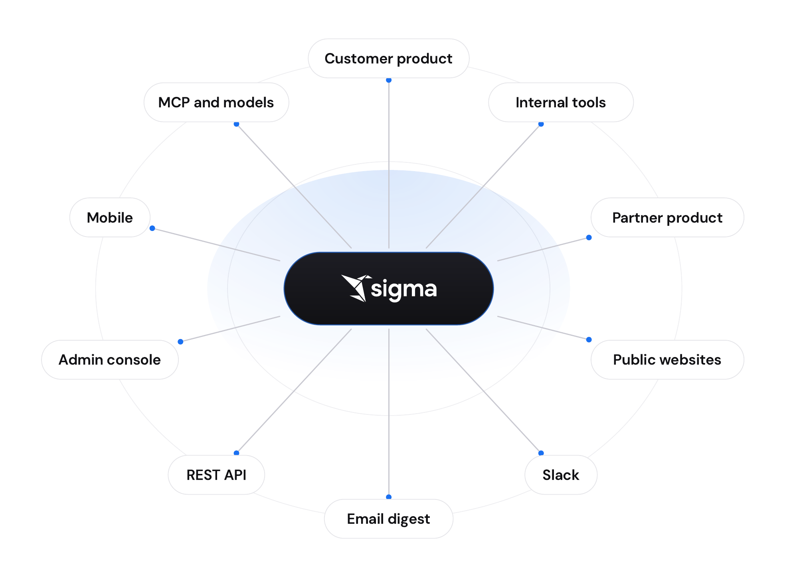

### Target Audience
This QuickStart is designed for new Sigma users across three roles:

- **Users** — analysts, report consumers, and anyone exploring data:
- [Fundamentals 2: Working with Data](https://quickstarts.sigmacomputing.com/guide/fundamentals_2_data_v3/index.html?index=..%2F..index#0)
- [Fundamentals 3: Pivot Tables](https://quickstarts.sigmacomputing.com/guide/fundamentals_3_data_pivot_tables_v3/index.html?index=..%2F..index#0)
- [Fundamentals 4: Input Tables](https://quickstarts.sigmacomputing.com/guide/fundamentals_4_input_v3/index.html?index=..%2F..index#0)
- [Fundamentals 5: Charts](https://quickstarts.sigmacomputing.com/guide/fundamentals_5_charts_v3/index.html?index=..%2F..index#0)
- [Fundamentals 6: Controls](https://quickstarts.sigmacomputing.com/guide/fundamentals_6_controls_v3/index.html?index=..%2F..index#0)
- [Fundamentals 7: Design Elements (UI & Layout)](https://quickstarts.sigmacomputing.com/guide/fundamentals_7_design_v3/index.html?index=..%2F..index#0)

**Builders** — developers and analysts creating workbooks, apps, and models:
- [Input Tables: Use Cases](https://quickstarts.sigmacomputing.com/guide/input_tables_use_cases/index.html?index=..%2F..index#0)
- [Fundamentals 9: Beyond the Basics](https://quickstarts.sigmacomputing.com/guide/fundamentals_9_beyond_the_basics_v3/index.html?index=..%2F..index#0)
- [Fundamentals 10: Data Modeling](https://quickstarts.sigmacomputing.com/guide/fundamentals_10_data_modeling/index.html?index=..%2F..index#0)
- [Fundamentals 11: Pixel Perfect Reporting](https://quickstarts.sigmacomputing.com/guide/fundamentals_11_pixel_perfect_reporting/index.html?index=..%2F..index#0)
- [Fundamentals 12: Build App-Style Layouts in Sigma](https://quickstarts.sigmacomputing.com/guide/Fundamentals_12_repeater_single_row_containers/index.html?index=..%2F..index#0)

**AI and agents** — building with Sigma Assistant, AI apps, and Sigma agents:
- [Build Dashboards and Apps with Sigma Assistant](https://quickstarts.sigmacomputing.com/guide/aiapps_build_with_assistant/index.html?index=..%2F..index#0)
- [AI Apps Category](https://quickstarts.sigmacomputing.com/?cat=aiapps)
- [Agents Category](https://quickstarts.sigmacomputing.com/?cat=agents)

**Admins** — administrators managing users, connections, and governance:
- [How to Get Started - A Guide for Sigma Administrators](https://quickstarts.sigmacomputing.com/guide/administration_getting_started_guide/index.html?index=..%2F..index#0)
- [Fundamentals 8: Administration](https://quickstarts.sigmacomputing.com/guide/fundamentals_8_administration_v3/index.html?index=..%2F..index#0)
- [Audit Logging](https://quickstarts.sigmacomputing.com/guide/administration_audit_logging/index.html?index=..%2F..index#0)
- [Security Category](https://quickstarts.sigmacomputing.com/?cat=security)

**Developers** — engineers building embedded analytics or integrating Sigma via API:
- [Sigma REST API Recipes](https://quickstarts.sigmacomputing.com/guide/developers_api_code_samples/index.html?index=..%2F..index#0)
- [Manage Sigma Workbooks as Code with Git and CI/CD](https://quickstarts.sigmacomputing.com/guide/developers_workbooks_as_code/index.html?index=..%2F..index#0)
- [Automate Sigma from the Command Line with the Sigma CLI](https://quickstarts.sigmacomputing.com/guide/developers_sigma_cli/index.html?index=..%2F..index#0)
- [Developer Category](https://quickstarts.sigmacomputing.com/?cat=developers)
- [Embedding Category](https://quickstarts.sigmacomputing.com/?cat=embedding)

<aside class="positive">
<strong>NOTE:</strong><br> Not sure where to start? Complete this QuickStart first — it gives you enough context to know which path fits your role.
</aside>

### Prerequisites
<ul>
  <li>A computer with a current browser.</li>
  <li>Access to a Sigma environment. A Sigma trial is acceptable and preferred for this series.</li>
</ul>

<aside class="positive">
<strong>IMPORTANT:</strong><br> Sigma recommends using non-production resources when completing QuickStarts.
</aside>

### What You’ll Learn
- How to set up a Sigma trial and navigate the user interface
- Key Sigma terminology and how workbooks, pages, and elements relate to each other
- How to create, save, and share a workbook
- How to use Formula Assistant and Sigma Assistant for AI-powered analysis, and how Sigma Assistant can plan and build dashboards and apps for you
- How Sigma agents, chat elements, and the Sigma MCP Server extend AI beyond the workbook
- How to organize content with pages, containers, modals, and other layout elements
- How account types and scheduled exports work


<!-- END OF OVERVIEW -->

## Sigma Trial Setup
Duration: 6

If you don’t have a Sigma account yet, sign up for a free trial to follow along with QuickStarts.
 
<button>[Try Sigma Free](https://www.sigmacomputing.com/go/free-trial)</button>

The trial is free and does not require a credit card. On the trial setup page, complete the required fields (1) using your work email, since you will verify it in the next step:

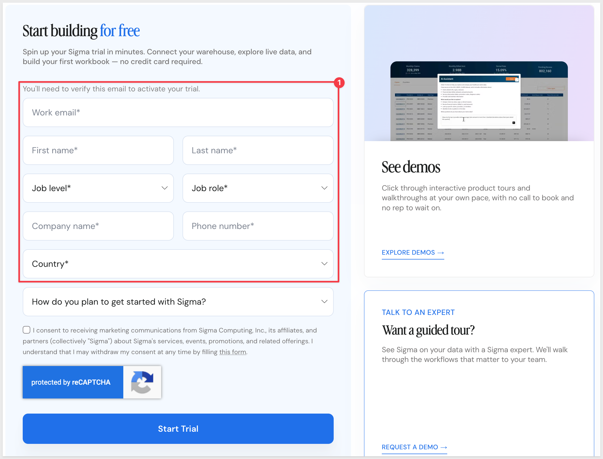

Select an option for `How do you plan to get started with Sigma?`, complete the reCAPTCHA, and click `Start Trial`.

You will receive notice that Sigma is sending an email invitation:

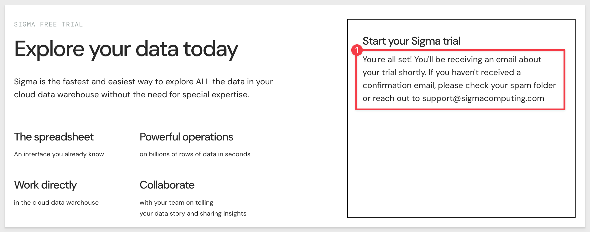

In your email application, open the email from Sigma and click `Verify Email Address`:

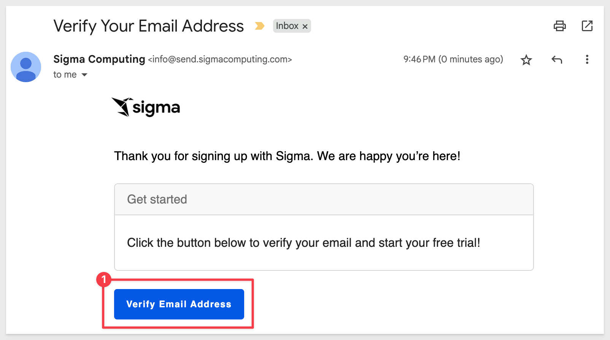

<aside class="negative">
<strong>NOTE:</strong><br> If you have not received this email within 10 minutes, please check your spam folder, and if not there, ask for assistance from support. The email will be "from" Sigma Computing using the address: info@send.sigmacomputing.com.
</aside>

When the page loads in your default browser, enter your `Company Name` and `Company Login URL` (if you prefer something different).

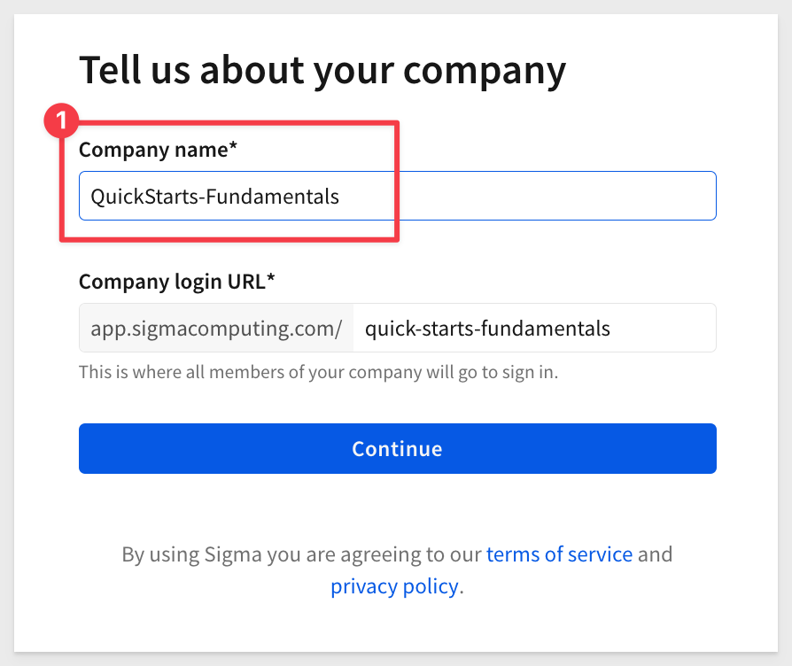

Sigma will pre-select a cloud location where the trial will be created. If location matters for your testing, click the pencil icon to select a different location. 

For example, if you are in Europe you may want to select Frankfurt:

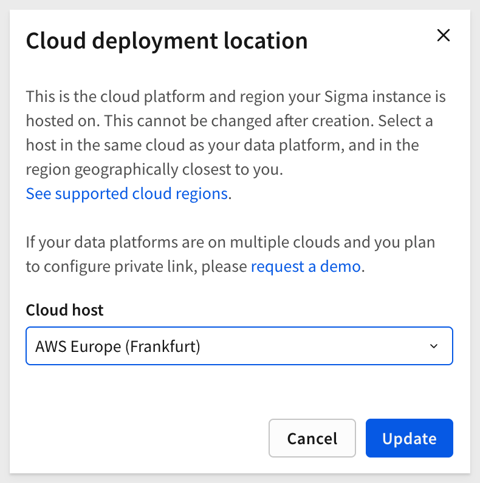

For more information, see [Supported regions, data platforms, and features](https://help.sigmacomputing.com/docs/region-warehouse-and-feature-support)

Click `Update` and then `Continue`:

Next, create your user profile and click the `Create` button:

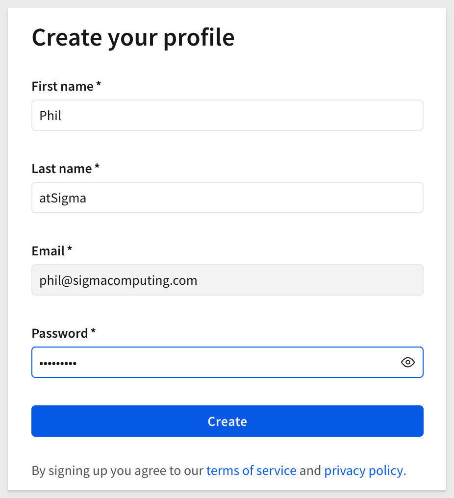

Sigma opens on the `Home` page (1), where your trial is ready to use:

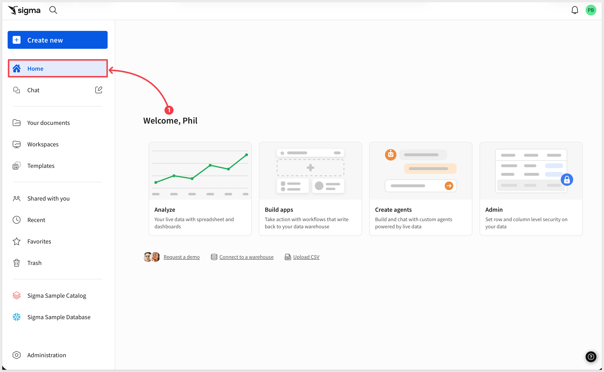

You should also receive a welcome email from Sigma:

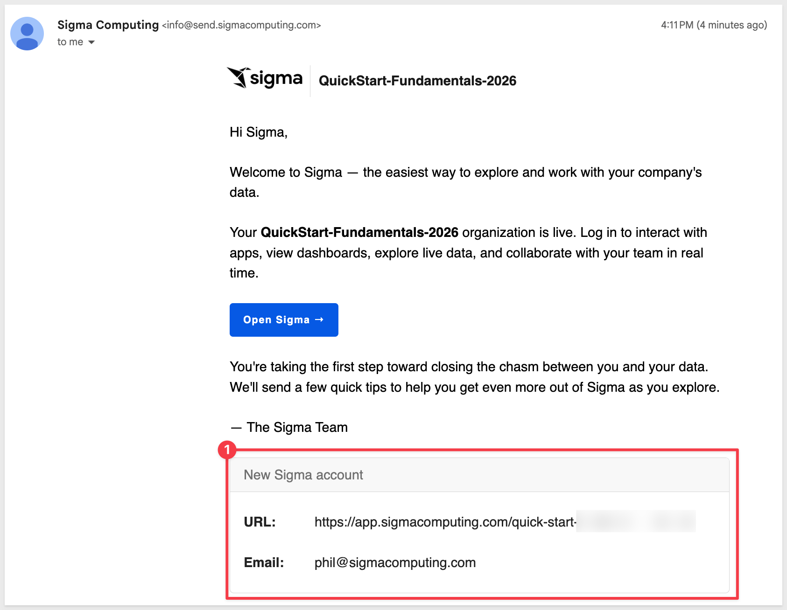

If something is not working as you expect, here is how to [contact Sigma support](https://help.sigmacomputing.com/docs/sigma-support)

<aside class="positive">
<strong>IMPORTANT:</strong><br> Trial instances are set up with administrative rights for the user who established the account. This provides access to all Sigma's default functionality, so you can explore everything. 
</aside>


<!-- END OF SIGMA TRIAL SETUP -->

## Getting Around the UI
Duration: 6

The Sigma homepage provides quick access to everything you need to get started.

<aside class="negative">
<strong>NOTE:</strong> What you see on the homepage depends on your assigned account type. Users with fewer permissions will see a more limited set of options.
</aside>

The main areas are numbered and described below:

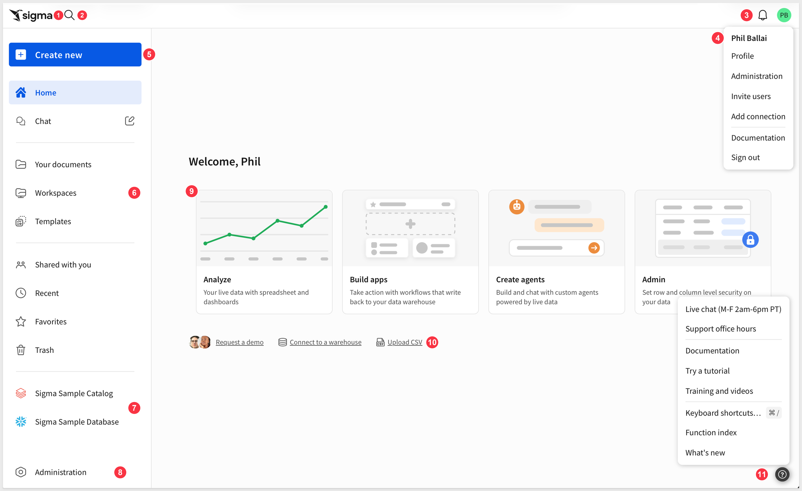

**Top bar**

 **Sigma Logo:** Click the Sigma logo in the upper left to return to the homepage from anywhere in the portal.

 **Search:** Click the search icon to find content across your Sigma environment.

 **Notifications:** The bell icon shows alerts and activity relevant to your account.

 **User Profile:** Click your initials in the upper right to open the user menu:
<ul>
  <li><strong>Profile:</strong> View and edit your profile and preferences.</li>
  <li><strong>Administration:</strong> Opens the Administration section (administrators only).</li>
  <li><strong>Invite users:</strong> Add colleagues to your account. Users can also be managed in the Administration section, or externally via any SAML 2.0 compatible identity management provider (e.g., Okta, Auth0).</li>
  <li><strong>Add connection:</strong> Connect a data warehouse.</li>
  <li><strong>Documentation:</strong> Opens the Sigma help center.</li>
  <li><strong>Sign out:</strong> Signs you out of Sigma.</li>
</ul>

**Left sidebar**

 **Create new:** The blue button at the top of the sidebar is your starting point for any new content:
<ul>
  <li><strong>Workbook:</strong> The primary interface for users and builders to view and interact with data and apps.</li>
  <li><strong>Report:</strong> A document type designed to help you create predictable, pixel-perfect PDF exports.</li>
  <li><strong>Data model:</strong> A reusable data layer shared across workbooks and reports.</li>
  <li><strong>SQL query:</strong> Write and run SQL directly against your connected warehouse.</li>
  <li><strong>CSV upload:</strong> Upload a CSV file to the warehouse for analysis.</li>
</ul>

 **Navigation:**
<ul>
  <li><strong>Home:</strong> Returns to the homepage.</li>
  <li><strong>Chat:</strong> Start a conversation with Sigma Assistant and ask questions about your data in plain language.</li>
  <li><strong>Your documents:</strong> Your personal folder for content you've created.</li>
  <li><strong>Workspaces:</strong> Shared folders for organizing and sharing content with specific teams or members.</li>
  <li><strong>Templates:</strong> Pre-built, ready-to-use content including Starter Apps — fully working apps built on sample data that cover common business workflows you can explore and connect to your own data.</li>
  <li><strong>Shared with you:</strong> Content others have shared with you directly.</li>
  <li><strong>Recent:</strong> Content you've accessed recently.</li>
  <li><strong>Favorites:</strong> Content you've marked as a favorite for quick access.</li>
  <li><strong>Trash:</strong> Deleted content, recoverable before permanent removal.</li>
</ul>

 **Connections:** Lists available data warehouse connections. Clicking one shows the tables and schemas you have access to. Connections are configured by administrators in the Administration section. A new trial includes two sample connections, `Sigma Sample Catalog` and `Sigma Sample Database`. These are hosted by Sigma and can be disabled by an administrator if preferred.

<aside class="negative">
<strong>NOTE:</strong><br> Trial accounts created from the Sigma website include these Sigma-managed sample connections. Trials created from cloud provider marketplaces may include additional connections.
</aside>

 **Administration:** Available to administrators only. Provides access to user management, connections, account settings, and more.

**Main content area**

 **Starting points:** Four cards open the most common paths from the homepage:
<ul>
  <li><strong>Analyze:</strong> Explore your live data with spreadsheet-style tables and dashboards.</li>
  <li><strong>Build apps:</strong> Create workflows that take action and write back to your data warehouse.</li>
  <li><strong>Create agents:</strong> Build and chat with custom agents powered by live data.</li>
  <li><strong>Admin:</strong> Set row and column level security on your data.</li>
</ul>

 **Quick links:** Shortcuts below the cards to `Request a demo`, `Connect to a warehouse`, and `Upload CSV`.

 **Help:** The help button in the lower right corner opens a menu of support and learning resources:
<ul>
  <li><strong>Live chat:</strong> Chat with Sigma support during support hours.</li>
  <li><strong>Support office hours:</strong> Book time with Sigma support.</li>
  <li><strong>Documentation:</strong> Opens the Sigma help center.</li>
  <li><strong>Try a tutorial:</strong> Guided, in-product walkthroughs.</li>
  <li><strong>Training and videos:</strong> Sigma training resources.</li>
  <li><strong>Keyboard shortcuts:</strong> Lists the available shortcuts.</li>
  <li><strong>Function index:</strong> A reference of the functions you can use in formulas.</li>
  <li><strong>What's new:</strong> Recent product release notes.</li>
</ul>

<aside class="positive">
<strong>IMPORTANT:</strong><br> There is a link to `Live chat` in this menu. Use it! Sigma is fanatical about supporting our customers.
</aside>

If you ever need to know what is new in Sigma, there are two resources:

[Release Notes](https://help.sigmacomputing.com/changelog)

We also publish a monthly summary on the "First Friday" of each month, covering everything released in the prior month, including bug fixes.

[First Friday Features](https://quickstarts.sigmacomputing.com/firstfridayfeatures/)


<!-- END OF GETTING AROUND IN THE UI -->

## Some Terminology
Duration: 6

Before diving in, it helps to understand some of the core terms Sigma uses. 

<aside class="positive">
<strong>IMPORTANT:</strong><br> Don't worry about memorizing all of these upfront — Sigma's terminology is designed to be intuitive, and most terms describe what they do. The list below covers the most common ones you'll encounter. The rest will become familiar as you explore.
</aside>

The diagram below shows how the key concepts relate to each other at a high level.

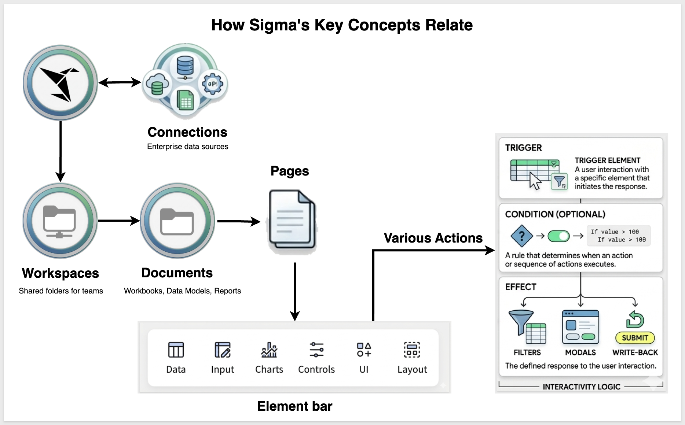

<aside class="positive">
<strong>NOTE:</strong><br> The diagram focuses on how content is organized and made interactive. Sigma's AI capabilities, including Formula Assistant, Sigma Assistant, and Sigma agents, work alongside these concepts and are covered in the sections that follow.
</aside>

Sigma connects to your data through **Connections**, organizes content in **Workspaces**, and everything you build lives in a **Document** — a workbook, report, or data model. Workbooks contain **Pages**, and pages are built from **Elements** — tables, charts, controls, and more. **Actions** wire those elements together, turning a static workbook into an interactive app.

The following sections describe each of these core terms in more detail.

**Document Types**
<ul>
  <li><strong>Document:</strong> The general term for any content item in Sigma — workbooks, reports, and data models are all documents.</li>
  <li><strong>Workbook:</strong> Sigma’s primary document type. A workbook can contain data tables, charts, controls, and apps — all on one or more pages.</li>
  <li><strong>Report:</strong> A fixed-layout document optimized for pixel-perfect PDF exports.</li>
  <li><strong>Data model:</strong> A reusable data layer where you define tables, columns, relationships, and metrics once, so every workbook and report built on it shares the same trusted definitions. See <a href="https://quickstarts.sigmacomputing.com/guide/fundamentals_10_data_modeling/index.html?index=..%2F..index#0">Fundamentals 10: Data Modeling</a>.</li>
</ul>

**Workbook Lifecycle**
<ul>
  <li><strong>Exploration:</strong> An unsaved or unpublished workbook. Explorations let you query and analyze data without cluttering your folders. Save only when the work is worth keeping.</li>
  <li><strong>Draft / Published:</strong> Once saved, a workbook exists in two states — a draft (work in progress, visible only to editors) and a published version (the stable version visible to viewers).</li>
</ul>

**Workbook Structure**
<ul>
  <li><strong>Page:</strong> Each workbook contains one or more pages, similar to tabs in a spreadsheet.</li>
  <li><strong>Element:</strong> The building block of any workbook page. Every table, chart, control, input table, image, or text block is an element.</li>
</ul>

**Element Types**
<ul>
  <li><strong>Table:</strong> A spreadsheet-like data element displaying rows and columns from your connected data source.</li>
  <li><strong>Chart:</strong> A visual data element such as a bar chart, line chart, scatter plot, or map.</li>
  <li><strong>Input table:</strong> A data entry element that allows users to add or edit data directly in Sigma.</li>
  <li><strong>Control:</strong> An interactive element — such as a date picker, dropdown, or text input — used to filter or drive other elements on the page.</li>
  <li><strong>Container:</strong> A layout element that groups other elements together on a page. Useful for visual organization and building app interactions.</li>
  <li><strong>Repeated container:</strong> A layout element that generates one card per row in a data source, such as a product catalog or a list of records. A related single row container shows one record in detail. Both are covered in <a href="https://quickstarts.sigmacomputing.com/guide/Fundamentals_12_repeater_single_row_containers/index.html?index=..%2F..index#0">Fundamentals 12</a>.</li>
  <li><strong>Modal:</strong> A layout element that opens as an overlay on top of the workbook when triggered by a user action. Useful for confirmations, forms, and focused workflows.</li>
</ul>

**Actions**
<ul>
  <li><strong>Action:</strong> User-defined interactivity configured on a workbook element. Each action pairs a trigger (a user interaction, such as clicking a row) with an effect (the response, such as filtering a chart, opening a modal, or writing data back to the warehouse), with an optional condition that decides when it runs. Actions are what transform a workbook from a static page into an app.</li>
</ul>

**Data & Connections**
<ul>
  <li><strong>Connection:</strong> A configured link between Sigma and a cloud data warehouse. Connections are set up by administrators and determine what data is available.</li>
  <li><strong>Sigma table:</strong> A table in your connected warehouse that has write access enabled in Sigma, so it can be edited directly in a workbook and shared as a data source. See <a href="https://help.sigmacomputing.com/docs/sigma-tables-overview">Sigma tables overview</a> and <a href="https://quickstarts.sigmacomputing.com/guide/tables_getting_started_with_sigma_tables/index.html?index=..%2F..index#0">Getting Started with Sigma Tables</a>.</li>
</ul>

**Organization & Access**
<ul>
  <li><strong>Workspace:</strong> A shared folder for organizing and collaborating on documents with specific teams or members.</li>
  <li><strong>Account type:</strong> Determines what a user can see and do in Sigma — such as whether they can create workbooks, edit data, or access administration features.</li>
</ul>

There are different icons used throughout Sigma to distinguish document types and objects at a glance.


<!-- END OF SECTION-->

## AI in Sigma
Duration: 4

AI is built into Sigma throughout — not as a separate product or add-on, but as a native capability available where you already work. Whether you're writing formulas, exploring data, or building apps, AI is there to help.

### AI provider setup

Before any AI feature can be used, an administrator must configure an AI provider. Sigma supports two approaches:

- **Warehouse-hosted models** — AI runs entirely within your data platform (for example, Snowflake Cortex or BigQuery ML), so your data never leaves your environment.
- **External AI providers** — OpenAI ChatGPT, Azure OpenAI, Google Gemini, Amazon Bedrock and others.

An administrator configures the provider in `Administration` > `AI settings` (1). In this example, the `AI provider` (2) is set to a `Data warehouse hosted model` that uses the `Sigma Sample Database` connection:

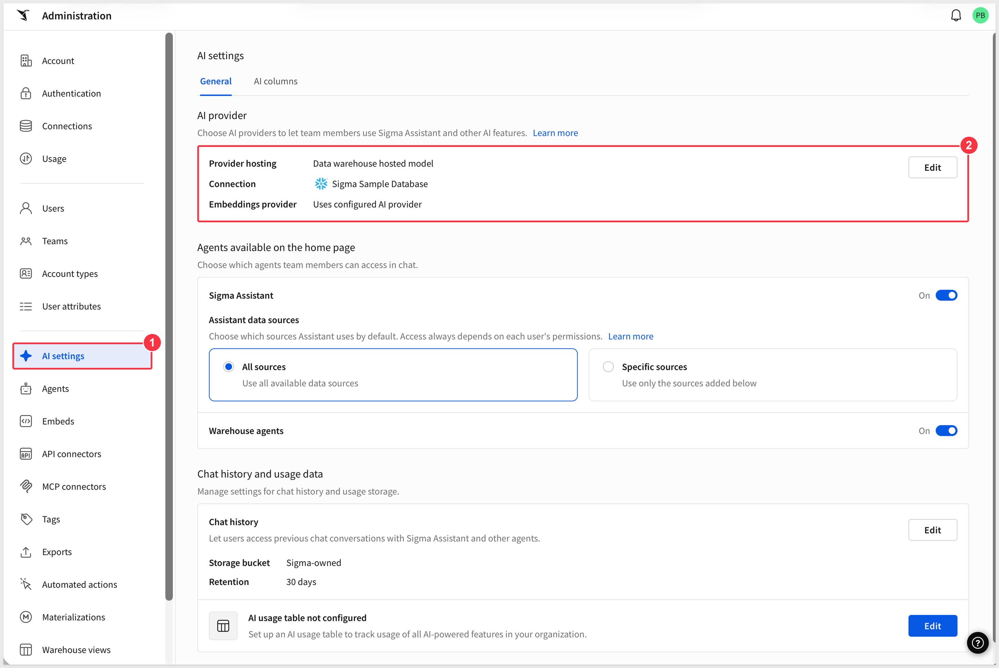

For setup instructions, see [Configure an AI provider](https://help.sigmacomputing.com/docs/configure-ai-features-for-your-organization#set-up-an-ai-provider)

<aside class="positive">
<strong>NOTE:</strong><br> Don't have an AI provider configured yet? No problem — follow along to understand what's available. You can set up a provider later when you're ready.
</aside>

In a trial, `Sigma Assistant` is on by default with access to the trial data, so you can start right away. Find it in the `Chat` section of the homepage. In the prompt box, `Sigma Assistant` is selected (1). Your conversations are saved under `Chat` (2) in the left sidebar, showing each question (3) and Sigma Assistant's response (4):

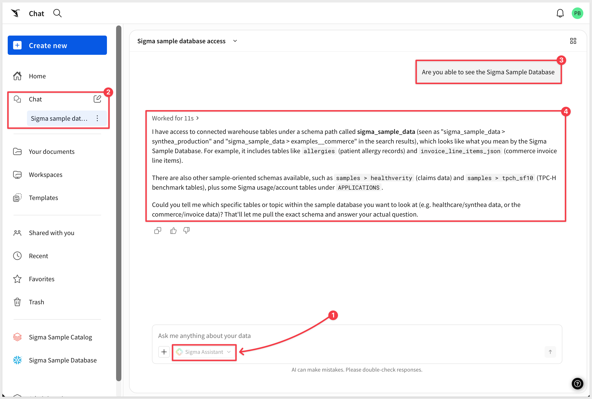

### AI features in Sigma

Once a provider is configured, AI appears across the product — and it's designed as a deliberate spectrum, from helping with a single formula to bringing Sigma's data into the AI tools you use elsewhere. This QuickStart walks through them in that order, simplest to most advanced:

<ul>
  <li><strong>Formula Assistant:</strong> Write, fix, or explain a single formula from the formula bar. Reach for it when you're working in one calculation. <a href="https://help.sigmacomputing.com/docs/use-ai-with-formulas">Learn more</a></li>
  <li><strong>Sigma Assistant:</strong> Sigma’s built-in AI, available from <code>Chat</code> on the homepage and inside workbooks. Ask questions in plain language and get AI-generated tables and charts you can open in a workbook, with each step shown so you can verify it. Reach for it to explore data or start an analysis. <a href="https://help.sigmacomputing.com/docs/ask-natural-language-queries-with-assistant">Learn more</a></li>
  <li><strong>Building with Assistant:</strong> Inside a workbook, Assistant plans and builds entire dashboards and apps. Reach for it to go from an idea to a working dashboard. <a href="https://help.sigmacomputing.com/docs/use-ai-to-build-dashboards-and-apps">Learn more</a></li>
  <li><strong>Sigma agents and chat elements:</strong> A Sigma agent is a workbook-scoped AI helper that follows custom instructions, uses selected data sources for context, and can call tools — such as actions, warehouse agents, warehouse search services, or MCP servers. A chat element is the on-canvas UI that connects to the agent, letting end users chat with it in natural language inside a published workbook. Reach for it to put AI to work inside an app. <a href="https://help.sigmacomputing.com/docs/sigma-agents">Learn more</a></li>
  <li><strong>Sigma MCP Server:</strong> Brings your Sigma data to an external AI tool of your choice, such as Claude, so you can query and explore Sigma from there. Reach for it to work with Sigma data from outside Sigma. <a href="https://help.sigmacomputing.com/docs/getting-started-with-ai">Learn more</a></li>
</ul>

Two more AI touches show up while you work, though we don't walk through them here: <strong>Explain this Chart</strong> generates an AI description of any chart, and <strong>AI Queries</strong> run AI analysis on text data — sentiment, classification, summarization — as part of a workbook calculation.

<aside class="positive">
<strong>WHY IT MATTERS:</strong><br> These aren't isolated AI features — they're integrated into the same governed, live-data environment your team already uses. Sigma is the governed runtime around AI: audit logs, permissions, cost controls, collaboration, and version management all come with the platform, regardless of which AI provider you've configured.
</aside>

<aside class="positive">
<strong>MONITORING AI USAGE:</strong><br> AI calls have real cost, and Sigma includes a built-in dashboard that lets administrators track token usage by agent, by user, and by product surface — making it easy to spot heavy users or runaway costs before they become a problem. 
</aside>

For more information, see [AI usage dashboard](https://help.sigmacomputing.com/docs/ai-usage)

For more information on all AI features, see [Get started with AI in Sigma](https://help.sigmacomputing.com/docs/getting-started-with-ai)

### Two paths, one platform

Sigma's AI features are genuinely useful — and they're only getting more capable. But powerful AI doesn't eliminate the value of understanding how things work.

Some users want to start with a question and get an answer in seconds. Others want to build from scratch, understand the data structure, and control every step. Some want both — starting with AI to explore quickly, then refining manually to get exactly what they need.

Sigma is designed to support both workflows without forcing a choice. You can let AI handle the initial analysis and then edit the results directly in a workbook. Or you can skip AI entirely and build everything by hand. The platform is the same either way — the same data, the same elements, the same publish and share workflow.

All of the AI features covered in the next few sections work with whichever AI provider your administrator has configured — whether that's a warehouse-hosted model like Snowflake Cortex or an external provider like OpenAI or Anthropic. Your organization chooses the provider; the experience in Sigma remains the same.

There is also an additional layer worth knowing about: the **Sigma MCP Server**. Rather than using AI inside Sigma, the MCP Server brings your Sigma data to your AI tool of choice — so you can query and explore Sigma directly from Anthropic Claude ("Claude"). That is covered later in this QuickStart.


<!-- END OF SECTION-->

## Formula Assistant
Duration: 3

Before we start to build something, let's look a bit deeper at each AI feature.

The simplest place AI shows up is the formula bar. The Formula Assistant lives in any workbook or data model and helps with a single calculation three ways:

- **Write a formula** — describe what you want to calculate, and AI suggests the formula
- **Correct a formula** — when Sigma detects an error, AI interprets your intent and suggests a fix
- **Explain a formula** — AI describes, in plain language, what an existing formula does

It becomes available when you select a column and open the formula bar. Click the AI wand icon (1) to open the `Ask AI to…` menu and choose an option (2):

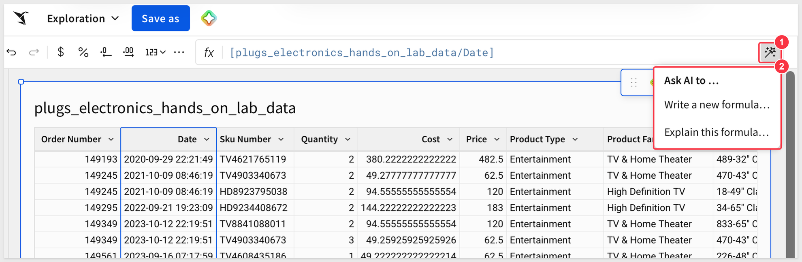

For example, selecting a calculated column (1) and choosing `Explain this formula` opens the `AI explain formula` panel (2), which returns a plain-language description of what the calculation does (3):

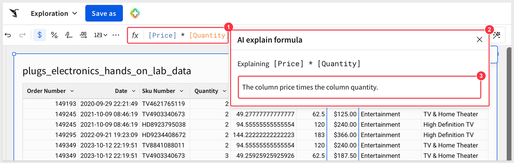

This is the whole idea in miniature: AI does the mechanical work while you stay in control — reading, verifying, and adjusting what it produces.

For more information, see [Use AI with formulas](https://help.sigmacomputing.com/docs/use-ai-with-formulas)


<!-- END OF SECTION-->

## Sigma Assistant
Duration: 8

Sigma Assistant is the conversational AI built into Sigma. From `Chat` on the homepage you can ask a question in plain language, and Assistant works to answer it using the data sources an admin has made available — explaining each step, showing the SQL it ran, and letting you open the result directly in a workbook for further analysis.

### Select data sources for Sigma Assistant

Sigma Assistant answers questions using the data sources your organization has made available. This keeps AI grounded in trusted, approved data and prevents accidental exposure of sensitive information to third-party providers.

In a trial there is nothing to configure. The Sigma Sample Database is available to Sigma Assistant by default, so you can start asking questions right away.

For reference, this is how an administrator controls it. In `Administration` > `AI settings`, `Assistant data sources` is set to `All sources` by default. To limit Sigma Assistant to specific data:

- Select `Specific sources` (1).
- Click `Add source` (2) and choose only the sources you want it to use.
- The chosen sources are listed below. In this example, `plugs_electronics_hands_on_lab_data` from the `Sigma Sample Catalog` is listed (3).
- Access always depends on each user's permissions.

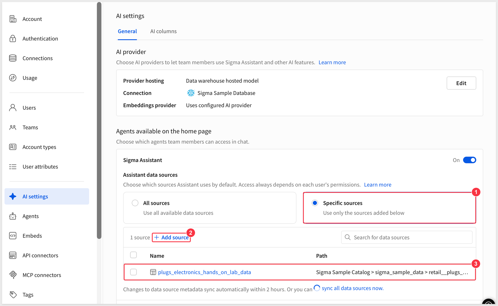

<aside class="positive">
<strong>NOTE:</strong><br> This is an example of how an administrator would limit Sigma Assistant to specific sources. You do not need to do this in your trial.
</aside>

<aside class="positive">
<strong>BEST PRACTICE:</strong><br> Connecting raw warehouse tables to Sigma Assistant works, but data models produce significantly better results. A data model lets your data team pre-define column names, descriptions, and metrics that AI uses to interpret your questions accurately. Instead of guessing what a column called <code>QTY_NET</code> means, Sigma Assistant can reference a model where it's already labeled "Net Quantity Sold" with a clear description. The more context your data model provides, the more accurate and useful the AI responses will be.

For more information, see <a href="https://help.sigmacomputing.com/docs/get-started-with-data-modeling">Get started with data modeling</a>.
</aside>

### Hands-on: Sigma Assistant

Sigma Assistant changes how you start an analysis. Instead of deciding what to build first, you start with a question.

From the homepage, click `Chat` in the left sidebar to start a conversation, and confirm `Sigma Assistant` is selected in the prompt box.

Sigma Assistant's interface is straightforward — type a question, and it will work to answer it using the data sources you've made available. 

Let's start by asking Sigma Assistant what it can see. Enter this question (1):
```copy-code
What data sources do you have access to?
```
Sigma Assistant reports the data source available to it (2) and summarizes the columns it contains (3):

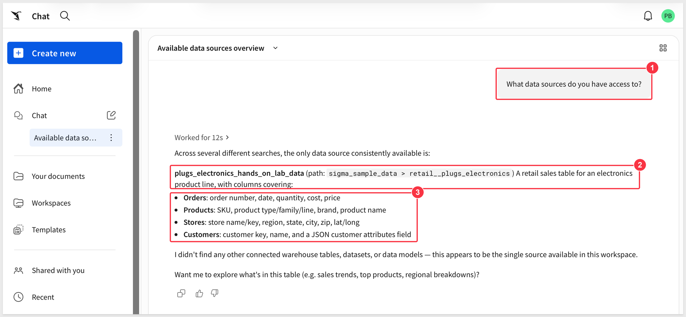

In practice you may have many data sources. It makes sense to focus Assistant on one or more sources instead of having it search all of them when responding to a question. Click the `+` icon (1) to open `Select source`, then choose the source you want, such as a connection (2):

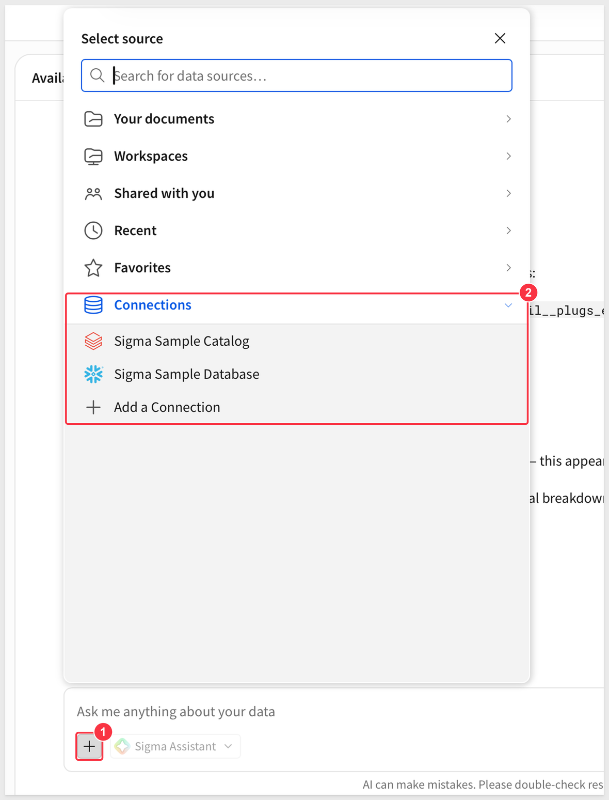

Now let's ask a focused business question:
```copy-code
The CEO wants to know the bottom ten stores in the chain.
```

Before submitting, click the `+` button (1) again and select `plugs_electronics_hands_on_lab_data` (2). Here it is listed under `Recent`; you can also search for it or browse `Connections`. This scopes the question to that table and avoids ambiguity when multiple data sources are available:

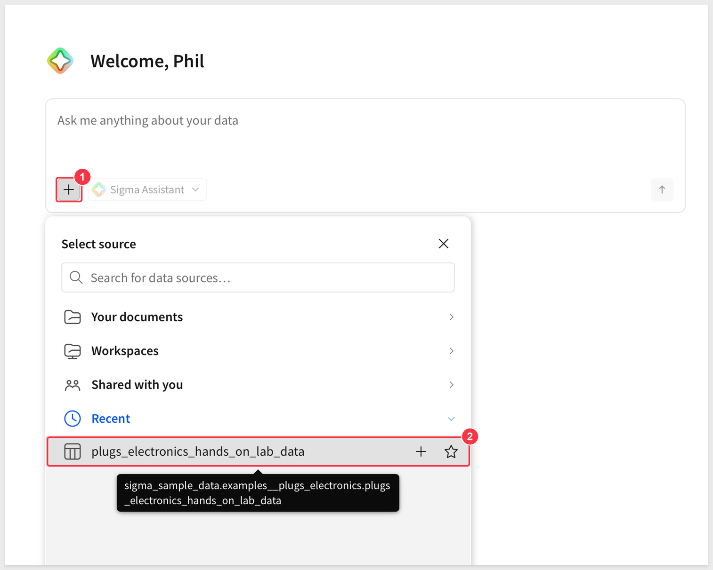

Now submit the question. The selected source appears with your question (1). Sigma Assistant works through it (2), returns the ranked results (3), and offers an `Open in workbook` link (4):

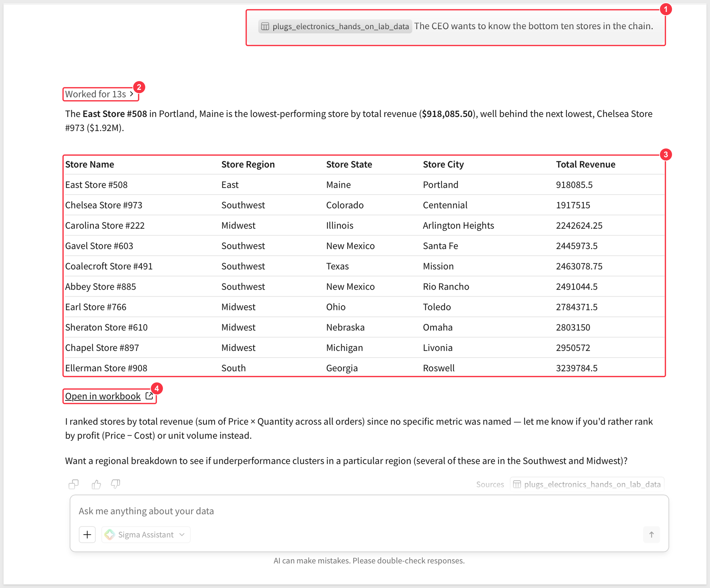

Click `Worked for…` (1) to see what Sigma Assistant did at each step. It lists the data it reviewed (2) and the query it ran (3). Click the query to open its results, where `View SQL` (4) shows the SQL used, for those who need to see it:

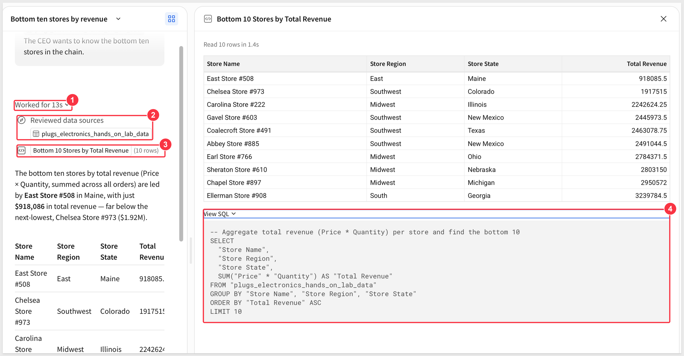

Once the response is ready, you'll see a full explanation, and the ability to open selected results directly in a workbook for further analysis by clicking the `Open in workbook` link.

<aside class="positive">
<strong>NOTE:</strong><br> Before launching into a workbook, you can continue asking Sigma Assistant follow-up questions to refine the results. Ask for a different breakdown, narrow the date range, filter by product type, or explore a different angle entirely. Only open the workbook when you're ready to save and build on the results.
</aside>

Once in the workbook, we see a table of the ten stores (1). Sigma Assistant handled the grouping (2) and the `Total Revenue` calculation (3) required to answer the question:

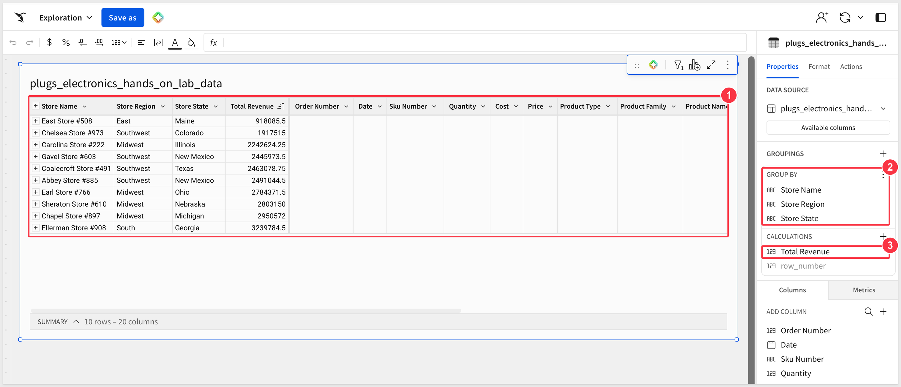

Now we can save it, refine it, or use Sigma's [drill-down](https://help.sigmacomputing.com/docs/view-underlying-data) capabilities for deeper analysis. We'll continue building on this workbook in the next section.

We can still access Sigma Assistant in the workbook by clicking the  icon (1). It opens in a panel (2) with a mode selector (3), where you choose `Build` or `Plan`. We cover both modes in the next section:

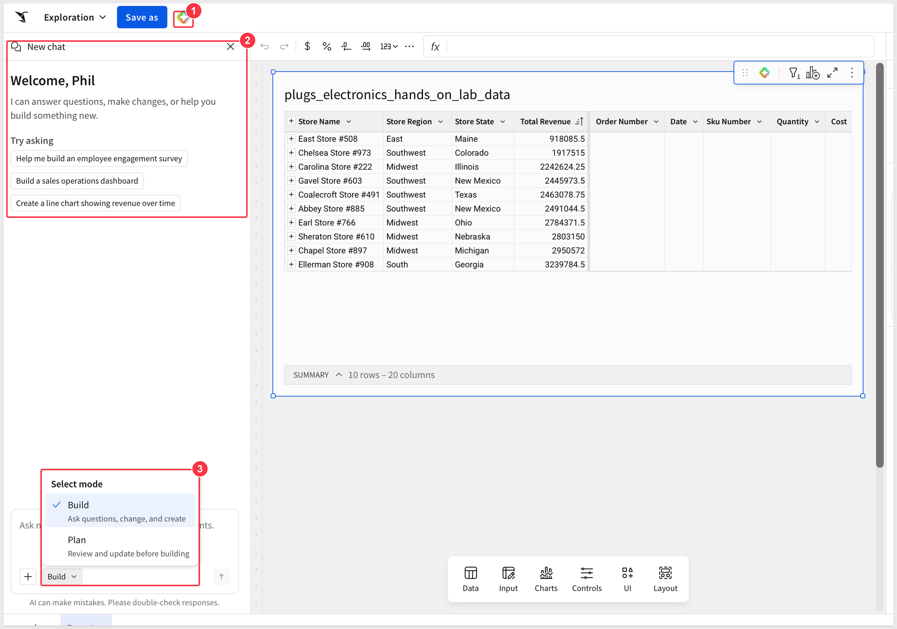


<!-- END OF SECTION-->

## Building with Assistant
Duration: 4

The previous section showed Assistant answering a question and returning results you open in a workbook. Inside a workbook draft, Assistant does more than analyze — it can plan and build for you. Using natural language, it designs and constructs dashboards and AI apps: tables, charts, KPIs, controls, filters, input tables, and even the actions that make an app interactive.

When editing a workbook draft, Assistant works in two additional modes:

- **Plan mode** — Assistant gathers context and proposes a structured approach — recommended pages, elements, layout, and the data sources needed — without changing anything yet. Scoping in `Plan` mode first also saves time and AI credits, since you settle the structure before Assistant builds anything.
- **Build mode** — Assistant creates and modifies workbook content: elements, formatting, layout, navigation, filters, and actions.

You can switch between modes at any time using the mode selector (3), and Assistant keeps the conversation's context as you move from scoping to building.

Assistant is available from several entry points while editing a workbook draft: the empty-state prompt bar on a new page, the `Assistant panel` icon in the workbook header (1), the `⌘ + K` / `Ctrl + K` keyboard shortcut, and the `Ask or edit with prompt` icon on an element's toolbar.


You can also attach context to any prompt — a specific data source, a page or element, or an image — so Assistant builds from exactly the right information. Attach a screenshot of a dashboard from any tool, and Assistant rebuilds it natively in Sigma.

<aside class="negative">
<strong>PREMIUM FEATURE:</strong><br> When editing a workbook, Assistant is only available to customers who meet certain conditions. For more information, contact your Account Executive.
</aside>

<aside class="positive">
<strong>WHY IT MATTERS:</strong><br> Building with Assistant collapses the distance between an idea and a working dashboard or app. Because Assistant inherits your permissions and builds inside Sigma's governed environment, what it creates is live, secure, and ready to publish — not a throwaway mockup.
</aside>

We take this much further — one-shot dashboard building, editing an existing workbook conversationally, and building from images and plans — in the [Build Dashboards and Apps with Sigma Assistant](https://quickstarts.sigmacomputing.com/guide/aiapps_build_with_assistant/index.html) QuickStart


<!-- END OF SECTION-->

## Sigma agents and chat elements
Duration: 4

A Sigma agent is the simplest way to put an AI helper inside a specific workbook. You give it a few plain-language instructions ("you help our team understand customer call transcripts"), point it at the data you want it to work with, and add a chat element to the page so people can ask it questions. That's the whole setup — no code, no separate app to build.

What makes an agent powerful is everything it can do beyond answering a question. An agent can:

- Run an action you've already built in the workbook — insert a row, send a notification, update a control.
- Call a warehouse agent in Snowflake or Databricks for deeper analysis.
- Search a warehouse search service like Snowflake Cortex Search.
- Reach out through an MCP server to a system like SharePoint or Slack.

You decide which of those tools the agent is allowed to use, and the agent reaches for them when the conversation calls for it.

The diagram below shows how it fits together: four ways to call an agent, the tools it can use, and the integrations and AI provider behind it, all under the same governance, security, observability, and cost controls.

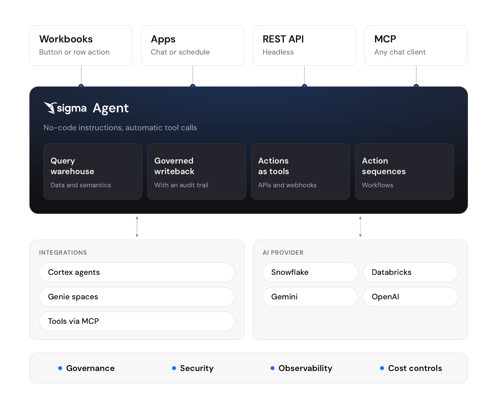

Builders add a chat element to a workbook page, and end users chat with the agent through it. An agent can also run on its own as part of an automated action sequence — for example, a nightly run that summarizes what changed in the data and posts the summary to Slack.

For example, we can let users chat with AI directly from any Sigma page by adding a chat element and setting some rules for it. This brings the power of AI to users in a controlled manner, helping maintain security and governance guidelines.

In the video example below we add a chat element to the page, set a target data source and have the agent also configure a set of standard instructions to use for all future prompts:

<video src="assets/chatelement.mp4"></video>

Conversations with an agent are saved automatically, so a reader can leave a workbook and pick up a conversation later instead of starting over. Click `View chat history` in the chat element header to see past conversations by title, then select one to resume it — using whichever agent is currently assigned to that chat element, even if a different agent handled the original conversation.

This next video shows how to navigate the chat history (assuming your administrator has enabled the feature):

<video src="assets/agentschathistory.mp4"></video>

For more on managing previous conversations, see [Review and restart previous conversations](https://help.sigmacomputing.com/docs/chat-with-agent#review-and-restart-previous-conversations) and [Configure chat history for agents](https://help.sigmacomputing.com/docs/configure-chat-history-agents)

When deciding which AI surface fits a task:

- **Sigma Assistant** is for general data analysis with minimal setup, across the data sources an admin has enabled.
- **Sigma agents** are for a specific job in a specific workbook — with custom instructions, a focused set of data, and the tools you've chosen to let the agent use.
- **Warehouse agents** are for cases where you've already built an agent in your data platform; they can be called from Sigma Assistant or used as a tool inside a Sigma agent.

A Sigma agent runs its queries as the user who's chatting with it, so role-based access control stays in force — an agent can't see data the user couldn't already see.

For more information, see [Build Sigma agents](https://help.sigmacomputing.com/docs/build-agents)

<!-- For hands-on walkthroughs, see:

- [Unlocking Insights from Unstructured Text with a Sigma Agent](https://quickstarts.sigmacomputing.com/guide/aiapps_gong_call_analysis/index.html) — using an agent against transcript text in Snowflake.
- [Build Conversational AI Apps with Chat Elements and Snowflake Cortex](https://quickstarts.sigmacomputing.com/guide/aiapps_chat_element/index.html) — pairing a Sigma agent with a Snowflake Cortex Agent and letting it write back to an input table when you approve. -->


<!-- END OF SECTION-->

## Sigma MCP Server
Duration: 5

The AI features so far work inside Sigma. The Sigma MCP Server goes the other way, bringing your governed Sigma data to the AI tool you already use, such as Claude.

<aside class="positive">
<strong>HEADS UP:</strong><br> This is the most advanced feature in the lineup, aimed at analysts and developers who already work in external AI tools. If your focus is analyzing and building inside Sigma, feel free to skim or skip this section — nothing later depends on it.
</aside>

### What is an MCP server?

MCP stands for **Model Context Protocol** — an open standard that allows AI assistants to connect to external tools and data sources in a structured, secure way. Think of it as a universal adapter: instead of an AI assistant being limited to what it already knows, MCP lets it reach out to live systems and work with real data in real time.

The Sigma MCP Server implements this protocol for Sigma. Once configured, Claude can search your Sigma environment, inspect data structures, and run queries against your connected warehouse — all without you opening Sigma in a browser. It authenticates using OAuth and inherits your existing Sigma account permissions, so no additional credentials or API keys are required.

### What this means for Sigma users

The AI features covered so far — Formula Assistant, Sigma Assistant, Building with Assistant, and Sigma agents — work inside Sigma. You open a workbook, ask a question, and the answer appears in context.

The MCP Server flips that around. You stay in your AI tool and bring Sigma to it. The core workflow is:

<ul>
  <li><strong>Discover:</strong> Search for documents, data models, workbooks, and tables across your Sigma organization.</li>
  <li><strong>Describe:</strong> Inspect the structure of any table or data model — column names, types, and definitions.</li>
  <li><strong>Query:</strong> Run natural language queries against any data source you have access to, without writing SQL.</li>
</ul>

This is particularly useful for analysts and developers who already work in AI-assisted environments and want Sigma data available in that same context.

<aside class="positive">
<strong>WHY IT MATTERS:</strong><br> The MCP Server doesn't bypass Sigma's permission model — it respects your account type and document-level access. Administrators retain full control over what data is reachable, making this a governed extension of Sigma into AI workflows rather than a workaround.
</aside>

### Setup

The Sigma MCP Server is available to all Sigma customers today via Claude's MCP registry. This provides a pre-configured MCP server that connects Claude to Sigma.

Before you start, you will need:

- A claude.ai account (Free, Pro, or Team)
- A Sigma account type with the `View connections`, `View data models`, and/or `View workbooks` permissions appropriate for the data you want to access
- An AI provider configured for your Sigma organization (already in place for a trial)

<aside class="positive">
<strong>NOTE:</strong><br> Claude can query only the data sources available to Sigma's AI features. In a trial, the Sigma sample data is available by default. Otherwise, an administrator controls the sources in <code>Administration</code> > <code>AI settings</code>.
</aside>

#### Required from Sigma
We need two pieces of information from Sigma so that we can provide them to Claude.

Copy these two values to a text file for use in Claude later.

1. **MCP URL:**<br>
Log into Sigma and click the profile icon in the upper right corner and select `Profile`. Select `Integrations`, then under `Connect Sigma to AI tools`, click the copy icon next to the `Sigma MCP URL` and save the value off to a text file.

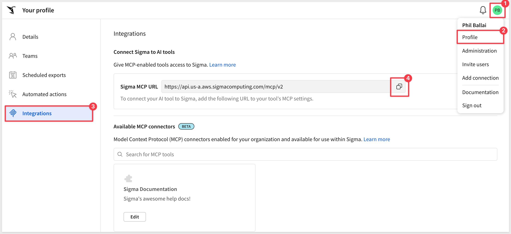

2. **Organization name:**<br>
This is part of the URL Sigma is using in your browser; for example:

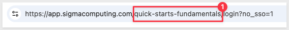

Copy your value off to a text file.

#### Claude setup
Log into Claude using your browser.

1. In Claude, click `Customize` from the left sidebar:

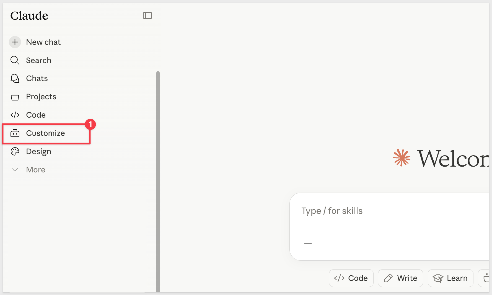

Under `Customize` click `Connectors`, `+` and `Browse connectors`:

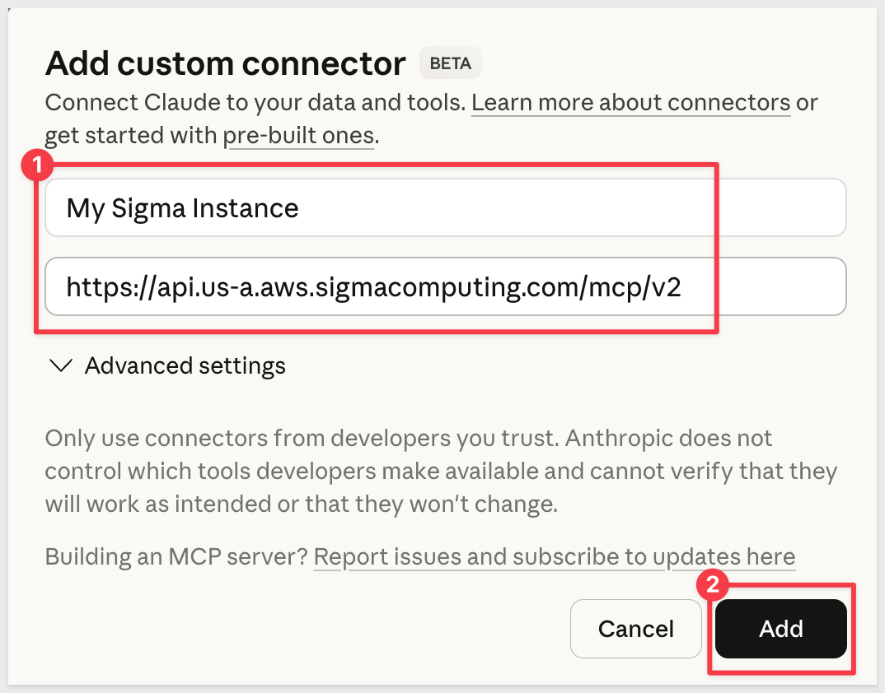

2. Search for `Sigma` and click `+`:

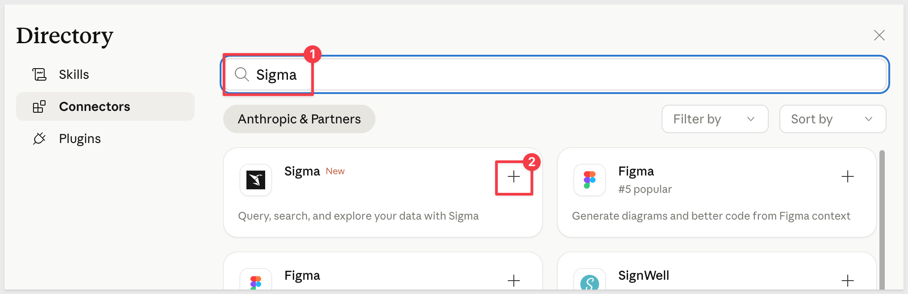

3. Paste the `MCP URL` copied from Sigma into Claude and click `Continue`:

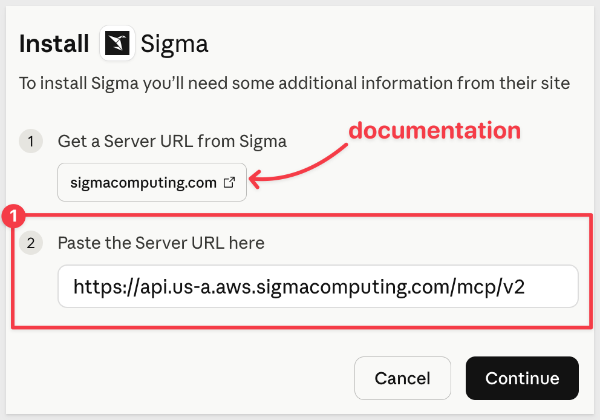

4. Add your Sigma organization name and click `Continue`:

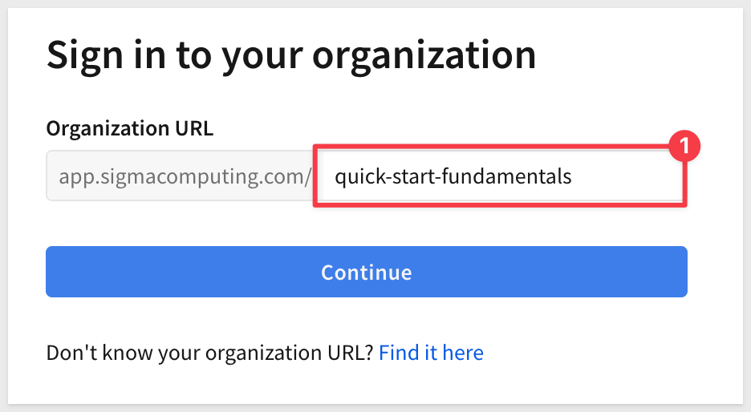

Provide your Sigma credentials and log in.

5. When prompted by Claude, click `Allow`:

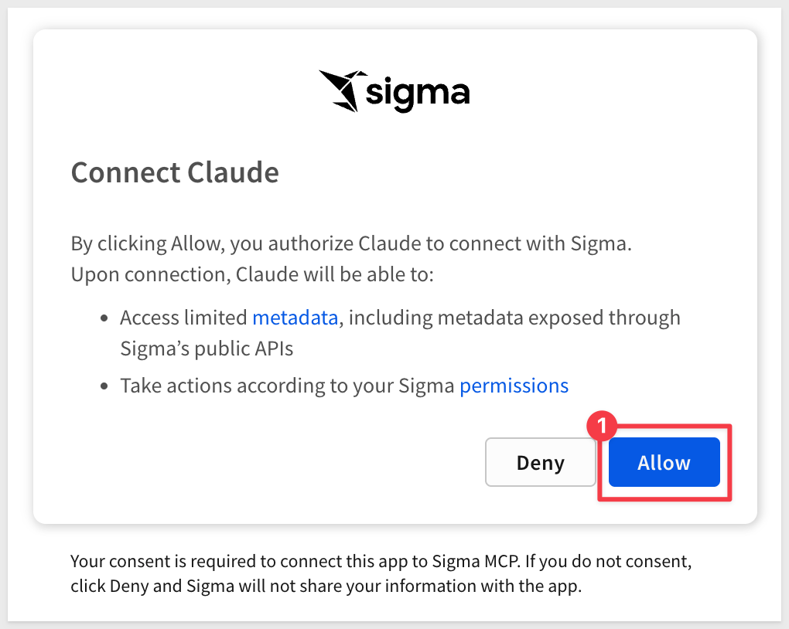

If successful, we can `Approve` the operations Sigma will permit via Claude. For testing we selected `Always allow` for all tools:

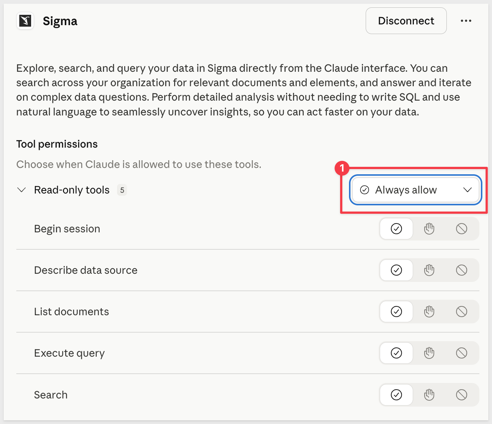

Now Claude can interact with your Sigma environment using plain language. We can also decide which tool permissions we want to allow. 

6. We ask a simple question about our Sigma instance, which is a new trial and has only one workbook currently:

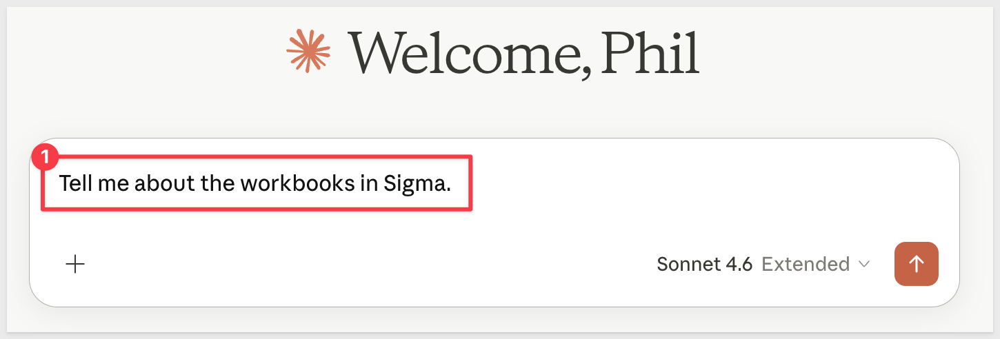

Since Claude has access, it is able to find the workbook and describe it to us:

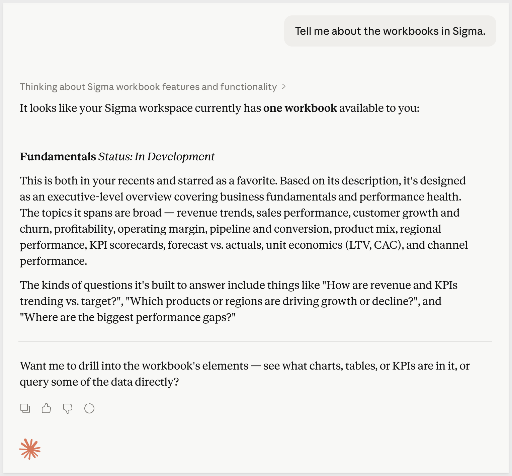

<aside class="negative">
<strong>NOTE:</strong><br> You will need appropriate Sigma permissions to use the MCP Server — at minimum, <code>View connections</code> on your account type and <code>Can view</code> or <code>Can use</code> access on the specific documents or connections you want to query.
</aside>

The value here is in the workflow. Instead of switching between Claude and Sigma to answer a data question, you stay in one place. Claude handles the discovery and query work, and you get answers grounded in your actual, live Sigma data — not a training dataset or a cached snapshot.

For teams that already work in AI-assisted environments, this means Sigma data becomes a natural part of that workflow rather than a separate tool you have to open.


For full setup instructions, see [Use the Sigma MCP Server](https://help.sigmacomputing.com/docs/use-sigma-mcp-server)

For a hands-on walkthrough — including how to configure a Claude Project with org-specific context, search your Sigma environment, and run natural language queries against live data — see [Natural Language Analytics with Claude and Sigma](https://quickstarts.sigmacomputing.com/guide/aiapps_natural_language_with_claude/index.html).


<!-- END OF SECTION-->

## Workbooks
Duration: 6

A workbook is where analysis happens in Sigma. It can hold tables, charts, controls, text, and apps — all organized across one or more pages, all connected to live data.

In this section, you’ll create a workbook from scratch, add data from the Sigma Sample Database, and walk through the key concepts: the exploration state, saving, the workbook interface, and the publish workflow.

### Create a new workbook

From the Sigma home page, click `Create new` (1) in the left sidebar, then select `Workbook` (2):

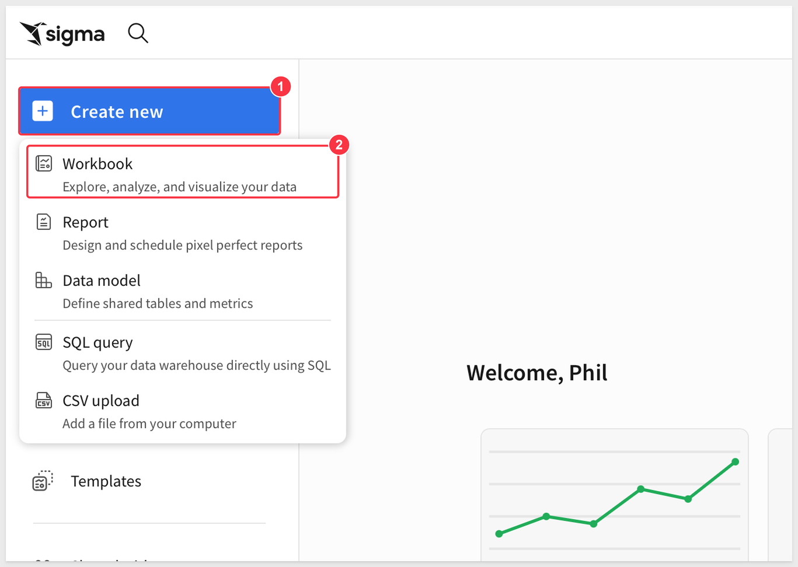

Sigma opens a blank workbook in the exploration state. You’ll notice there’s no name yet — the workbook doesn’t exist in your files until you choose to save it.

New workbooks lead with Sigma Assistant. You can describe what you want to create, start from a template, or add elements yourself from the element bar at the bottom of the canvas. The `Element panel` is hidden at first. Click the icon in the upper right corner (red box) to open it:

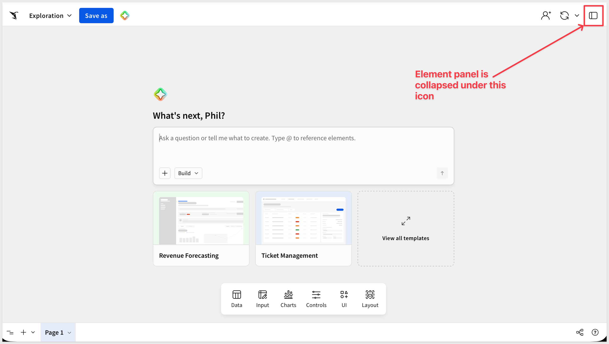

<aside class="positive">
<strong>NOTE:</strong><br> In Sigma, all workbooks start as unsaved explorations. If the analysis isn’t worth keeping, you can close it without saving and nothing is created. If it is worth keeping, you save it — and then it enters a draft/publish workflow.
</aside>

### Workbook settings

Before adding any data, it's worth knowing that workbooks have their own settings that control how they look and behave. With the element panel open (1), click the `Workbook settings` button (2):

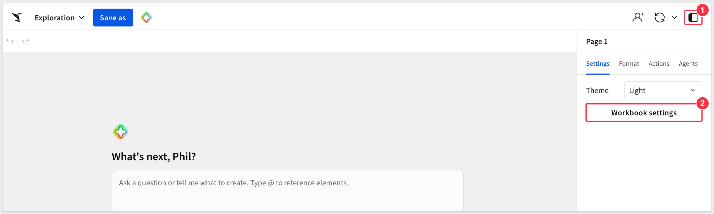

The settings panel is organized into expandable sections:

<ul>
  <li><strong>Theme:</strong> Set a Light or Dark theme for the workbook.</li>
  <li><strong>Color:</strong> Configure the color palette used across charts and visualizations.</li>
  <li><strong>Font:</strong> Set the default font family and size for text elements.</li>
  <li><strong>Layout Style:</strong> Control padding, spacing, and canvas behavior.</li>
  <li><strong>Table Style:</strong> Set default styling for table elements — borders, row height, header appearance.</li>
  <li><strong>Layout Settings:</strong> Configure how the workbook scales and responds across screen sizes.</li>
  <li><strong>Workbook Navigation:</strong> Enable and configure in-workbook navigation menus for viewers.</li>
</ul>

At the bottom of the panel, `Manage locales` allows you to configure number and date formatting for different regional audiences.

These settings apply to the entire workbook and can be adjusted at any time. 

For more information, see [Workbook settings overview](https://help.sigmacomputing.com/docs/workbook-settings-overview)

### Add data

Let's add a table to the workbook. Open the `Data` group on the `Element bar` and drag/drop (or just click) a `Table` onto the canvas:

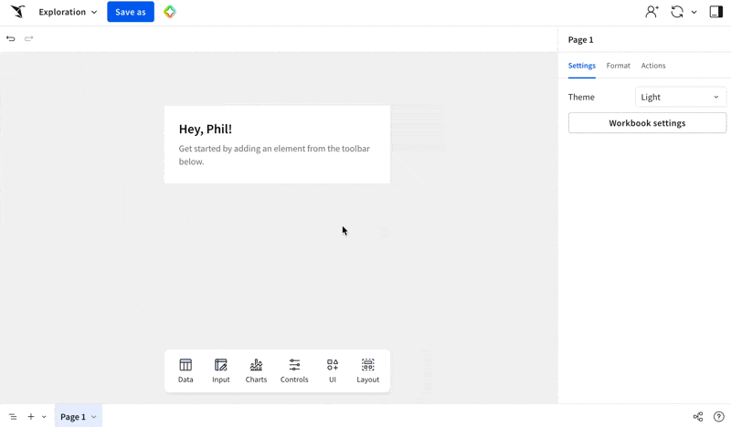

Resizing and arranging elements is simple, as is selecting the source of the data from the warehouse. 

Data can be sourced from suggestions made by Sigma (based on recent activity), other elements in the workbook or from any available connection.

As shown in the gif, search for `Hands` and choose the `plugs_electronics_hands_on_lab_data` table.

Sigma adds the table to the canvas and pulls the data live from the cloud data warehouse. You’re not working with a copy or a snapshot — the data reflects whatever is in the warehouse at query time.

Notice in the summary (1) that this table is over **4.5 million rows** and 22 columns:

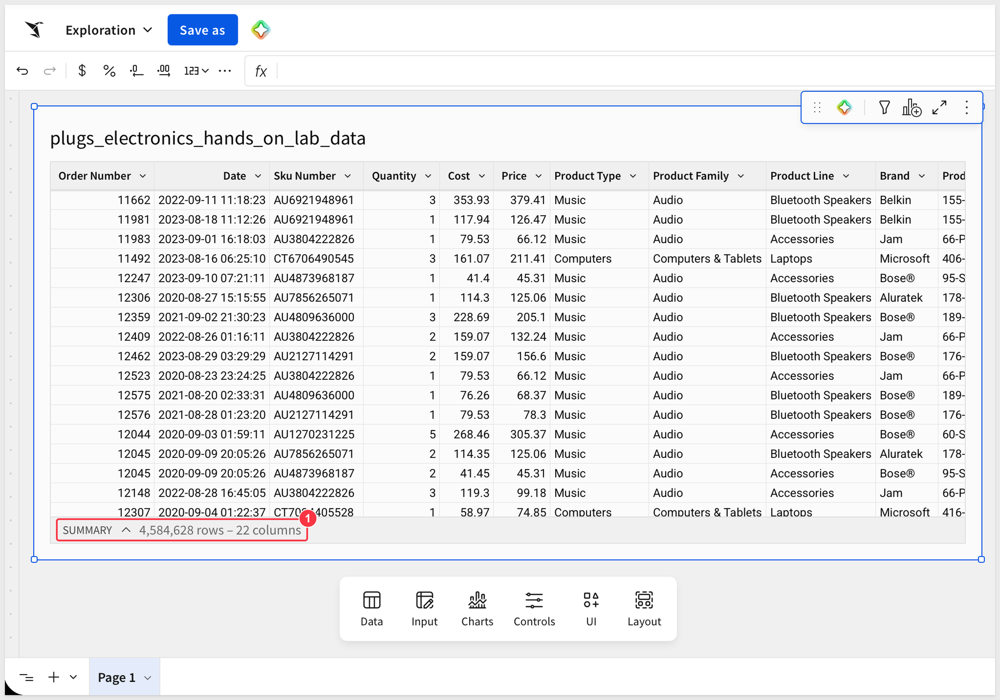

<aside class="negative">
<strong>NOTE:</strong><br> Workbooks can connect to data from multiple sources — tables in your cloud data warehouse, data models created in Sigma, or CSV files uploaded directly.
</aside>

### The workbook interface

With the table on the canvas, take a moment to get oriented.

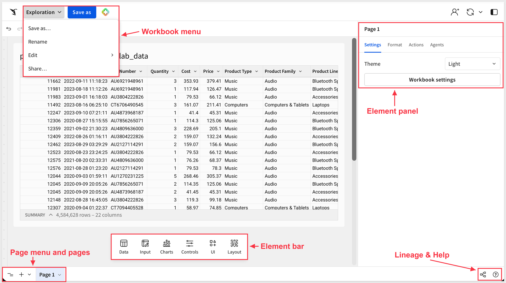

Each workbook can have one or more **pages**. Each page has its own canvas. The table you just added is on `Page 1`.

Objects on the canvas are called **elements** — tables, charts, controls, text, buttons, and so on. 

When an element on the canvas is selected, it will have a blue border and the `Element panel` (1) will show the related configuration:

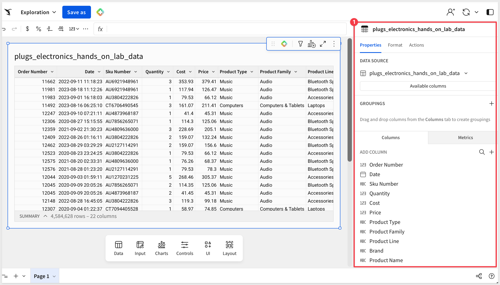

The titles of elements on the page can easily be renamed by double-clicking the name. For example, change the `plugs_electronics_hands_on_lab_data` title to `Sales Transactions`.

When a cell in the `Order Number` column of the `Sales Transactions` table is selected, we can access the `Toolbar`, `Formula bar` and `Element features`. 

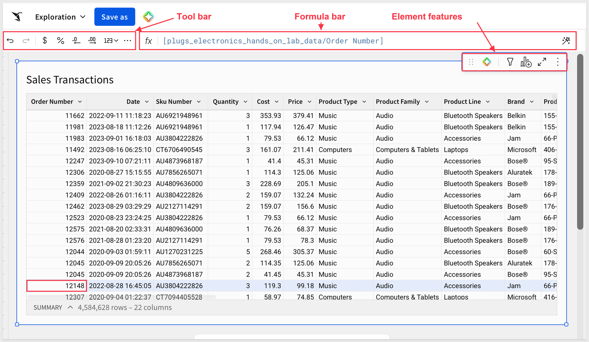

The **formula bar** is super-powerful as it gives you access to [Sigma’s full library of functions](https://help.sigmacomputing.com/docs/popular-functions) and is where custom calculations are written and edited.

Important to notice that icons for undo and redo are present - . These are really handy, and will be used often.

<aside class="positive">
<strong>IMPORTANT:</strong><br> Use the `Undo` and `Redo` arrows in the toolbar — not the browser’s back button. The browser back button will navigate away from the workbook.
</aside>

### Save the workbook

When you’re ready to keep this workbook, click `Save as` in the upper left corner.

Give the workbook a name that would make sense to you and to anyone you might share it with later. For this QuickStart, create a folder called `QuickStarts` and name the workbook `Fundamentals`.

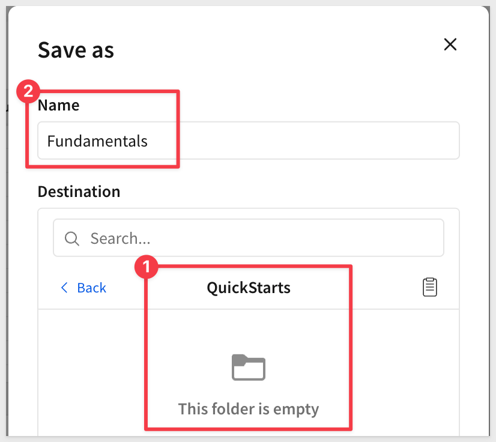

Once saved, the workbook is now in **Draft** mode. The `Publish` button is visible in the header, but it remains inactive as we just saved the workbook. It will remain inactive until you make changes.

### About this workbook

Click the down-arrow next to the workbook name (1) and select `About this workbook…` (2).

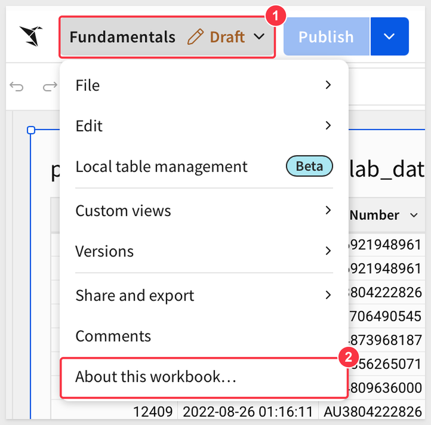

From here you can:
<ul>
  <li>Star the workbook to add it to your Favorites section on the home page left sidebar menu.</li>
  <li>Leave a text comment to provide additional context.</li>
  <li>Details about where the workbook is stored and who owns it — useful when the workbook is shared with you.</li>
</ul>

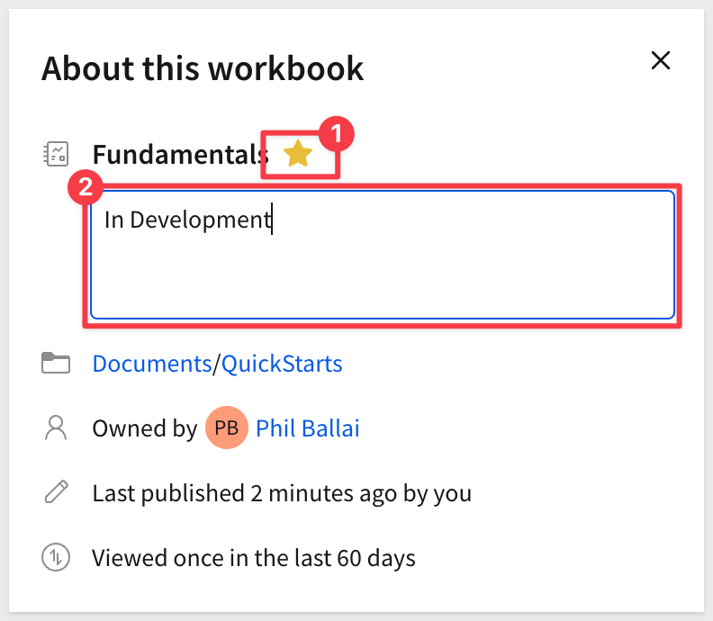

You may also want to set a `Badge` on the workbook, to inform users about the status of the content. Open the workbook menu, select `File` (1), then `Set badge…` (2):

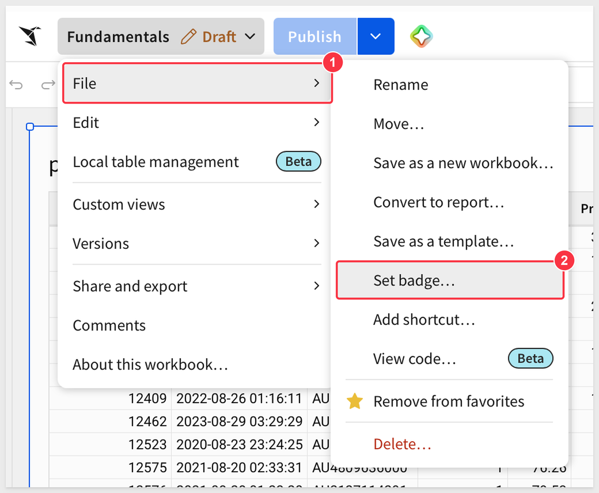<br>

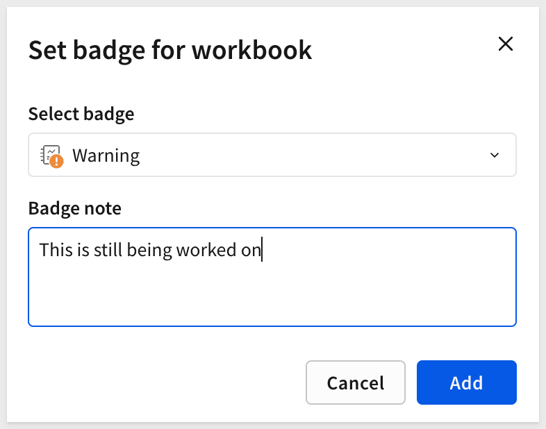<br>

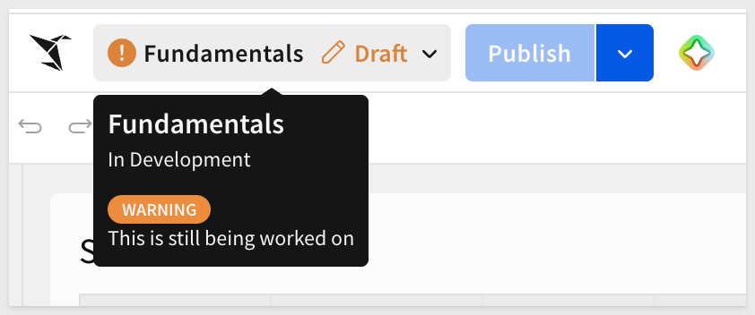<br>

### Publish and view

When you’re ready to share the workbook with others, click `Publish`. This promotes the current draft to the published version — the version all users with access will see.

Opening the `Publish` drop-down (1) before clicking provides additional options:

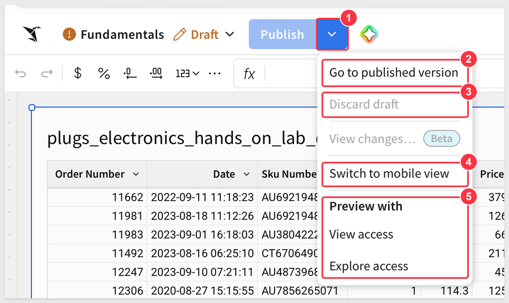

<ul>
  <li>Go to the published version (2) to see what viewers see.</li>
  <li>Discard unpublished draft changes (3).</li>
  <li>Preview the workbook at a smaller screen size for mobile use (4).</li>
  <li>Preview with different access rights applied (5).</li>
</ul>

<aside class="positive">
<strong>NOTE:</strong><br> Sigma also supports workbook version history and version tagging for more controlled release workflows. For more information, see <a href="https://help.sigmacomputing.com/docs/workbook-versions-and-version-history">Workbook version history</a> and <a href="https://help.sigmacomputing.com/docs/version-tagging">Version tagging</a>.
</aside>

### The published view

After publishing, click `Go to published version` from the `Publish` menu.

In the published view, the header shows an option to return to `Edit` mode, plus a `Custom view` icon. 

Custom views let you make changes visible only to you — useful for adapting a shared workbook to your own needs without affecting what others see.

If a user has the permission, they can use `File` > `Save as a new workbook` to save that view for themselves (and perhaps others):


Once you’re done reviewing, click `Edit` in the header to return to editing mode.


<!-- END OF WORKBOOKS -->

## Pages
Duration: 6

Each workbook page has its own canvas and can be made to operate independently of others, or not.

For example, on one page, we may want to have the data and controls that drive the content on other pages. 

On another page, we may want to provide some instructions for the users. Sigma is flexible enough that you can create very different designs and even make the design properties reusable as a [Theme](https://help.sigmacomputing.com/docs/create-and-manage-workbook-themes).

### Create a data page
A dedicated data page in a workbook can be useful for storing information that other users don’t need to see. However, elements on the data page can still be easily referenced on any other workbook page.

<aside class="positive">
<strong>WHY IT MATTERS:</strong><br> When a source table — for example, a Sales Transactions table — lives on a data page, Sigma fetches that data from the warehouse once. 

Any child elements created from it (such as charts or summary tables) and any references to it from other pages in the workbook are served from that same result, without triggering additional warehouse queries. 

This keeps compute costs down and performance consistent as a workbook grows. 

For a deeper look at how Sigma handles calculations and query execution, see the <a href="https://quickstarts.sigmacomputing.com/guide/developers_sigma_calculations/index.html">Sigma's Query Engine</a> QuickStart.
</aside>

In the lower left corner of the workbook there is a page tab called `Page 1`.

Double-click on the `Page 1` text and rename the page to `Data`. 

Add a new page and name it `Dashboard` for now:


Drag the `Dashboard` page to be first in line.

Click the menu arrow on the `Data` page and select `Hide page`:


Click `Publish`.

The `Data` tab will now carry an icon to indicate that it will not be visible to users who do not have edit rights.


<aside class="positive">
<strong>NOTE:</strong><br> Hidden pages are permission-aware — users with edit access will still see the page, while viewers will not. To verify this behavior, use the <code>Preview with</code> option in the <code>Publish</code> menu. This lets you simulate how the workbook appears to users with different permission levels without publishing or sharing anything.
</aside>

All Sigma elements use a common method for making adjustments via the `3-dot` or "[Kebab Menu](https://en.wikipedia.org/wiki/File:Kebab-menu-ui-icon-1.svg)" option.

For example, if we wanted to move the `Sales Transactions` table to another page, we can do that easily:


<aside class="positive">
<strong>IMPORTANT:</strong><br> It is easy to move elements between pages and any associations that an element has to other elements is automatically maintained. This "automatic association" is what allows us to have a "Data" page that is hidden from users, but contains elements that we can reference in any other page.
</aside>

Now that we made some changes, the `Publish` button is active again.

### Version history

Every change you make to a workbook — including structural changes like hiding the `Data` page — is tracked automatically. Sigma maintains a full version history so you can review what changed, when, and who made the change. If something goes wrong, you can restore a previous version without losing other work.


<aside class="positive">
<strong>NOTE:</strong><br> Version history is available for saved workbooks. To access it, open the workbook menu (1), select <code>Versions</code> (2), then <code>Version history</code> (3). For more information, see <a href="https://help.sigmacomputing.com/docs/workbook-versions-and-version-history">Workbook version history</a>.
</aside>

When we changed the visibility of the `Data` page, the change was tracked and can be reverted by clicking any of the earlier changes. 

<aside class="positive">
<strong>IMPORTANT:</strong><br> Version history provides a much deeper level of control than just using undo/redo, which is session-based. When more than one user is editing a workbook, it also shows who made each change.
</aside>


### Use a page for instructions or useful information
Creating a dedicated workbook page to inform and assist users who are looking at the workbook is a best practice.

As an example, this `Financial Services: Portfolio Risk Modeling` workbook has informative text along with some navigation buttons along the top and uses a dark theme. Since it is on the `Home` page, it is the first thing users see:


The `Templates` section (1) in the left sidebar includes Starter Apps — pre-built, fully working apps built on sample data that cover common business workflows across finance, operations, sales, and more. You can explore them, inspect how they're built in edit mode, and connect them to your own data when you're ready.


<!-- END OF PAGES -->

## Layout Elements
Duration: 6

Sigma offers several layout elements that help you structure workbook pages, improve navigation, and create interactive user experiences. Each element is designed to make your content more organized, visually appealing, and easier to use. 

Having all these options allows you to get creative with workbook functionality and design—encouraging your users to engage with and return to your workbooks.

You can find them in the `Layout` group (1) on the element bar:


### Containers
Sigma's container feature allows you to organize workbook pages by grouping elements within a customizable container. 

This provides an intuitive way to manage layouts, ensuring that related elements remain visually cohesive. 

Containers not only streamline the design process by enabling you to adjust and style grouped components collectively, but also enhance flexibility when rearranging or resizing elements on the canvas. 

This powerful feature simplifies complex workbook structures, making it easier to maintain consistency in both functionality and appearance.

In the animation below, we show how containers dramatically improve the appearance of existing Sigma workbooks.


To learn more about using containers, see [Organize workbook layouts with containers](https://help.sigmacomputing.com/docs/organize-workbook-layouts-with-containers)

### Tabbed Container
Tabbed containers let you organize related content into separate tabs within the same space. This saves screen real estate, reduces scrolling, and allows users to easily switch between different views or datasets without leaving the page.


### Modal
A modal feels somewhat similar to a page but behaves differently in that it enables a pop-up window that overlays the workbook. Modals are ideal for highlighting important content, collecting input, or guiding users through a focused interaction without navigating away from the main page.

Modals can be used for simple things like confirming a change, or as complex as the workflow shown in the [Approvals QuickStart](https://quickstarts.sigmacomputing.com/guide/dataapps_approvals_flow/index.html?index=..%2F..index#0)


### Popover
Popovers display additional information or interactive controls in a small floating panel triggered by a click or hover.
They’re perfect for providing contextual help, quick filters, or small forms without cluttering the main layout.

An example can be seen on the `Administration` > `Usage` page where a popover is used for filters, freeing up space:


### Form
Forms enable users to input and submit data directly within a workbook. They can be used to capture user feedback, send parameters to queries, or write data back to your warehouse—bringing interactivity and data collection directly into your Sigma dashboards.

There is a QuickStart, [Building Forms for Data Capture and Analysis](https://quickstarts.sigmacomputing.com/guide/aiapps_forms/index.html#0) that walks through the process of using forms to capture trade show leads.

Here is an example of a form for capturing trade show leads:


<!-- END OF LAYOUT ELEMENTS -->

## Account Types
Duration: 6

<aside class="negative">
<strong>NOTE:</strong><br> This section is useful to understand how different users may use Sigma. If you are not involved in those decisions, feel free to skip to the next section.
</aside>

Sigma’s licensing model includes tiers that define the usage terms of your organization members: `View`, `Act`, `Analyze` and `Build`. 

If your organization utilizes the older Lite/Essential/Pro license model, [refer to this document.](https://help.sigmacomputing.com/docs/create-and-manage-account-types-2024)

Each license tier establishes a different set of available permissions that enable access to Sigma’s features and capabilities. 

At a high-level, this is what each tier provides:

<ul>
  <li><strong>View:</strong> Suitable for report consumers who need access to prepared data and insights with baseline interactions.</li>
  <li><strong>Act:</strong> Ideal for collaborative data contributors who actively input and update data.</li>
  <li><strong>Analyze:</strong> Optimized for decision-making data consumers who require more deep-dive capabilities without building workbooks themselves.</li>
  <li><strong>Build:</strong> Designed for data architects, BI analysts, and report builders who model, transform, and analyze data.</li>
</ul>

<aside class="negative">
<strong>NOTE:</strong><br> The Build license is also used for system administrators. The key difference is that an administrator has an elevated account type. This allows them to manage organization settings and users and so on.
</aside>

As an `administrator`, we can see these default account types by navigating to `Administration` > `Account Types`.

Here we see the default types, description and can also create a new custom account type.

Custom account types provide the ability to define a granular permission level using `Account Types`. 


For more information, see [Account type and License Overview](https://help.sigmacomputing.com/docs/account-type-and-license-overview)


<!-- END OF ACCOUNT TYPES -->

## Sharing
Duration: 6

Sharing in Sigma is simple. Permissions to access a Sigma document can be granted, modified, or revoked by either the document’s owner or an organization admin. 

Return to the `Fundamentals` workbook, and click the `Share` icon (1) in the upper right corner of the workbook:


In the share modal, search for the team or member (2) that you want to share the workbook with, and choose their permission level.

For example, we invited another user (using [Gmail's alias feature](https://support.google.com/a/answer/33327?hl=en)) and set their permissions to `Build`.

Now we can share the workbook with that new user and select the level of access we want to allow. 


The new user can see the workbook by navigating to `Shared with you` in the left sidebar. 

In the image below, we logged into Sigma as the new user using a different browser and can see the shared workbook:


### Live edit

When we are both editing the same workbook, we can see each other's activity.

First we elevated the `Build` user to `Edit` permission using the workbook's sharing icon again.

<aside class="negative">
<strong>NOTE:</strong><br> To use live edit, users need to have `Edit` access.
</aside>

Then we logged both users in using Chrome and Safari browsers and placed the workbook into `Edit`.

Each user can see the other's presence on the table:


<aside class="negative">
<strong>NOTE:</strong><br> We simulated this using two different browsers, each with a different user logged into Sigma.
</aside>

For more information, see [About sharing with users, teams, and all organization members](https://help.sigmacomputing.com/docs/share-a-workbook#about-sharing-with-users-teams-and-all-organization-members)


<!-- END OF SHARING -->

## Scheduling
Duration: 6

Sigma workbooks support the ability to export data immediately or on a user-defined schedule.

Open the workbook menu (1) and select `Share and export` (2) > `Schedule exports…` (3):

<aside class="negative">
<strong>NOTE:</strong><br> The `Export` option is also provided for immediate export. There are some restrictions on data export. For more information, see <a href="https://help.sigmacomputing.com/docs/download-workbook-data">Download workbook data</a>.
</aside>


In the modal window, click `Create new schedule`.

<aside class="negative">
<strong>NOTE:</strong><br> There is also an option provided to see all your scheduled exports in one place.
</aside>


The same summary page is also available from `Profile` (1) in the user menu, then `Scheduled exports` (2):


We are able to customize several areas of this operation. 

### Export (select a type)
There are many destinations supported. Select the desired destination (1), then provide one or more recipients, a subject and message:


For the most recent list of supported export destinations, see [Schedule a conditional export or alert](https://help.sigmacomputing.com/docs/schedule-a-conditional-export-or-alert)

### Email bursting
When the destination is `Email`, the `Delivery method` offers `Standard` or `Burst` (1). A standard delivery sends the same export to everyone. A burst splits one export into a personalized version for each recipient, based on a workbook control.

To set up a burst, choose the control to `Split by` and the email column for `Dynamic recipients` (2). Each dynamic recipient receives the export filtered to their own value, while `Standard recipients` receive everything, unfiltered.


<aside class="negative">
<strong>NOTE:</strong><br> Bursting requires the `Export as email burst` permission on your account type, and is not available in free trials (3). To use it, contact your Sigma Account Executive.
</aside>

For a complete walkthrough, see the [Export Bursting](https://quickstarts.sigmacomputing.com/guide/administration_export_bursting/index.html?index=..%2F..index#0) QuickStart

### What to attach
Choose what to attach (1), then the format, orientation and page size to include with the export (2):


Use `+ Add` (3) to build a message from more than one part of a workbook.

### Frequency & Conditions

The `Frequency` tab controls when the export runs and the timezone it runs in. Set the schedule to match the cadence your audience expects — daily, weekly, or at a custom interval.

Sigma also supports conditional exports — exports that only deliver when specific data conditions are met. For example, you can configure a schedule to send only when a metric exceeds a threshold, ensuring recipients receive a notification only when action may be required.


<aside class="negative">
<strong>NOTE:</strong><br> Conditional exports are not available on trial accounts. To explore this feature, you'll need access to a full Sigma environment. For setup details, see <a href="https://help.sigmacomputing.com/docs/schedule-a-conditional-export-or-alert#schedule-an-export-based-on-data-availability">Schedule a conditional export or alert</a>.
</aside>

### More options
For workbooks that have parameter-driven data based on the user, sent items can be run with data filtered for the recipient:


A very powerful feature of scheduling allows us to deliver exports deterministically, based on control parameters.

For more information, see [Filter by control values](https://help.sigmacomputing.com/docs/configure-additional-options-for-exports) on this page.

### Managing my workbook schedule
Once a user creates a schedule, it is shown on the `Schedule exports` modal. At this point, we can take some `Action` on it, including running it now:


### Administrative control
Once created, administrators can see it on the list of available `Exports` in the `Administration` section:


Administrators are able to delete jobs at their discretion.

### Export element
There is also a method to export data for any single workbook element. While it is preferred to use Sigma to work with warehouse data, there are times where an export is required. 

For example, our workbook has one table, `Sales Transactions`. 

We can access the element menu (2) for this table (1) and select `Export` (3), then select a document type (4). Downloading up to one million rows of data in the available formats is supported.

<aside class="negative">
<strong>NOTE:</strong><br> Creating a delivered export or a scheduled export is also available from this menu.
</aside>


For more information, see [Schedule a conditional export or alert](https://help.sigmacomputing.com/docs/schedule-a-conditional-export-or-alert)


<!-- END OF SCHEDULING -->

## What we've covered
Duration: 6

We covered the foundational layer of working in Sigma — the interface, the terminology, and the core workflows that everything else builds on.

We navigated the Sigma home page, explored the UI, created a workbook from scratch, and followed a document from exploration through draft to published. Along the way we saw how AI is built in at every level, from Formula Assistant and Sigma Assistant to agents and the MCP Server, how pages and data pages keep workbooks organized and warehouse-efficient, and how sharing, version history, and scheduled exports fit into a real workflow.

The patterns introduced here apply across every workbook you'll build going forward. The next QuickStart in the series picks up where this one leaves off — working with data in Sigma:

[Fundamentals 2: Working with Data](https://quickstarts.sigmacomputing.com/guide/fundamentals_2_data_v3/index.html?index=..%2F..index#0)

[](https://twitter.com/sigmacomputing)&emsp;
[](https://www.linkedin.com/company/sigmacomputing)&emsp;
[](https://www.facebook.com/sigmacomputing)


<!-- END OF WHAT WE COVERED -->
<!-- END OF QUICKSTART -->
