author: pballai
id: aiapps_build_app_with_claude_and_mcp
summary: Build a four-page store performance app on live warehouse data by describing it to Claude through the Sigma MCP server, from dashboards to a review queue with writeback and a Sigma agent.
categories: aiapps
environments: web
status: Published
feedback link: https://github.com/sigmacomputing/sigmaquickstarts/issues
tags: Default
lastUpdated: 2026-11-12

# Build an AI app with Claude and the Sigma MCP server

## Overview
Duration: 5

In this QuickStart you'll build a working store performance app for Plugs Electronics, a fictional retailer with 200 stores. You won't click through menus. You'll describe what you want to Claude, and Claude will build it in your Sigma org through the Sigma MCP server, on live data in the warehouse.

Prefer to watch first? [Watch the short summary video](https://sigmacomputing.wistia.com/s/phdslan4mw2hrxk) to see how a four-page store performance app is built by describing it to Claude through the Sigma MCP server.

<aside class="positive">
<strong>PLEASE READ:</strong><br> Sigma AI Apps are rapidly evolving, with new features being added regularly. If your Sigma instance does not have the specific feature shown (or if the UI has changed), please contact Sigma support for assistance in accessing the feature.
</aside>

[How to contact Sigma support](https://help.sigmacomputing.com/docs/sigma-support)

### Target Audience
Developers interested in using Sigma to build interactive data applications.

### Prerequisites

<ul>
  <li>A computer with a current browser. It does not matter which browser you want to use.</li>
  <li>Access to your Sigma environment.</li>
  <li>Some familiarity with Sigma is assumed. Not all steps will be shown as the basics are assumed to be understood.</li>
 </ul>

<aside class="positive">
<strong>IMPORTANT:</strong><br> Sigma recommends that you use non-production resources when doing QuickStarts.
</aside>

<button>[Sigma Free Trial](https://www.sigmacomputing.com/free-trial/)</button>
<aside class="positive">

<strong>IMPORTANT:</strong><br> Some screens in Sigma may appear slightly different from those shown in QuickStarts. This is because Sigma is continuously adding and enhancing functionality. Rest assured, Sigma’s intuitive interface ensures that any differences will not prevent you from successfully completing any QuickStart.
</aside>

For more information on Sigma's product release strategy, see [Sigma product releases.](https://help.sigmacomputing.com/docs/sigma-product-releases)


<!-- END OF SECTION-->

## Install the Sigma Build MCP plugin in Claude
Duration: 5

Before we start, we need to download the Sigma plugin and install it into Claude.

Sigma hosts each organization in one region, so first find yours. In Sigma, open `Administration` > `Account` > `General Settings` and read the `Cloud` field under `Site`. Keep it handy, because you need it again in Part 2.

Sigma publishes the plugin on GitHub, in the [sigma-plugin](https://github.com/sigmacomputing/sigma-plugin) repository. 

Open the latest release, and under `Assets` download the file named `sigma-build-<version>.claude.plugin` (for example, `sigma-build-v1-1-0.claude.plugin`). Save it somewhere easy to find. **There is no need to unzip the file.**

On the release page, scroll to the `Assets` list and select the `.claude.plugin` file (1):

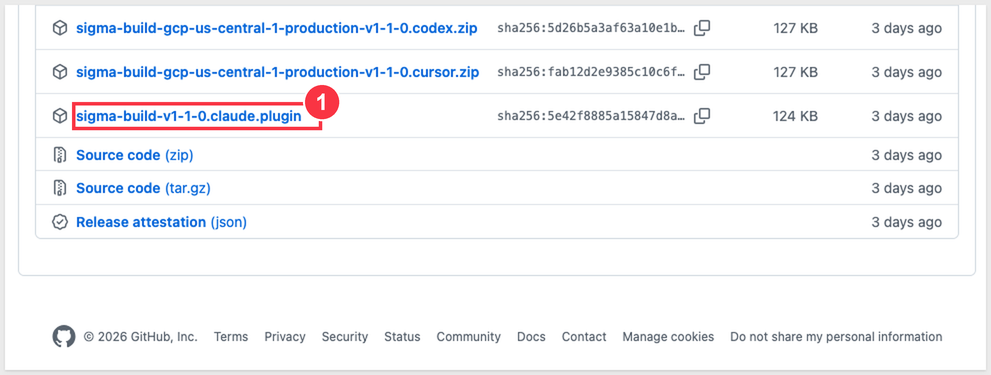

<button>[Download the Plugin](https://github.com/sigmacomputing/sigma-plugin/releases/latest)</button>

<aside class="positive">
<strong>NOTE:</strong><br> The release lists many files. For Claude, download only the `.claude.plugin` file: it is the same for every region, and you set your region when you connect the plugin to Sigma in Part 2. The `.cursor.zip`, `.codex.zip`, and `.coco.zip` files are for Cursor, Codex, and Cortex Code, and those are region-specific: choose the one whose name includes your region, such as `sigma-build-aws-us-west-2-production`.
</aside>

<aside class="positive">
<strong>NOTE:</strong><br> If you would rather not download a file, open `Customize` > `Plugins` in Claude, add the marketplace `sigmacomputing/sigma-plugin`, and install `Sigma`. Then continue with Part 2.
</aside>

### Part 1: Upload the plugin to Claude

Sign in to Claude, then follow the steps below.

**1. Open Customize**<br>
In Claude, select `Customize` > `Plugins` > `Yours` from the left sidebar.

Click the `+ Add` button and select `Upload a plugin`.

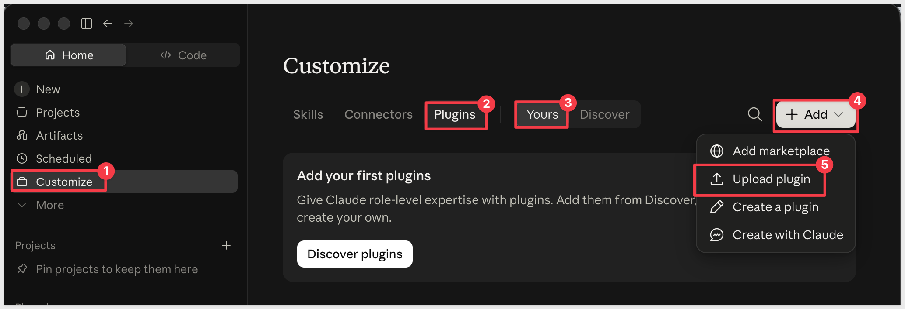

**2. Select the plugin file**<br>
Choose the `.claude.plugin` file you downloaded from GitHub (1). Click `Upload` (2).

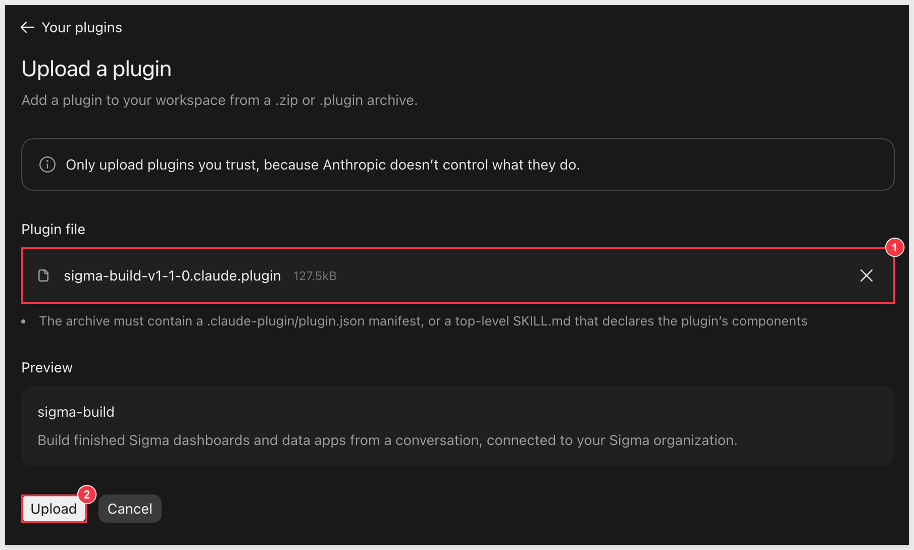

Claude will run a security scan and, once done, the plugin is ready for use. The plugin page shows `Sigma` by Sigma Computing with its version (1), and the plugin is turned on (2).

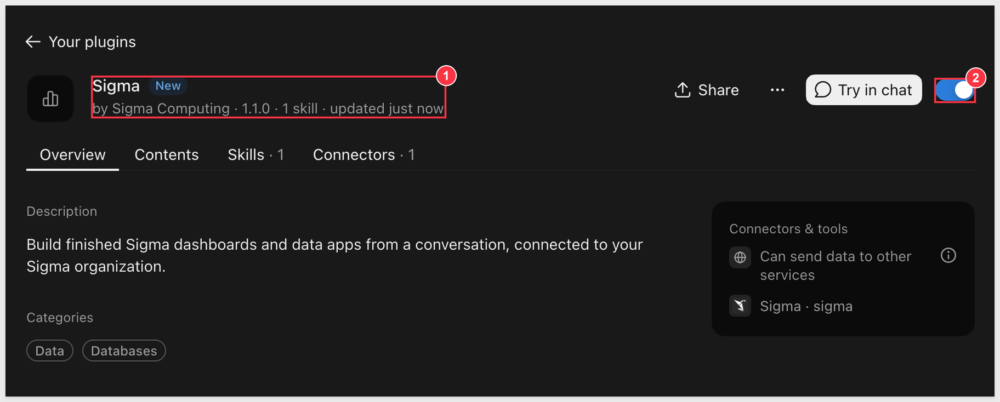

### Part 2: Connect to Sigma with OAuth

**1. Find your Server URL**<br>
Claude connects to the Sigma region your organization runs in. In Sigma, open `Administration` > `Account` (1) > `General settings` (2) and note the `Cloud` field (3).

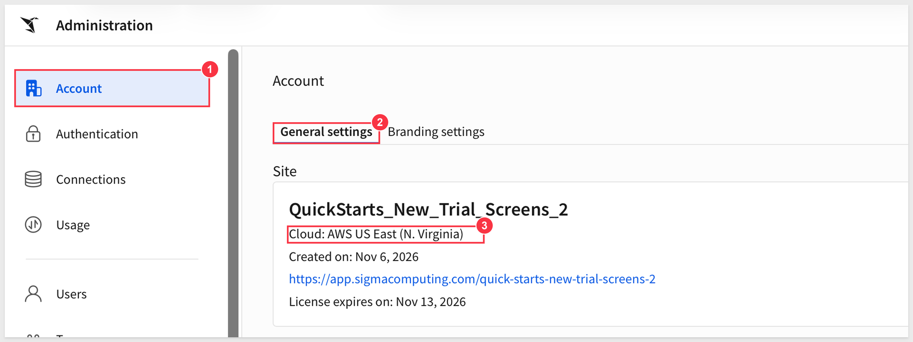

Then, in Claude, open the plugin's `Contents` tab (1) and select `README.md` (2). The row for your region (3) lists its Server URL. Names can be spelled slightly differently: Sigma shows `AWS US East (N. Virginia)`, and the table shows `AWS US-East (N. Virginia)`. The same table is in the plugin's [README on GitHub](https://github.com/sigmacomputing/sigma-plugin/blob/main/plugins/claude/sigma-build/README.md#find-your-region).

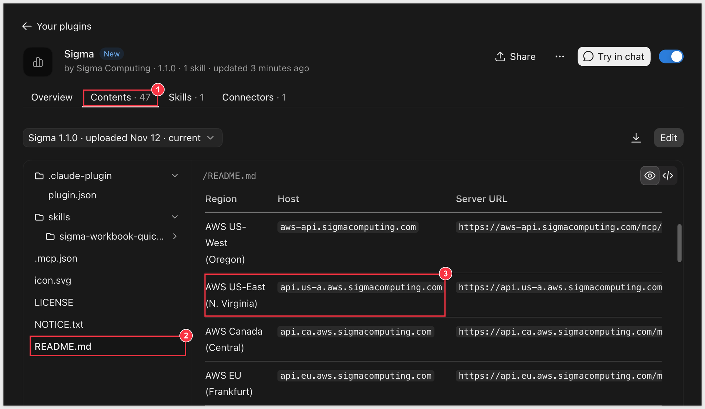

**2. Go to Connectors**<br>
On the Sigma plugin page, select the `Connectors` tab (1).

**3. Start the connection**<br>
Next to the Sigma connector, which shows `Not connected`, select `Connect` (2). If Claude asks for a `Server URL`, enter the one for your region from step 1. A Sigma sign-in window opens.

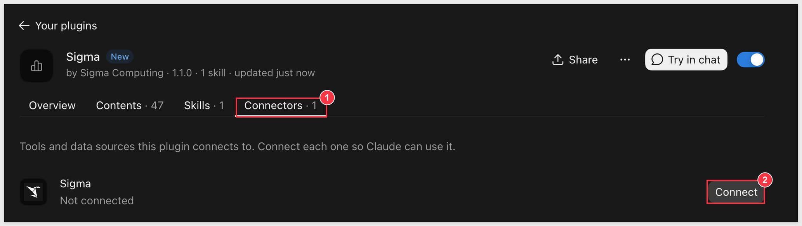

**4. Sign in to Sigma**<br>
Claude will open your default browser. Sign in with your usual method, including single sign-on (SSO) if your organization uses it.

**5. Approve access**<br>
The browser asks `Finish connecting a connector?` Select `Continue connecting` (1).

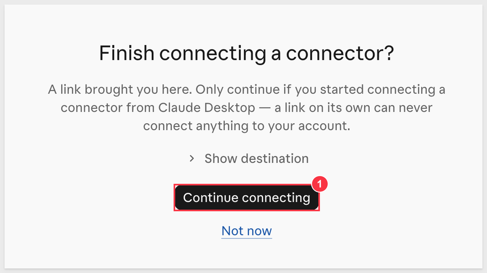

**6. Log into your Sigma instance**<br>
This will land you on a Sigma login page. Provide your org slug and click `Continue` (2).

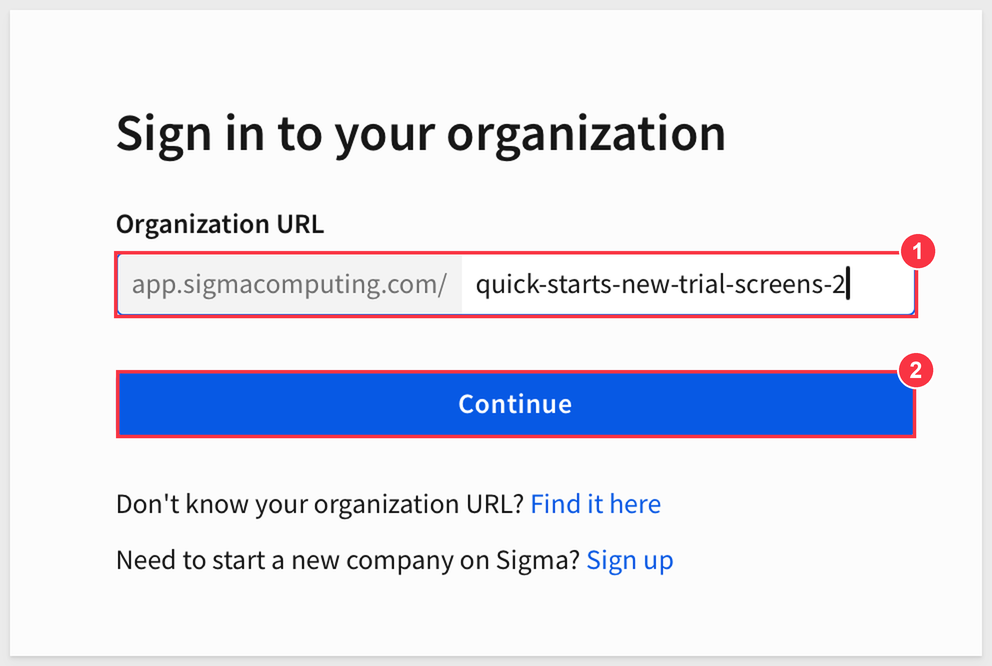

**7. Confirm the connection**<br>
On the `Connect Claude` page (1), review what Claude can do in your Sigma organization, then click `Allow` (2).

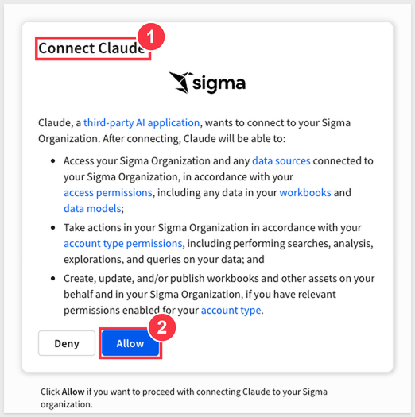

Back in Claude, check that the Sigma connector shows as `Connected` (1).

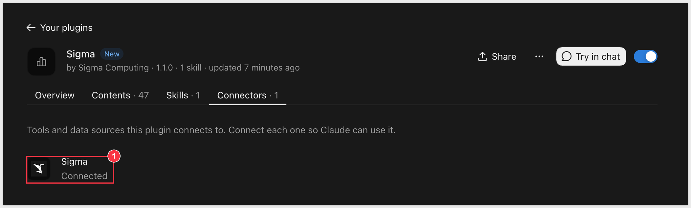

### Part 3: Choose tool permissions

Claude groups the Sigma tools, and you decide when it may use them. Open a group's permission menu (1) to set every tool in it at once, and choose `Blocked`, `Needs approval`, `Always allow`, or `Custom` (2). To set a single tool, use the icons next to it (3). You can change these any time under `Customize` > `Connectors`.

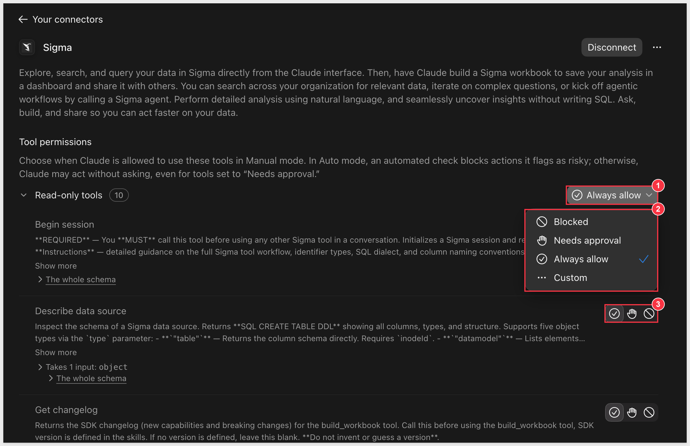

### Test it

Start a new chat and make a simple request.

```copy-code
Build a workbook from the table PLUGS_ELECTRONICS_HANDS_ON_LAB_DATA in the RETAIL schema of the Sigma Sample Database connection, with a KPI for total revenue and a chart of revenue by month.
```

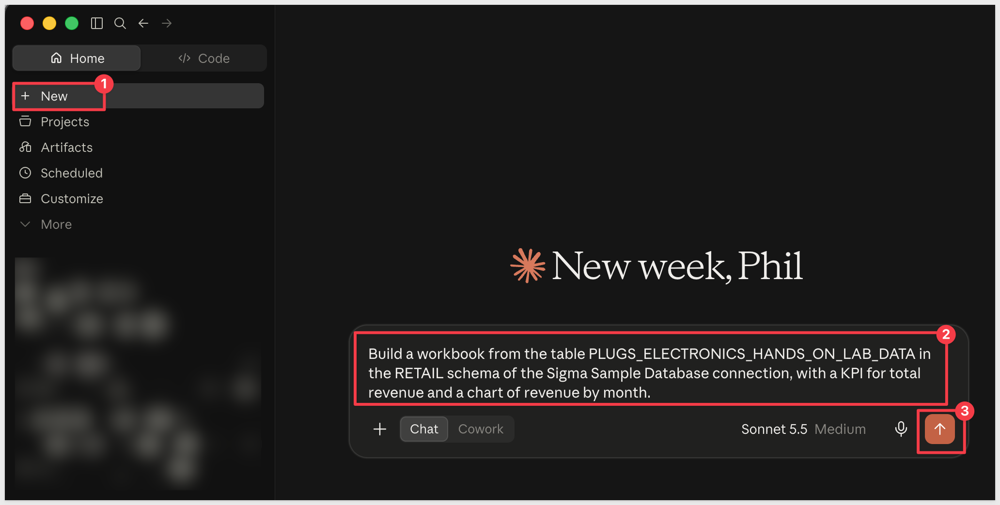

Claude may ask for permission before it runs a tool, depending on the permissions you just set. Here it wants to use `Build workbook` (1). Select `Always allow` (2) to stop being asked for this tool, or `Allow once` (3) to approve just this request:

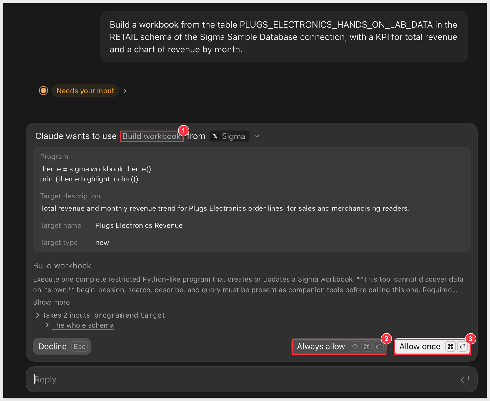

Claude constructs the new workbook and, when done, provides a link to it (1). It also lists the choices it made that you may want to change (2), such as how it defined revenue.

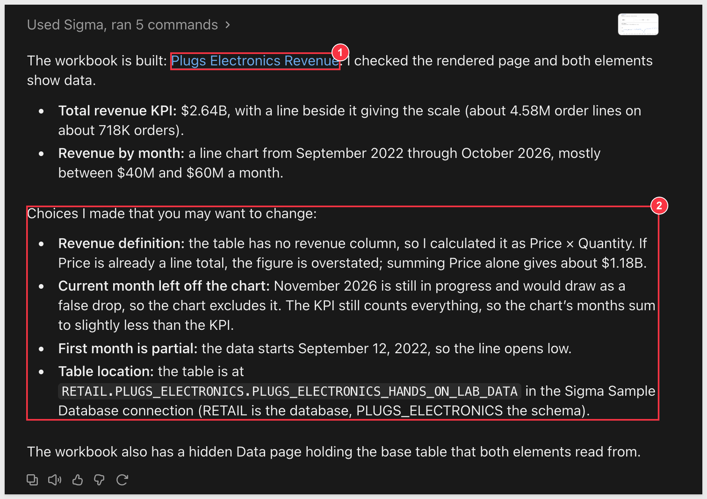

After logging into Sigma, we are presented with the new workbook, with the total revenue KPI (1) and the revenue by month chart (2).

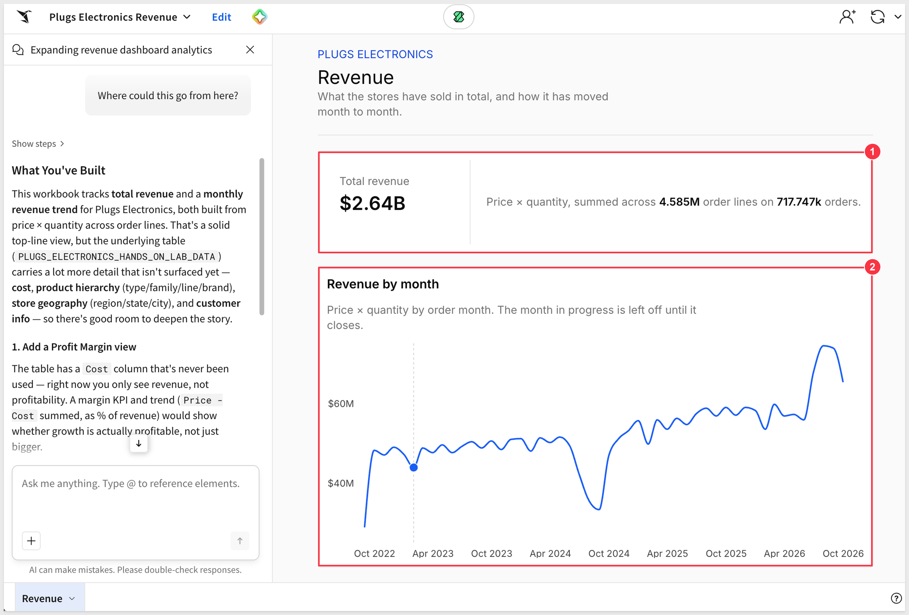

### Troubleshooting

| Issue | What to try |
| --- | --- |
| Upload plugin isn't available | Your organization may restrict custom plugins. Ask your Claude admin to enable them. |
| The sign-in window doesn't open | Allow pop-ups for claude.ai, then select Connect again. |
| Sign-in works but Claude shows an error | Disconnect the connector, reconnect, and approve the permissions again. |
| Claude can't find your data | Confirm your Sigma account has access to the connection or data model you're asking about. |


<!-- END OF SECTION-->

## Connect and discover
Duration: 5

Next, let's build something more involved. Start a new chat and ask the following.

```copy-code
Start a Sigma session. Then find the table PLUGS_ELECTRONICS_HANDS_ON_LAB_DATA in the RETAIL schema of the Sigma Sample Database connection. There is a second copy in an EXAMPLES schema, so use the RETAIL one.

Describe its columns, then run a query that returns: total rows, the number of distinct stores and regions, the earliest and latest order date, and total revenue (Price times Quantity).

Don't build anything yet. Summarize what the data covers in three sentences.
```

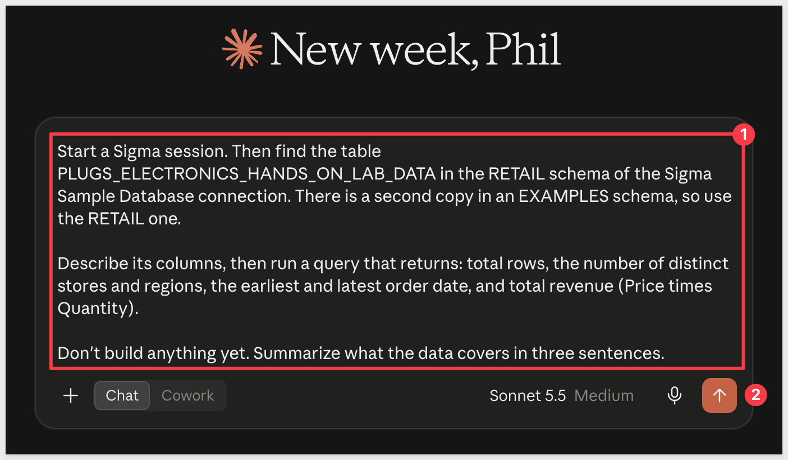

**WHAT YOU SHOULD SEE**<br>
About 4.6 million rows, 200 stores, 5 regions, and orders from July 2022 through the last week or two.

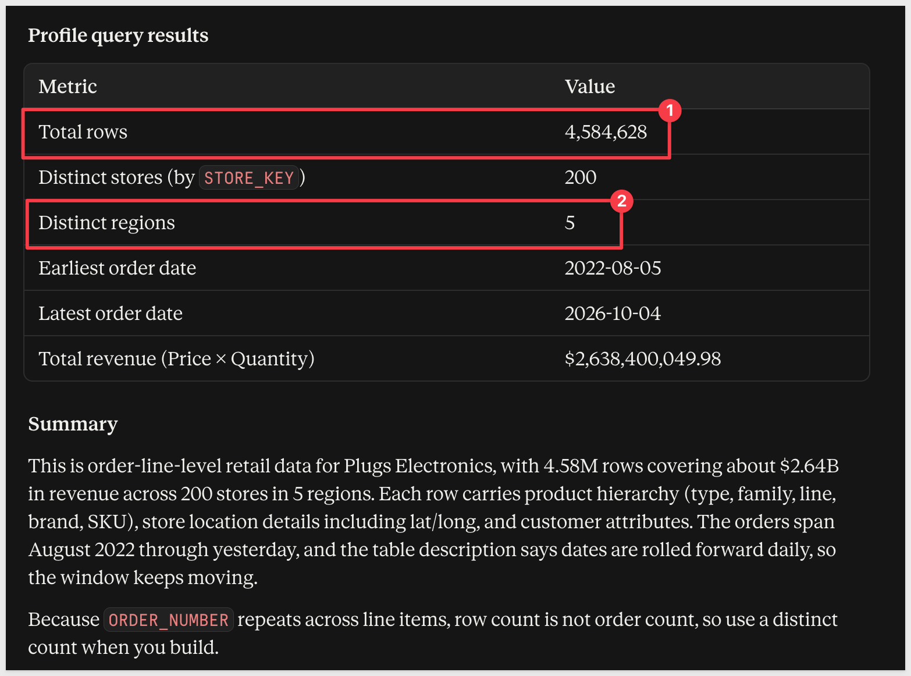

**WHY IT MATTERS**<br>
Claude signs in with your identity, so it can only see what you can see in Sigma. Every query runs live in the warehouse. No data is copied into Claude or into Sigma.

Leave this chat window open.


<!-- END OF SECTION-->

## Overview dashboard
Duration: 12

Now that we are comfortable we have identified the right source table, we can create a workbook.

```copy-code
Build a new Sigma workbook named "Plugs Store Performance Center" on the RETAIL table you just described. Don't ask me clarifying questions. Use these decisions:

Structure
- Pages: Overview, Store explorer, Store review, Decisions, and a hidden Data page that holds the base table.
- A sidebar rail on every visible page with the lockup "Plugs store performance" and vertical navigation to the four pages. Hide page tabs in view mode.

Calculated columns on the base table
- Revenue = [Price] * [Quantity]
- Gross profit = ([Price] - [Cost]) * [Quantity]
- Period: "Last 12 months" for the 12 complete calendar months before the current month, "Prior 12 months" for the 12 months before that, and "Current month" or "Earlier" for everything else. Compute it relative to today, with no hardcoded dates.

Overview page
- A title that greets the viewer by first name.
- Four KPIs comparing Last 12 months to Prior 12 months: Revenue, Gross profit, Gross margin, and Units sold (sum of Quantity).
- A line chart of monthly revenue over the last 24 full months, beside a donut of last-12-month revenue by Store Region.
- A horizontal bar chart of the top 10 brands by last-12-month revenue, with axis labels instead of data labels, beside a table of Product Type with Last 12 mo, Prior 12 mo, and YoY change colored green or red.

Leave the other three pages with only a title for now. When it's built, screenshot the Overview and tell me the four KPI values.
```

**WHAT YOU SHOULD SEE**<br>
Claude will provide the workbook link (1) along with summary information as before, including the four KPI values (2).

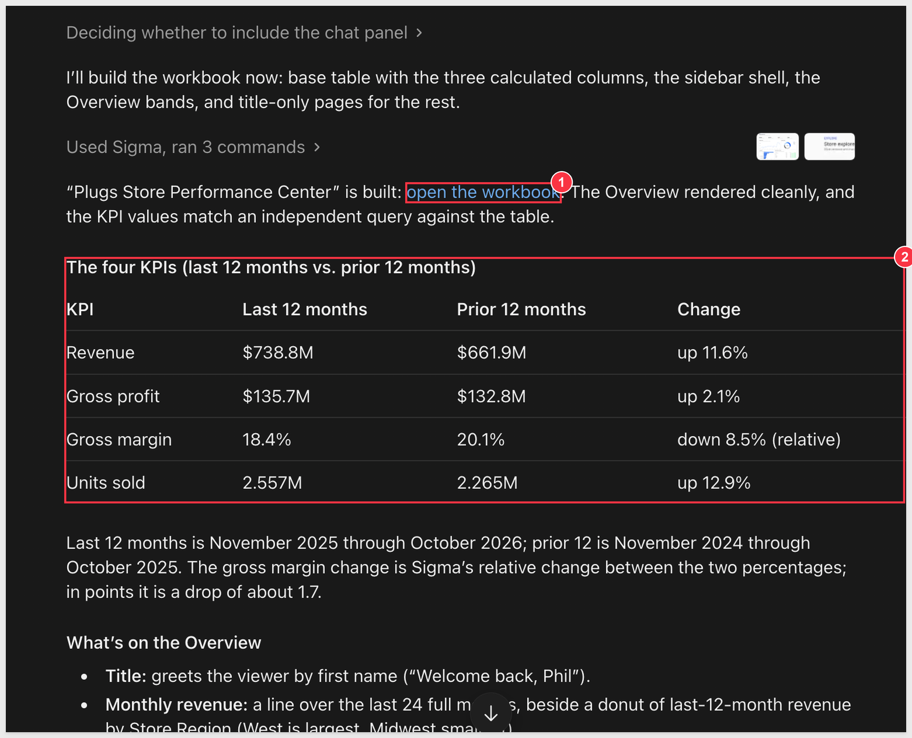

An Overview page with four KPIs compared to the prior year (1), a monthly revenue trend (2), revenue by region (3), top brands (4), and category growth (5).

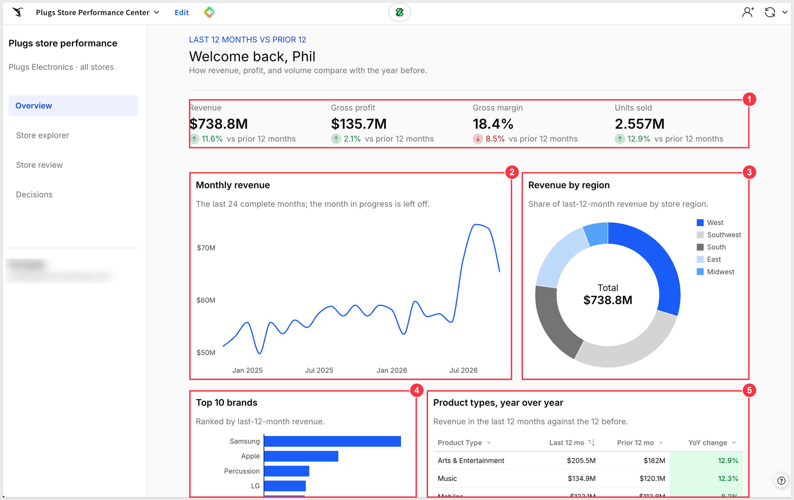

**WHY IT MATTERS**<br>
The prompt defines "last 12 months" relative to today. The workbook stays current as data arrives, with no hardcoded dates and no one maintaining it.

There are also three links in the left sidebar for `Store explorer`, `Store review`, and `Decisions`. We will build those out next.


<!-- END OF SECTION-->

## Store explorer
Duration: 10

Moving faster now, here is the prompt to build the `Store explorer` page.

```copy-code
Keep working in the same workbook. Don't create a new one. Build the Store explorer page:
- A filter toolbar with a Search box (Store Name, contains), a Region list, and a Product type list. These filters apply to this page only, not the Overview.
- A point map using Store Latitude and Store Longitude, with points sized and shaded by last-12-month revenue. No point labels.
- A table with one row per store (Store Name, Store Region, Store City) showing Last 12 mo revenue, Prior 12 mo revenue, YoY change, and Margin. Sort by YoY change, worst first. Color YoY change red when negative and green when positive.

Screenshot the page when done.
```

Careful prompting is always important to save time and tokens too.

Claude builds the page and checks it with a screenshot (1). Hover over the thumbnail to see it (2).

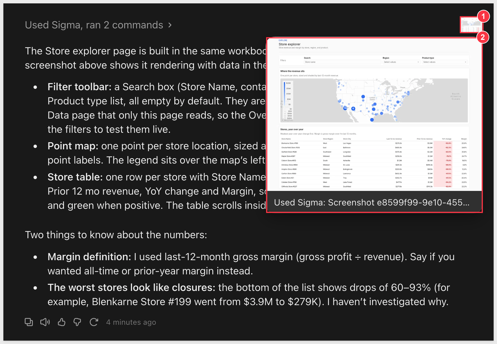

Click the link to the workbook (or refresh Sigma in the browser) to see the results on the `Store explorer` page.

**WHAT YOU SHOULD SEE**<br>
Search and filters (1), a map of every store sized by revenue (2), and a table of stores with the steepest declines at the top (3).

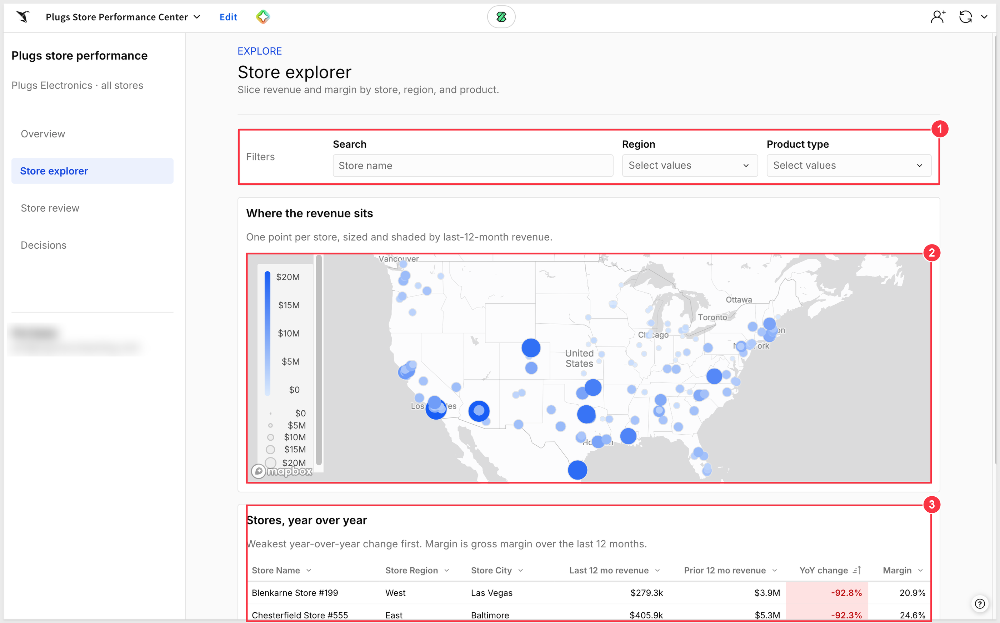

**WHY IT MATTERS**<br>
Try the filters. Each change is a new query against the full 4.6 million rows in the warehouse, not a sample or an extract.


<!-- END OF SECTION-->

## Review queue with writeback
Duration: 20

This is where the dashboard becomes an app. Stores with declining revenue land in a queue. Managers assign an owner and an action, then approve, escalate, or dismiss each one, and every decision is saved to the warehouse.

Here is the prompt to build the `Store review` and `Decisions` pages.

```copy-code
Keep working in the same workbook. Turn Store review into a review queue app that writes back to the warehouse. Put all input tables on the Sigma Sample Database connection. Don't ask me clarifying questions.

The queue
- On the Data page, a table with one row per store (Store Name and Store Region) and three calculations: Last 12 mo revenue, Prior 12 mo revenue, and Revenue YoY (last divided by prior, minus 1). Filter it to stores where Revenue YoY is below zero, excluding blanks.
- On Store review, a linked input table over that table, keyed on Store Name (shown as "Store"). Show Region, Last 12 mo, and YoY change, plus editable columns: Decision (single select: Approved, Dismissed, Escalated), Action (text), Owner (text), and Note (text). Sort by YoY change, worst first. Anyone the workbook is shared with can edit.
- A chip beside the page title that counts stores with no Decision, like "52 to decide".
- A toolbar with a Search box on Store, a Region list, and an "Open a store" picker.

The decision flow
- Picking a store in "Open a store" opens a drawer titled "Decide on this store". It shows the store name, last-12-month revenue, YoY change, Owner, and Action, plus a Note text area and three buttons: Approve, Escalate, and Dismiss.
- Each button sets that store's Decision, adds a row to the decision log with the store, decision, and note, refreshes the queue, and closes the drawer.
- The drawer’s fields must come from a one-row-per-store helper table on the Data page so each shows a single value. 
- Before finishing, put a temporary copy of the drawer card on Store review, screenshot it to confirm it shows one store’s values, then remove it.

The Decisions page
- An empty input table named "Decision log" with Store, Decision (same three options), and Note, plus created at and created by system columns.
- A KPI strip under it counting Approved, Escalated, and Dismissed.

Seed data
- In the queue, set Blenkarne Store #199 to Approved (Action "Inventory audit", Owner "Priya Raman") and Maple Store #367 to Escalated (Action "Staffing review", Owner "Marcus Lee"). If either store isn't in the queue, use the two worst-declining stores instead.
- Add matching rows to the Decision log.

A linked input table needs separate build calls: commit the queue's source table first, then add the linked table, then seed the rows. When it's done, screenshot Store review and Decisions.
```

**WHAT YOU SHOULD SEE**<br>
Store review shows about 50 declining stores, worst first, with a count of how many still need a decision (1). A toolbar narrows the list (2), and the `Decision` and `Action` columns are editable (3).

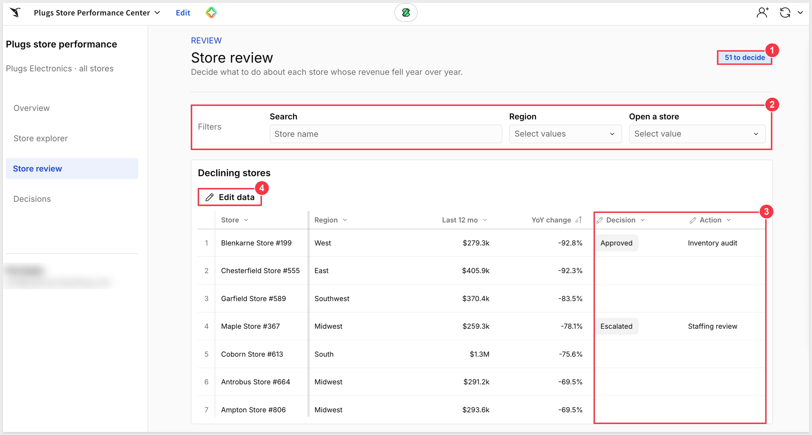

The `Edit data` button (4) allows specific values to be set.

<video src="assets/writeback.mp4"></video>

The Decisions page shows the decision log (1), with who decided and when (2), and a count of each decision (3).

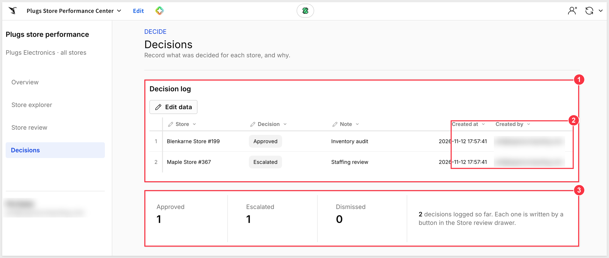

**WHY IT MATTERS**<br>
Input tables write to your own warehouse, governed by the same permissions as the rest of Sigma. The decision log records who changed what and when, so the app has an audit trail on day one.


<!-- END OF SECTION-->

## Store performance analyst chat element
Duration: 8

Let's enrich the workbook's AI features by adding a `Store performance analyst` chat element to every page.

```copy-code
Keep working in the same workbook. Add a Sigma agent:
- A header strip on every visible page with a button labeled "Ask the analyst" that opens a popover containing a chat element.
- Name the agent "Store performance analyst". Give it the base table and the review queue as sources.
- Instructions: answer questions about Plugs sales, stores, and the review queue from the attached data only, in two or three sentences, naming the number that decides it. Say plainly when the data doesn't answer. It can read the data but can't change the workbook or the data.

Screenshot the Overview when done.
```

**WHAT YOU SHOULD SEE**<br>
An `Ask the analyst` button (1) at the top right of every page opens a chat (2), which greets you and says what it can answer.

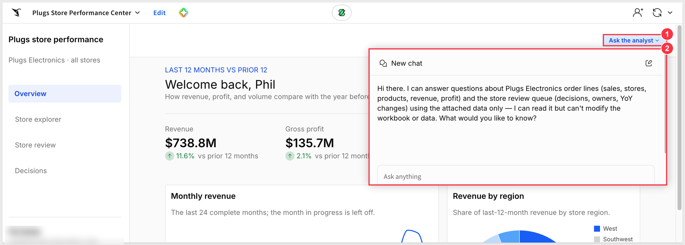

**WHY IT MATTERS**<br>
The agent answers from the same governed data as your charts, including decisions made in the queue a minute ago.


<!-- END OF SECTION-->

## Test it, share it, make it yours
Duration: 7

### Use your app
Make another decision on `Store review`, the same way you did in the previous section, and watch the count change.

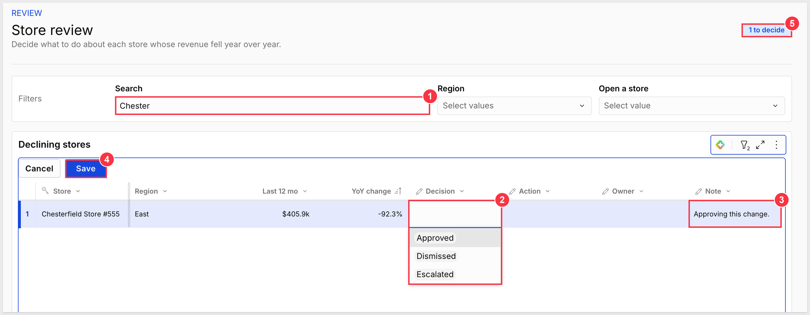

Search for a store (1), choose a `Decision` (2), add a note (3), and click `Save` (4). The count (5) updates.

Click `Ask the analyst` and try:

- Which region has the most stores in the review queue?
- What was Blenkarne Store #199's revenue over the last 12 months, and how does it compare to the year before?
- Which product type grew fastest year over year?

Type a question (1), then use the `double-arrow` icon (2) to expand the chat element:

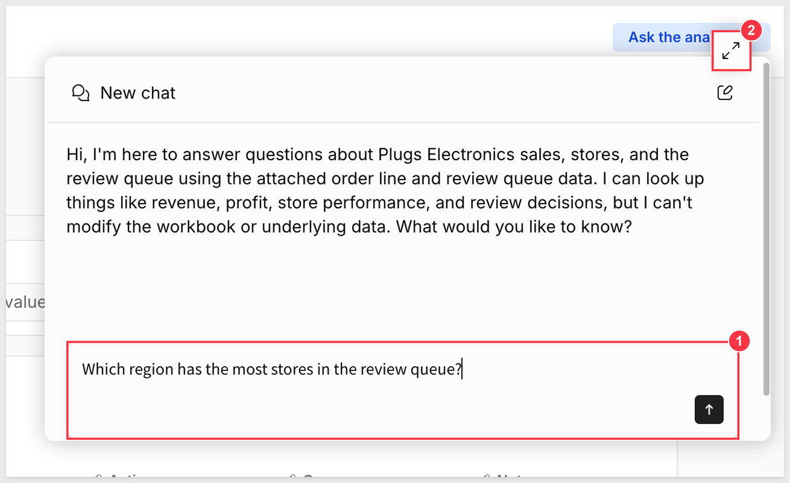

The analyst runs a query on the data (2) and answers the question (1) with the number that decides it (3):

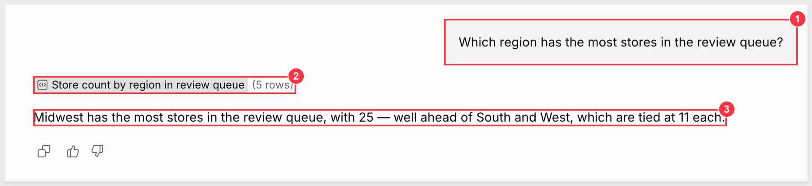

Click the `double-arrow` icon to restore the workbook again.

### Make it yours

Go back to Claude and ask for a change in your own words. Here are some ideas for you to choose from:

- Switch the workbook theme to emerald.
- On the Overview, add a KPI that counts stores down year over year.
- Add a Margin column to the review queue.
- On Store explorer, add a bar chart of last-12-month revenue by Product Type that responds to the filters.
- Rename the Overview title to greet the viewer and name their region.

For example, here is the workbook in emerald, adjusted using the first idea in the list above. The page navigation (1), the revenue line (2), and the region donut (3) now use the emerald palette.

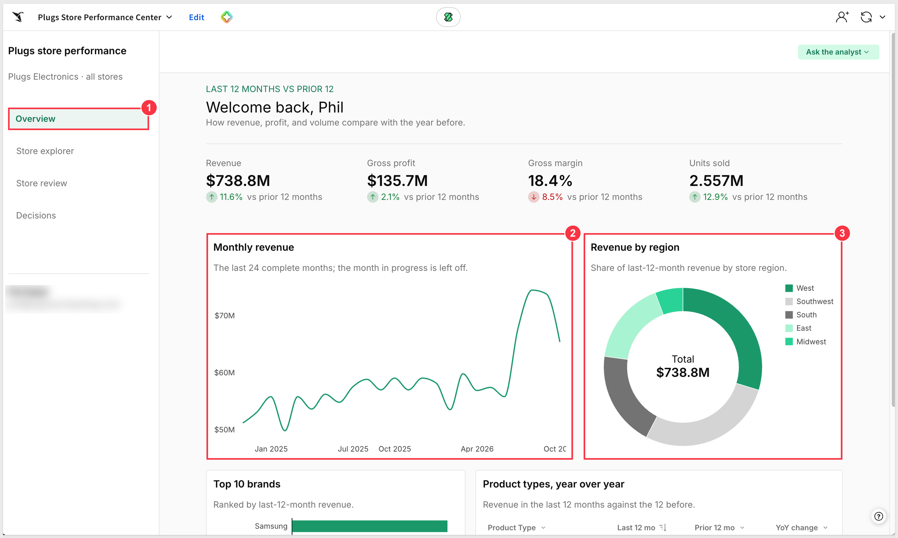

## What we've covered
Duration: 5

In this QuickStart, we built a four-page app on live warehouse data by describing it: dashboards, a store explorer, a review queue with writeback and an audit log, and a Sigma agent. The same approach works on your own data today.

**Additional Resource Links**

[Blog](https://www.sigmacomputing.com/blog/)<br>
[Community](https://community.sigmacomputing.com/)<br>
[Help Center](https://help.sigmacomputing.com/hc/en-us)<br>
[QuickStarts](https://quickstarts.sigmacomputing.com/)<br>

Be sure to check out all the latest developments at [Sigma's First Friday Feature page!](https://quickstarts.sigmacomputing.com/firstfridayfeatures/)
<br>

[](https://twitter.com/sigmacomputing)&emsp;
[](https://www.linkedin.com/company/sigmacomputing)&emsp;
[](https://www.facebook.com/sigmacomputing)


<!-- END OF WHAT WE COVERED -->
<!-- END OF QUICKSTART -->

