author: pballai
id: aiapps_find_and_interact_with_sigma_workbooks
summary: Run a small local MCP server so Claude Desktop can find a Sigma workbook by name and open it live and interactive in Claude's browser pane.
categories: aiapps
environments: web
status: Published
feedback link: https://github.com/sigmacomputing/sigmaquickstarts/issues
tags: default
lastUpdated: 2026-10-13

# Find and Interact with Sigma Workbooks in Claude Desktop

## Overview
Duration: 5

Sigma gives every user governed access to live data wherever they work, and the [Sigma MCP server](https://help.sigmacomputing.com/docs/use-sigma-mcp-server) extends that access into Claude. You can use the Sigma MCP server to locate data sources in your organization, explore and describe their contents, analyze your data, and save your analysis as a workbook without leaving the AI assistant’s interface.

This QuickStart takes it one step further. Instead of a table in response to a natural language question, Claude can show the workbook itself, live and interactive inside Claude, so you can filter, drill, and use its controls without leaving the conversation.

We will demonstrate how to run a small local MCP server that finds workbooks in your Sigma organization and opens them in Claude Desktop.

The steps involve configuring the code, connecting it to Claude Desktop, and using it with a workbook of our own.

Along the way you'll learn how to:
- Create one set of Sigma client credentials to list your workbooks and open them
- Configure and run a local MCP server that Claude Desktop can call
- Configure Claude to use the local server
- Find a workbook by name and open it live in Claude's browser pane
- Decide when this approach fits, compared with the other ways to connect Claude and Sigma

Sigma has many more [AI features](https://help.sigmacomputing.com/docs/getting-started-with-ai) but this QuickStart is focused on Claude for simplicity.

### Choosing a route
There are now several ways to connect Claude and Sigma, and while options are great to have, it can be hard to know which is best for the job at hand. Each one works differently, so the right one depends on what you want Claude to do, and your organization's policies too.

| Route | Use it when you want to | Keep in mind |
| --- | --- | --- |
| Sigma MCP server | Find, describe, and query your Sigma data in conversation. See [Natural Language Analytics with Claude and Sigma](https://quickstarts.sigmacomputing.com/guide/aiapps_natural_language_with_claude/index.html). | Runs as you, using OAuth. Returns answers and data in the chat rather than displaying a workbook. |
| Build with Claude | Describe a workbook or app and have Claude create or edit it in Sigma. | Runs as you, using OAuth. Requires a Build license. The result lives in Sigma, so you review and extend it there. |
| Send to Sigma | Prototype a live dashboard in Claude, then send the draft to Sigma to extend with forms, controls, Input Tables, Actions, and Sigma Agents. Read the [announcement](https://www.sigmacomputing.com/blog/claude-dashboards). | Runs as you, using OAuth. Requires a Build license with the OAuth permission enabled. The draft begins in Claude and is finished in Sigma. |
| Local MCP server (this QuickStart) | Find an existing workbook by name and use it live in Claude's browser pane, without opening Sigma yourself. | You run a small local server and keep your Sigma client credentials in a `.env` file. The browser pane is available in Cowork. Each workbook opens as the user you configure, not as whoever is asking. |

The first three authenticate each person with their own Sigma sign-in, so their existing permissions apply automatically. This QuickStart trades that for something different: the finished workbook, with all of its controls, appears in Claude. If you set the configured user to your own Sigma email, the workbook opens with your access.

<aside class="positive">
<strong>NOTE:</strong><br> The local server in this QuickStart is a learning and prototyping pattern. It runs on your machine with credentials in a local `.env` file, which keeps every moving part visible. For broader use, the same ideas are typically hosted as a central service that signs each person in and maps them to their own Sigma user.
</aside>

<aside class="negative">
<strong>IMPORTANT:</strong><br> Some screens in Sigma may appear slightly different from those shown in QuickStarts. This is because Sigma continuously adds and enhances functionality. Rest assured, Sigma's intuitive interface ensures that any differences will not prevent you from successfully completing any QuickStart.
</aside>

For more information on Sigma's product release strategy, see [Sigma product releases](https://help.sigmacomputing.com/docs/sigma-product-releases)

If something doesn't work as expected, here's how to [contact Sigma support](https://help.sigmacomputing.com/docs/sigma-support)

### Target Audience
Sigma customers who work in Claude and want to explore Sigma workbooks without leaving the conversation, and anyone demonstrating that experience to others. You don't need an existing embedded application. You should be comfortable running a Node.js project and editing a `.env` file.

### Prerequisites

<ul>
  <li>Administrator access to your Sigma environment, to create client credentials.</li>
  <li>Claude Desktop, with access to Cowork.</li>
  <li>Node.js 18 or later and Git installed locally.</li>
  <li>A workbook in your Sigma organization that you can open, to try it with.</li>
</ul>

<aside class="positive">
<strong>IMPORTANT:</strong><br> Sigma recommends using non-production resources when completing QuickStarts.
</aside>

<button>[Sigma Free Trial](https://www.sigmacomputing.com/free-trial/)</button>


<!-- END OF SECTION-->

## How it works
Duration: 5

There are three main things that make this work:

1. A local MCP server that we will clone from Git. This project gives Claude two tools: `search_workbooks` and `show_sigma_workbook`.
2. Claude Desktop starts the local server when it opens, using the path in `claude_desktop_config.json`, and then asks the server what it can do.
3. Sigma lists your workbooks through its REST API, and shows a workbook when it receives the workbook URL with a sign-in token, signed with your client credentials. Any workbook that the configured Sigma user can access can be opened.

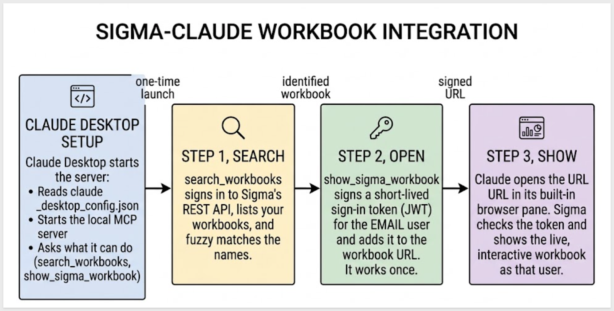

### What happens when you ask for a workbook
**Step 1: Claude searches**<br>
Claude calls `search_workbooks` with the words you used. The server signs in to Sigma's REST API, lists your workbooks a page at a time, and compares your words with each workbook's name and path using the Fuse.js library.

Here is how the matching works:
- The match is fuzzy, so typos, missing words, and a different word order are fine.
- It matches letters, not meaning, so an abbreviation like "P&L" won't find "Profit and Loss".
- The server returns the best matches, along with a flag that says whether one is clearly the right one.
- When several are close, the tool description tells Claude to ask which one you mean.
- If a search finds nothing, Claude can try different words.
- To make the matching stricter or looser, change the `threshold` in `lib/search.js`.

**Step 2: Claude opens it**<br>
Claude calls `show_sigma_workbook` with the workbook's slug, which is the last part of its URL. The server signs a short-lived sign-in token, called a JWT, that identifies the Sigma user in the `EMAIL` value of the `.env` file, and adds it to the workbook URL.

**Step 3: Claude shows it**<br>
Claude opens that URL in its built-in browser pane. Sigma checks the sign-in token and shows the live workbook as that user.

### Why the credentials need two capabilities
Sigma's embedding feature identifies a user with a signed token, the JWT, instead of a separate sign-in, so the credentials need `Embedding`. Listing workbooks to search them uses the REST API, so they also need `REST API`. One Client ID and Secret does both jobs, which leaves one secret to protect.

### Things to know about the sign-in token
- Each token is signed fresh and works once. Claude receives the workbook URL with the token in the tool result, so a short life and a single use keep it from being reused.
- The token carries only the identity of the Sigma user in `EMAIL`. Settings such as an account type, teams, or user attributes describe embed users, and Sigma rejects them for existing Sigma users.
- Search lists the workbooks your client credentials can see, while each workbook opens as the user in `EMAIL`. A result may not open if that user lacks access.

<aside class="positive">
<strong>WHY IT MATTERS:</strong><br> Sigma still does the work. The workbook is displayed by Sigma, as a real Sigma user, so its controls, data, and permissions behave as they do in Sigma. Claude receives workbook names and a single-use sign-in token, not the workbook's data.
</aside>


<!-- END OF SECTION-->

## Configure your credentials
Duration: 10

Client credentials (a unique client ID and secret) are how this project proves its identity to Sigma.

Sigma uses the client ID to determine which secret is referenced in a request. Each time a request is made, this project's server uses the secret to generate an encrypted signature.

This project uses one pair of client credentials for two jobs, so the credentials need both capabilities:

- `Embedding`: signs the JWT that opens each workbook.
- `REST API`: lets the server list your workbooks so Claude can search them.

Log into Sigma, navigate to `Administration`, and scroll down to `Developer Access`.

Click `Create New`:

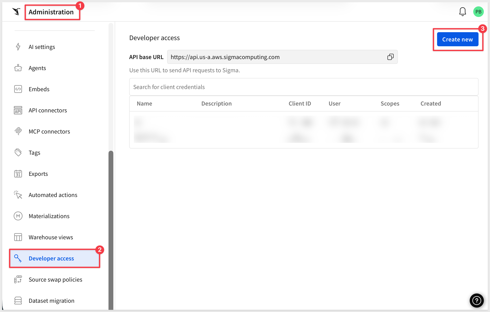

In the `Create client credentials` modal, select both `Embedding` and `REST API`, give it a name, and assign an administrative user as the owner.

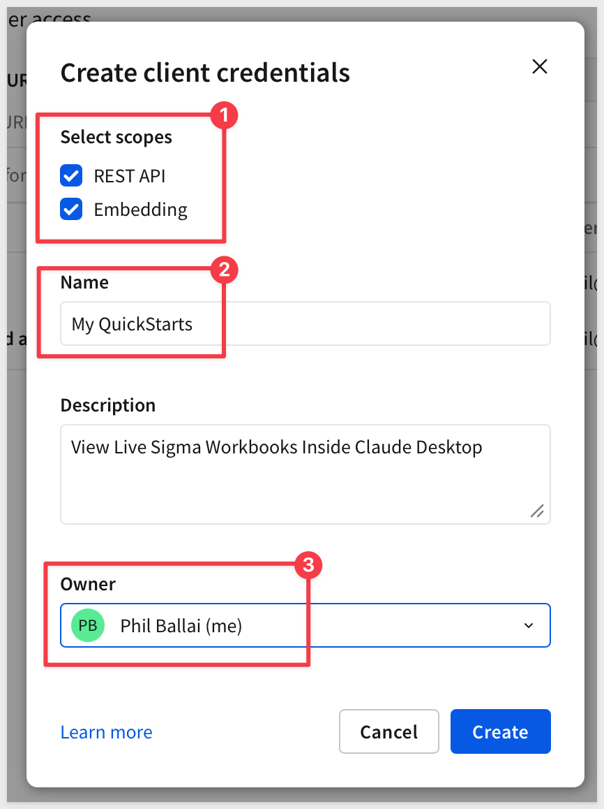

Click `Create`.

Copy both values to a secure location.

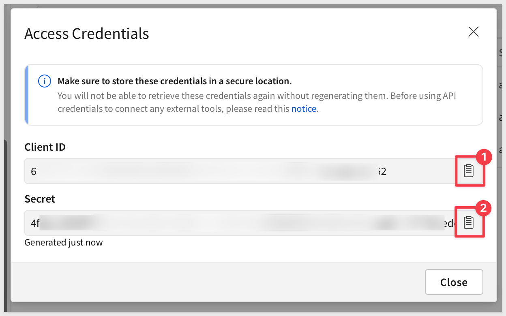

In a later step, you will paste them into the respective locations in the `.env` file, in the `Shared settings` grouping.

<aside class="positive">
<strong>IMPORTANT:</strong><br> For security purposes, Sigma provides a one-time view of the secret at the time of creation and does not display it again. Because the secret is non-retrievable, it's important that you store the secret securely when you create it.

If you lose the secret, or it becomes compromised, you can revoke it and generate a new one; however, this invalidates the previous secret and everything that uses it. When a new secret is generated, you must update every place that uses it.
</aside>


<!-- END OF SECTION-->

## Get the code
Duration: 10

### Clone the Git Repository Project Folder
We have made sample project code available in a public GitHub repository to save time.

While you may clone the entire repository (it is not that large), we want to avoid cloning portions of the repository that aren't immediately relevant.

Instead, we will use VSCode and terminal to perform a git `sparse-checkout` of the specific project folder we are interested in. This involves a few extra steps, but results in a cleaner local project folder.

Open `VSCode` and a new `Terminal` session.

Create a new directory in a location of your choice. For example:
```copy-code
mkdir sigma_quickstarts
```

Change to the new directory:
```copy-code
cd sigma_quickstarts
```

Execute the terminal command:
```copy-code
git init
```

Add the remote repository as the origin:
```copy-code
git remote add -f origin https://github.com/sigmacomputing/quickstarts-public.git
```

No errors should show.

Enable sparse checkout:
```copy-code
git config core.sparseCheckout true
```

Specify the folder you want to clone by adding it to the sparse-checkout configuration:
```copy-code
echo "claude-desktop-view-workbooks" >> .git/info/sparse-checkout
```

Pull the specified folder from the repository:
```copy-code
git pull origin main
```

<aside class="positive">
<strong>IMPORTANT:</strong><br> The next step requires Node.js 18 or later. If it has never been installed on your machine, install it from the official site:
</aside>

[Download Node.js](https://nodejs.org/)

We recommend installing the **LTS (Long Term Support)** version.

Once installed, you can verify the installation in Terminal with:
```copy-code
node -v
npm -v
```

Change directory to the new folder:
```copy-code
cd claude-desktop-view-workbooks
```

Finally, load node into the local project:
```copy-code
npm install
```

Open the `sigma_quickstarts/claude-desktop-view-workbooks` folder if not already open.

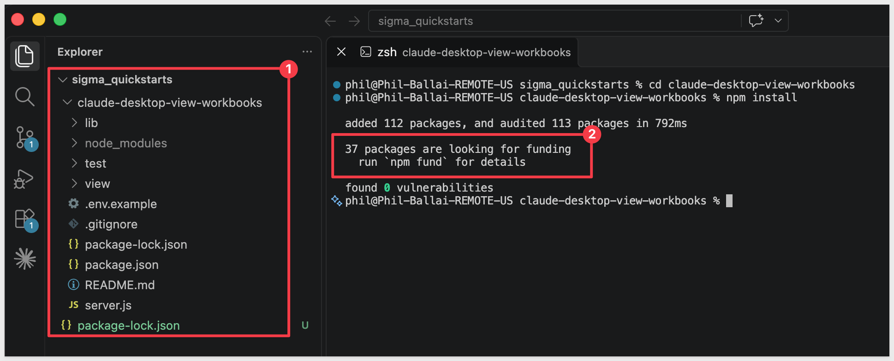

### Add your settings
The project reads its settings from a `.env` file. Create yours from the example file provided:
```copy-code
cp .env.example .env
```

Open the `.env` file in VSCode and update these values.

- Paste the `Client ID` and `Secret` from the previous section into `CLIENT_ID` and `SECRET`, in the `Shared settings` grouping.

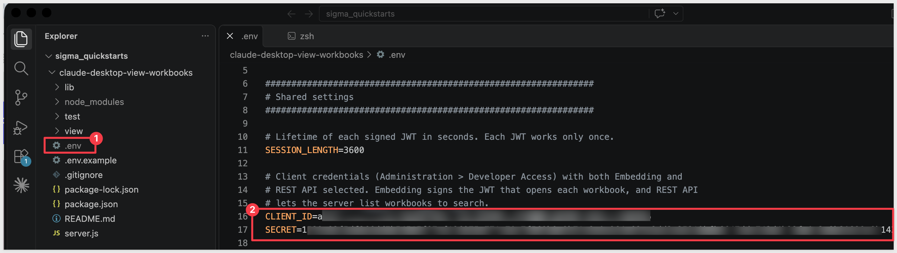

- Scroll down and update `EMAIL` with your own Sigma email address. Each workbook opens as this user, so Claude shows exactly what that user can see in Sigma. Search lists the workbooks your client credentials can see, so a result may appear that this user cannot open.
- Update `CLAUDE_DESKTOP_BASE_URL` with the URL of any workbook in your organization you have access to in Sigma. To do this, open the selected workbook in Sigma and copy the URL from the browser.
- Update `CLAUDE_DESKTOP_API_URL` with the `API base URL`. This can be found in Sigma under `Administration` > `Developer Access`.

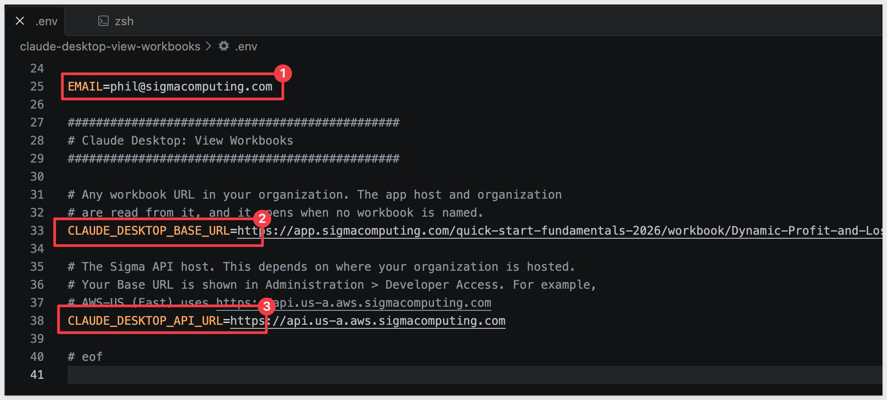

For more information, see [Identify your API request URL](https://help.sigmacomputing.com/reference/get-started-sigma-api#identify-your-api-request-url)

Leave the remaining settings as they are for now. The `.env` file holds your secret, so do not commit it or share it.

`Save` the changes to `.env`.

### Run the tests
The project includes tests that check the search, the sign-in tokens, and the connection to Claude without calling Sigma. Run them from the project folder:
```copy-code
npm test
```

Every test should pass:

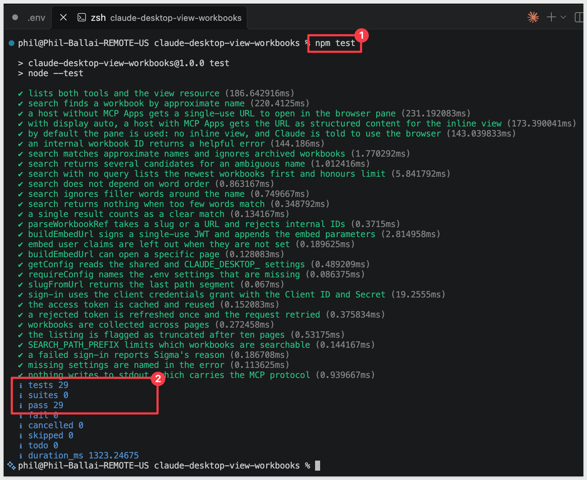


<!-- END OF SECTION-->

## Connect Claude Desktop
Duration: 10

The project you just set up is what lets Claude find a Sigma workbook by name and show it live. Registering it tells Claude Desktop where to find it.

Claude Desktop starts the server itself whenever it opens and asks what it can do, so there is nothing to keep running in a terminal.

### Find the full paths
Claude Desktop needs the full location of the server file and of Node.js.

In the VSCode terminal, in the project folder, run:
```copy-code
echo "$(pwd)/server.js"
```

Copy the result somewhere handy. This is the full path to `server.js`.

Then run:
```copy-code
which node
```

Copy this too. Claude Desktop is not started from your terminal, so it may not find `node` by name alone.

### Add the server to Claude Desktop
Open the Claude Desktop configuration file, `claude_desktop_config.json`.

In Claude Desktop, go to `Settings` (under your profile icon) > `Developer` and click `Edit Config`. This shows the folder that holds the file. Open it in a text editor.

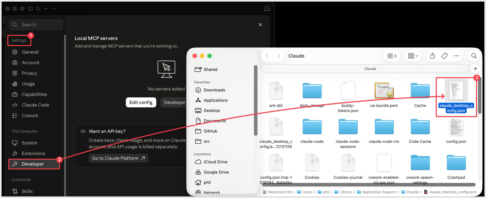

Near the top of the file, look for a line that reads `"mcpServers": {},`. Claude Desktop may already have added this empty section. Replace that line with this section, keeping the comma after the closing brace:
```copy-code
"mcpServers": {
  "sigma-workbooks": {
    "command": "{full path to node}",
    "args": ["{full path to server.js}"]
  }
},
```

Replace `{full path to node}` with the result of `which node`, and `{full path to server.js}` with the result of the `echo` command.

<aside class="positive">
<strong>IMPORTANT:</strong><br> If you do not see an `mcpServers` line, paste the section on a new line right after the first `{` at the top of the file, and keep the comma after it. The server must be in the top-level `mcpServers` section, so do not add a second `mcpServers` section, do not paste a second set of outer braces, and do not remove your existing settings. The file must remain valid JSON, or Claude Desktop will not read it.
</aside>

The top of the file should look like this, starting with the file's own opening `{`:
```
{
  "mcpServers": {
    "sigma-workbooks": {
      "command": "/opt/homebrew/bin/node",
      "args": ["/Users/{your user name}/sigma_quickstarts/claude-desktop-view-workbooks/server.js"]
    }
  },
  ...your other settings
```

For example:

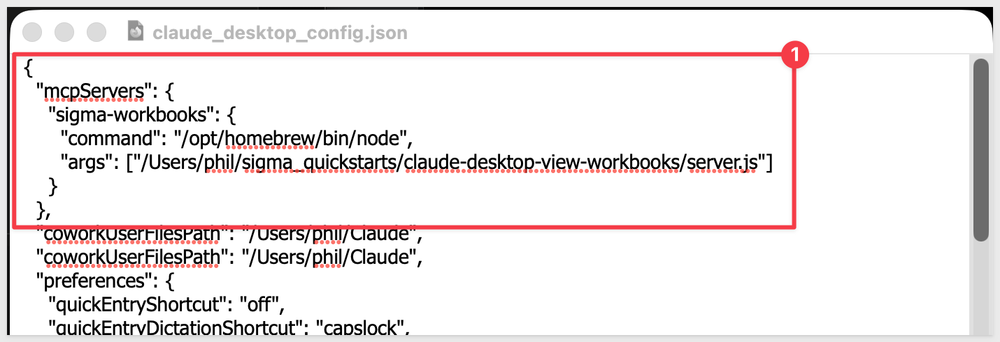

`Save` the file.

### Restart and confirm
**Fully quit Claude Desktop**, rather than only closing its window, and open it again. Claude Desktop reads the file when it starts.

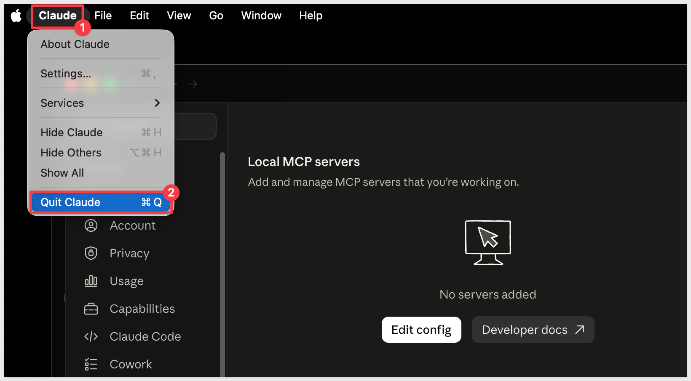

Go to `Settings` > `Developer`. The `sigma-workbooks` server should be listed as `Running`.

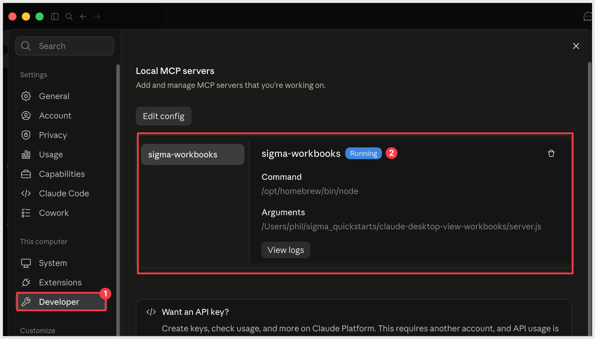

<aside class="negative">
<strong>NOTE:</strong><br> If `sigma-workbooks` shows an error or does not appear, check the two paths in the file and that the JSON is valid.
<br><br>
The server reads the `.env` file only when Claude Desktop starts it, so quit and reopen Claude Desktop after any change to that file. The server starts even if your `.env` file is incomplete. A missing setting is reported the first time you ask for a workbook.
</aside>

To see what Claude Desktop reports about the server, check its logs. They are in the `Library` folder inside your home folder, which is hidden by default. In Finder, choose `Go` > `Go to Folder` and paste this path. The log files start with `mcp`:
```copy-code
~/Library/Logs/Claude
```


<!-- END OF SECTION-->

## Find and open a workbook
Duration: 10

With the server connected, you can ask Claude for a workbook by name and work with it right where you are, without opening Sigma yourself.

### Start a Cowork session
Claude will open the Sigma workbook in its built-in browser pane, which is available in `Cowork`.

In Claude Desktop, open a new chat and select `Cowork` next to the message box.

Cowork asks you to approve what Claude does. To save steps, you can select `Automatically approve`. If you prefer to review each action, leave it on `Manually approve`.

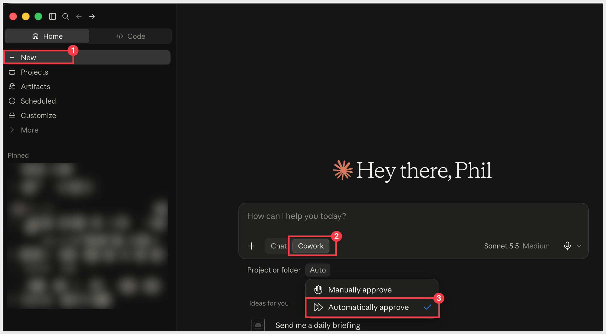

### Ask for a workbook
Ask for one of your workbooks by name. Replace `{workbook name}` with the name of a workbook you can open in Sigma:
```copy-code
Show me the {workbook name} in Sigma
```

Claude searches for the workbook, then asks the server to open it. Claude may ask for permission to use the browser on Sigma. Allow it.

Claude opens the workbook in the browser pane, beside the conversation. For example (expand the video and click the play button):

<video src="assets/final1.mp4"></video>

The workbook is live, so you can use its controls the way you would in Sigma. Of course, you can also ask Claude to make changes to the workbook.

<aside class="negative">
<strong>NOTE:</strong><br> Each sign-in token the server creates works once. If the pane shows an error that the JWT has already been used, ask Claude to open the workbook again to get a new token.
<br><br>
If Sigma reports that it cannot update an account type, teams, or user attributes for internal users, remove `ACCOUNT_TYPE`, `TEAMS`, and any user attribute settings from your `.env` file, then quit and reopen Claude Desktop.
<br><br>
If Claude says it cannot open a browser, check that you are in a `Cowork` session and not a `Chat` session.
</aside>


<!-- END OF SECTION-->

## What we've covered
Duration: 5

As mentioned in the Overview section, there are many ways to interact with Sigma from Claude; one size does not fit all. Some users want to never leave the Claude Desktop interface.

To accomplish that, we used a small local MCP server to find a workbook by name and open it, live and interactive, in Claude's browser pane. Instead of a table of results, we had the real workbook beside the conversation, running as our own Sigma user, so it showed what that user is permitted to see.

What you can reuse:
- Two small tools that work together: one finds a workbook by name, and the other opens it.
- Because they are separate, Claude can ask which workbook you mean before it opens anything.
- The same pattern works for any content you can look up by name and open by its URL.
- One Sigma client credential does both jobs, so there is a single secret to protect.
- Each sign-in token works once, so it can't be reused.

Keep in mind as you adapt it:
- An existing Sigma user needs only an identity in the token.
- Search lists what the client credentials can see, while each workbook opens as the configured user, so a result may not open if that user lacks access.
- The server reads its settings when Claude Desktop starts it, so restart after a change to the `.env` file.

Locking this down further, such as limiting what the configured user can open, is outside the scope of this QuickStart, but Sigma can support that too.

**Additional Resource Links**

[Blog](https://www.sigmacomputing.com/blog/)<br>
[Community](https://community.sigmacomputing.com/)<br>
[Help Center](https://help.sigmacomputing.com/hc/en-us)<br>
[QuickStarts](https://quickstarts.sigmacomputing.com/)<br>

Be sure to check out all the latest developments at [Sigma's First Friday Feature page!](https://quickstarts.sigmacomputing.com/firstfridayfeatures/)
<br>

[](https://twitter.com/sigmacomputing)&emsp;
[](https://www.linkedin.com/company/sigmacomputing)&emsp;
[](https://www.facebook.com/sigmacomputing)


<!-- END OF WHAT WE COVERED -->
<!-- END OF QUICKSTART -->
