author: pballai
id: developers_layout_composer
summary: developers_layout_composer
categories: developers
environments: web
status: Published
feedback link: https://github.com/sigmacomputing/sigmaquickstarts/issues
tags: default
lastUpdated: 2026-10-22

# Layout Composer: Governed Self-Service Layouts with Workbook as Code

## Overview
Duration: 5

Sigma lets teams define their data once and put governed content in front of everyone who needs it. Many teams that use Sigma, including those that embed it in their own application, want their users to stay in that application instead of moving into Sigma to build their own views.

Workbook as code makes that possible. A workbook's elements and layout become a specification that an application can read, change and write back through the API, so the application can offer self-service layouts while Sigma continues to supply the governed data and the elements.

This QuickStart demonstrates that with a Layout Composer. We will build a small library of Sigma elements, then an application where users choose elements, place them in zones on a canvas, and generate a real Sigma workbook from their selections. The workbook displays in a single view, is regenerated in place as the layout changes, and can be saved by the user as their own.

Along the way you'll learn how to:
- Build a governed data model and an element library workbook that act as the source of reusable elements
- Read a workbook specification and rewrite its layout with workbook as code
- Create and update a workbook in place through the REST API
- Display the generated workbook with a signed embed URL
- Let users save copies of the generated workbook as their own and switch between them

This design is extensible into more areas, for example:
- More element types, such as maps, pivot tables, controls and chat or agent elements
- More layouts and multi-page workbooks
- Saved layouts for each user, using each user's own identity in the signed token
- Starting points by role, such as pre-composed layouts for sales or finance users
- Scheduled exports or sharing of a saved workbook
- Use outside embedding, as a page in an internal portal


<aside class="positive">
<strong>IMPORTANT:</strong><br> Some screens in Sigma may appear slightly different from those shown in QuickStarts. This is because Sigma continuously adds and enhances functionality. Rest assured, Sigma's intuitive interface ensures that any differences will not prevent you from successfully completing any QuickStart.
</aside>

For more information on Sigma's product release strategy, see [Sigma product releases](https://help.sigmacomputing.com/docs/sigma-product-releases)

If something doesn't work as expected, here's how to [contact Sigma support](https://help.sigmacomputing.com/docs/sigma-support)

### Target Audience
Developers who want to let their users assemble their own Sigma workbooks from approved elements, inside an application they control.

### Prerequisites

<ul>
  <li>Any modern browser is acceptable.</li>
  <li>Access to your Sigma environment, with permission to create teams and client credentials.</li>
  <li>Some familiarity with Sigma is assumed. Not all steps will be shown, as the basics are assumed to be understood.</li>
  <li>Microsoft VSCode or other suitable development tool.</li>
  <li>Git and Node.js (LTS) installed.</li>
 </ul>

<aside class="positive">
<strong>IMPORTANT:</strong><br> Sigma recommends using non-production resources when completing QuickStarts.
</aside>

<button>[Sigma Free Trial](https://www.sigmacomputing.com/free-trial/)</button><br>

<button>[Download Visual Studio Code](https://code.visualstudio.com/download)</button>

<aside class="negative">
<strong>IMPORTANT:</strong><br> Some features may carry a "Beta" tag. Beta features are subject to quick, iterative changes. As a result, the latest product version may differ from the contents of this document.
</aside>


## Create the Data Model
Duration: 10

Every element a user can place on the canvas needs to answer to the same trusted definition of the data. A Sigma [data model](https://help.sigmacomputing.com/docs/get-started-with-data-modeling) gives us that: one governed place where `Sales`, `COGs` and `Profit` are defined once, so every element we build, and every workbook the application generates later, calculates them the same way.

### Create the model
From the Sigma homepage, click `Create new` > `Data model`.

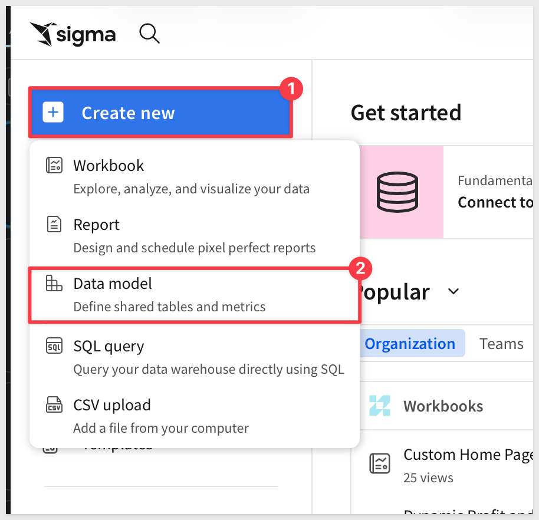

Add a table from the `Element bar` > `Data` group, search for:
```copy-code
PLUGS_ELECTRONICS_HANDS_ON_LAB_DATA
```

Select the table from the `Sigma Sample Database` > `RETAIL` schema.

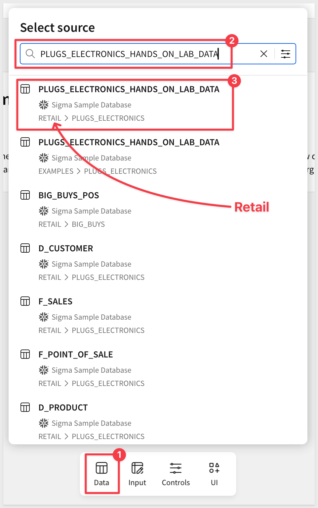

<aside class="negative">
<strong>NOTE:</strong><br> Sigma administrators may elect to disable access to the Sigma Sample Database for their instance. It is enabled by default in all trials.
</aside>

Rename the table to:
```copy-code
Plugs Sales
```

### Add calculated columns
The source table has `Price`, `Quantity` and `Cost`, but not the measures our elements will need. We add them here, once, instead of in every element.

Add four new columns. Rename each as shown, then enter its formula in the formula bar:

Column name: `Sales`
```copy-code
[Price] * [Quantity]
```

Column name: `COGs`
```copy-code
[Quantity] * [Cost]
```

Column name: `Profit`
```copy-code
[Sales] - [COGs]
```

Column name: `Profit Margin`
```copy-code
[Profit] / [Sales]
```

Set `Profit Margin` to a `%` format, and `Sales`, `COGs` and `Profit` to a currency format.

Finally, add a month column for trend charts and rename it:
```copy-code
Month
```

The formula is:
```copy-code
Month([Date])
```

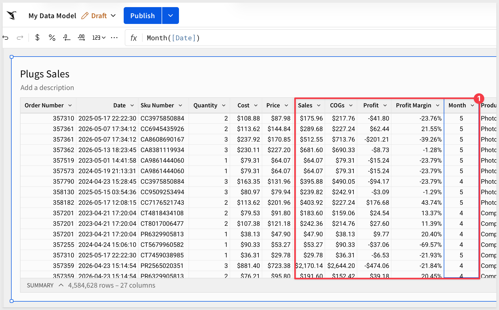

### Save the model
Save the data model with the name:
```copy-code
Layout Composer Data
```

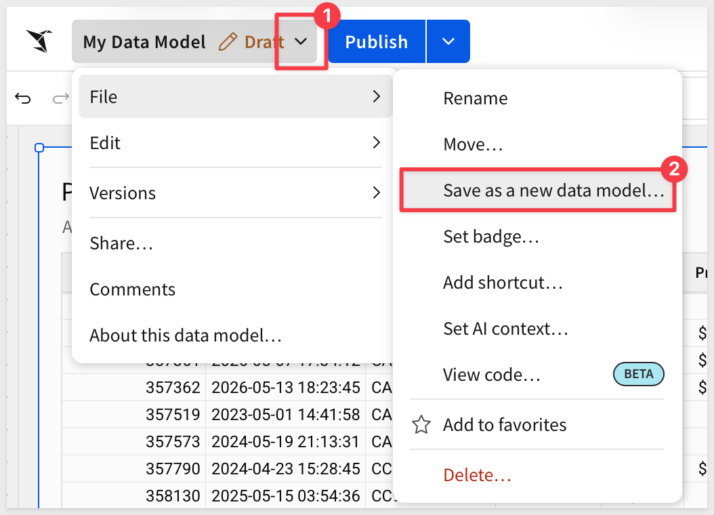

<aside class="positive">
<strong>NOTE:</strong><br> The workbooks our application generates will use this data model as their source. The Sigma user or API client that creates them needs at least view access to it. If you created it under the Admin role for this QuickStart, that is not an issue.
</aside>


<!-- END OF SECTION-->

## Build the Element Library
Duration: 15

With the data model in place, we can build the elements users will choose from. We keep them together in a single workbook that acts as the application's library: build each element once in Sigma, and the application allows new workbooks to be assembled from those same elements.

### Create the library workbook
Create a new workbook, rename the first page to `Library`, and save it as:
```copy-code
Layout Composer Library
```

Add a second page named `Source`. 

From the `Element bar` > `Data` group, add a `Table` to it and set its source to the `Layout Composer Data` data model, using the `Plugs Sales` table. 

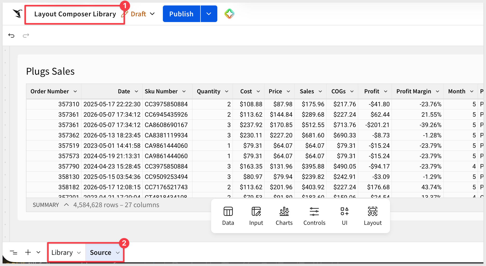

The library elements below use this table as their source, and keeping it off the `Library` page leaves that page for the elements users will choose from.

### Name elements for the picker
The name we give each element here is the label users will see in the application's element picker. Name them the way you want them displayed, but keep them short.

The application builds its element list by reading the first page of this workbook, so any element you place on that page appears in the application automatically. The `Source` page is never listed.

<aside class="positive">
<strong>NOTE:</strong><br> Pay attention to element sizes as you build. A KPI suits a small zone, while charts and tables need more room. Keep tables to a handful of columns so they stay readable when a user places them in a narrower zone.
</aside>

### Add a KPI
Add a `KPI` element to the `Library` page, using the `Plugs Sales` table on the `Source` page as its source. Style the elements any way you see fit. Apart from the size of each element, the layout here does not matter.

Configure it in the `Element panel`:
- Value: `Sum of Sales`

- Title: 

```copy-code
Total Sales
```

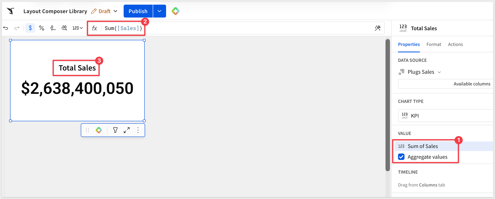

### Add a second KPI
Add another `KPI` element, using the `Plugs Sales` table on the `Source` page as its source.

Configure it in the `Element panel`:
- Value: `Average of Profit Margin`
- Title: 

```copy-code
Profit Margin
```

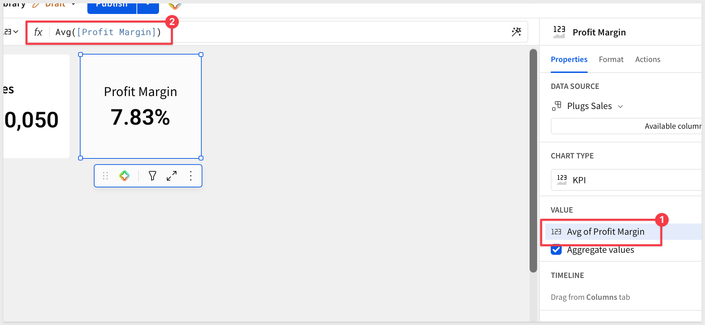

### Add a bar chart
Add a `Bar` chart element, using the `Plugs Sales` table on the `Source` page as its source.

Configure it in the `Element panel`:
- X-axis: `Store Region`
- Y-axis: `Sum of Sales`
- Title:

```copy-code
Sales by Store Region
```

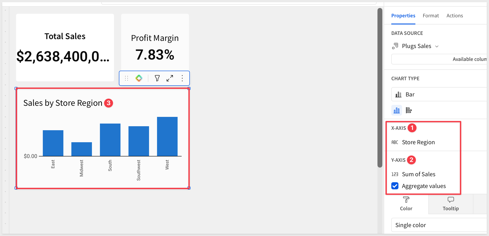

### Add a line chart
Add a `Line` chart element, using the `Plugs Sales` table on the `Source` page as its source.

Configure it in the `Element panel`:
- X-axis: `Month`
- Y-axis: `Sum of Sales`
- Title:

```copy-code
Sales by Month
```

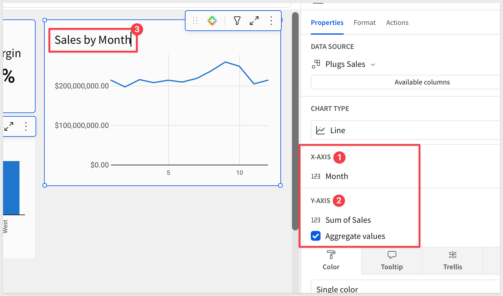

### Add a table
Tables are among the most common elements, so we include one. Add a `Table` element to the `Library` page, using the `Plugs Sales` table on the `Source` page as its source.

Show only these columns and hide the rest: `Store Region`, `Month`, `Quantity`, `Sales` and `Profit`.

Rename the table:
```copy-code
Sales Detail
```

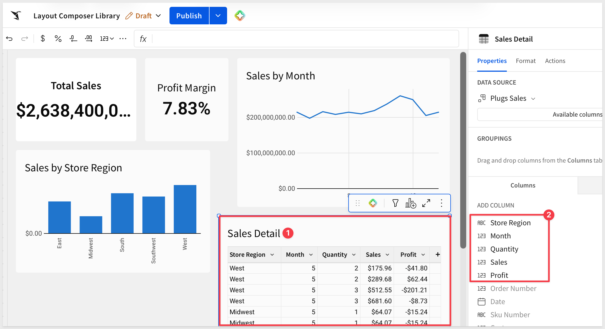

Five elements are enough to demonstrate the approach, and the application works the same way with more.

`Publish` the workbook.


<!-- END OF SECTION-->

## Prepare Embed Access
Duration: 5

The generated workbooks display for an embed user, so Sigma needs two things ready first: a team the embed user belongs to, and a folder where the application creates workbooks that the team can view. Granting access once, at the team level, means every workbook the application creates or updates is visible to the embed user without any per-workbook sharing steps.

### Create the team
Navigate to `Administration` > `Teams` and click `Create team`. Name the team:
```copy-code
Embed_Users
```

### Create and share the folder
In `Your Documents`, create a new folder named:
```copy-code
Layout-Composer
```

From the folder's menu, select `Share`, add the `Embed_Users` team with `Can view` permission, and save.

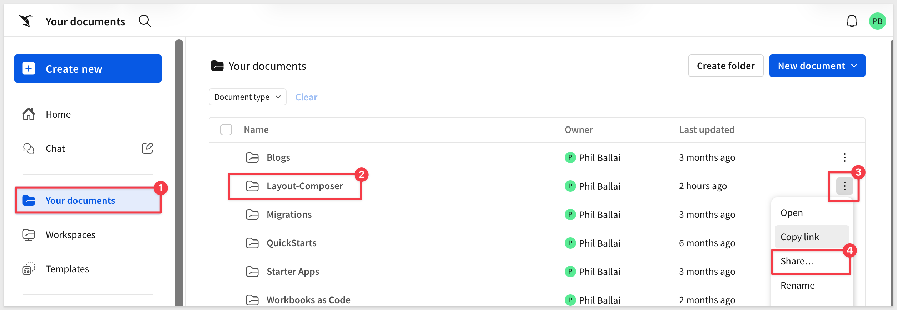

<aside class="positive">
<strong>NOTE:</strong><br> There is no embed user to create. Sigma creates the embed user automatically the first time the application loads an embedded workbook for the email we configure later, and places the user in the team named in the signed token.
</aside>


<!-- END OF SECTION-->

## Set Up the Local Project
Duration: 10

The application is a small Node.js project that talks to Sigma's REST API, so the same governed library we just built can be assembled into new workbooks by code. Sigma does the heavy lifting; the project only decides which elements go where.

The sample application runs standalone here so we can focus on the pattern. In practice, it is intended to be one page inside your own application, such as an embedded analytics product, an internal portal or any other web application your users already work in. Your application owns the sign-in and the experience around it, while Sigma supplies the governed data, the elements and the rendering.

The details of how it all works are covered in the `How It Works` section.

### Clone the project
The sample code is in a public GitHub repository. Rather than cloning the entire repository, we use a `sparse-checkout` to pull only the project folder we need, which keeps the local folder clean.

<aside class="positive">
<strong>IMPORTANT:</strong><br> This step requires Git and Node.js. If either is missing, install them first. We recommend the Node.js `LTS (Long-Term Support)` version.

[Download Node.js](https://nodejs.org/)

You can verify both are installed from a terminal with `git --version` and `node -v`.
</aside>

Open `VSCode` and start a new `Terminal` session.

Create a new directory in your preferred location:
```copy-code
mkdir sigma_quickstarts
```

Change to the new directory:
```copy-code
cd sigma_quickstarts
```

Initialize an empty Git repository:
```copy-code
git init
```

Add the QuickStarts repository as the origin:
```copy-code
git remote add -f origin https://github.com/sigmacomputing/quickstarts-public.git
```

Enable sparse checkout:
```copy-code
git config core.sparseCheckout true
```

Specify the project folder to pull:
```copy-code
echo "layout_composer" >> .git/info/sparse-checkout
```

Pull the folder from the repository:
```copy-code
git pull origin main
```

Change into the project folder:
```copy-code
cd layout_composer
```

Install the project dependencies:
```copy-code
npm install
```

In VSCode, click `Open Folder`, locate the `layout_composer` folder and click `Open`. The project structure should look like this:

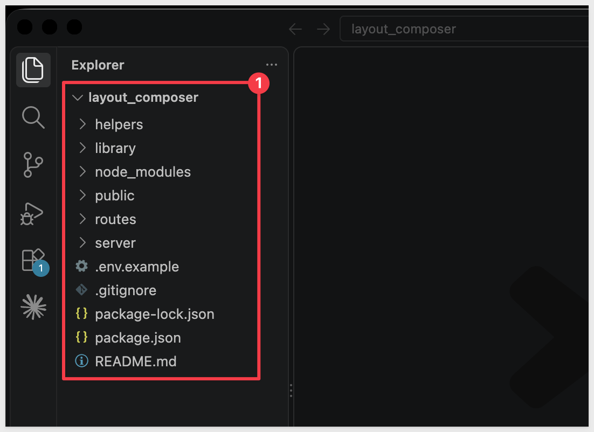

Here is what each part of the project is for:
- `server/` starts the Express server and serves the application
- `routes/` holds the API endpoints the application calls
- `helpers/` holds the code that talks to Sigma, including the code that builds the workbook specification
- `library/` holds a reference copy of the element library's specification
- `public/` holds the canvas page, styles and element icons that run in the browser

### Create client credentials
The application calls Sigma's REST API to read the element library and create the generated workbook, and signs the embed URL for the embedded view. Both need client credentials.

In Sigma, navigate to `Administration` > `Developer Access` and click `Create New`. 

Select both the `REST API` and `Embedding` checkboxes, provide a name, and assign an administrative user as the owner. Click `Create`.

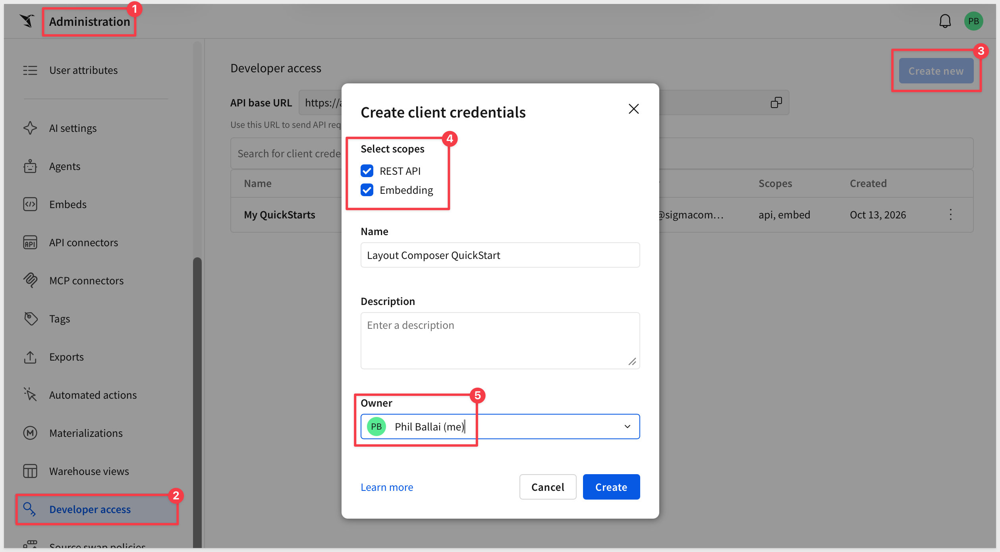

<aside class="negative">
<strong>IMPORTANT:</strong><br> Sigma shows the embed secret one time only, at creation. Store it securely before closing the dialog. If it is lost, revoke the credentials and create new ones.
</aside>

If you completed REST API Usage 01: Getting Started, you can reuse the same client credentials.

### Configure the environment file
The project reads its settings from a `.env` file that is never committed to Git. Create it from the provided example.

In the terminal, from the `layout_composer` folder:
```copy-code
cp .env.example .env
```

Open `.env` and set the following values:
- `SIGMA_BASE_URL`: the API host for your Sigma cloud, for example `https://api.us-a.aws.sigmacomputing.com`
- `CLIENT_ID`: the client ID from the previous step
- `SECRET`: the secret from the previous step

For more information, see [Identify your API request URL](https://help.sigmacomputing.com/reference/get-started-sigma-api#identify-your-api-request-url)

Next, tell the application where the element library is and where to create the generated workbook. Both IDs can be copied straight from the browser address bar in Sigma, so there is nothing to look up.

Open the `Layout-Composer` folder and copy the ID at the end of the browser URL (the text after the last hyphen) into `TARGET_FOLDER_ID`.

<aside class="negative">
<strong>IMPORTANT:</strong><br> Confirm that the folder name `Layout-Composer` is shown at the top of the page before you copy the ID. The URL for the top level of `Your Documents` looks almost the same, and if its ID is used, the generated workbook is created where `Embed_Users` cannot see it and the embedded view reports that you do not have permission to access the page.
</aside>

Open the `Layout Composer Library` workbook and copy the ID at the end of its URL the same way into `LIBRARY_WORKBOOK_ID`. For example, in `.../workbook/Layout-Composer-Library-n31S7AbQwMsxpOY93hRom` the ID is `n31S7AbQwMsxpOY93hRom`.

Then, set `ORG_SLUG` to your organization's slug. It is the text immediately after `https://app.sigmacomputing.com/` in the browser. For example, if the URL is `https://app.sigmacomputing.com/quick-starts-fundamentals`, the slug is `quick-starts-fundamentals`.

Set the embed user settings:
```copy-code
EMBED_EMAIL=layout_composer@example.com
EMBED_ACCOUNT_TYPE=View
EMBED_TEAMS=Embed_Users
```

For example:

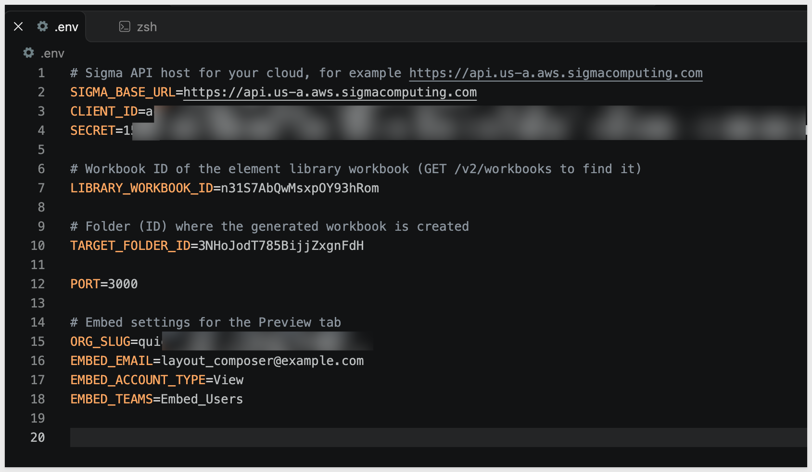

<aside class="positive">
<strong>SECURITY NOTE:</strong><br> The `.env` file contains secrets. The project's `.gitignore` already excludes it, so it will not be committed, but double-check this before pushing any fork of the project to a public repository.
</aside>


<!-- END OF SECTION-->

## Run the Application
Duration: 10

With the project configured, we can run the application and compose a first layout. The page is intentionally simple: the library's elements on one side, a canvas on the other, and one button that turns the arrangement into a workbook.

Start the server in the terminal, from the `layout_composer` folder:
```copy-code
npm start
```

The server is ready when it displays: `Server listening at http://localhost:3000`.

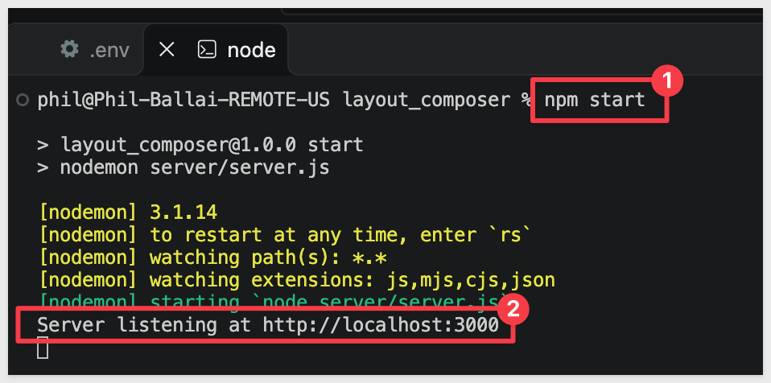

Browse to the application:
```copy-code
http://localhost:3000
```

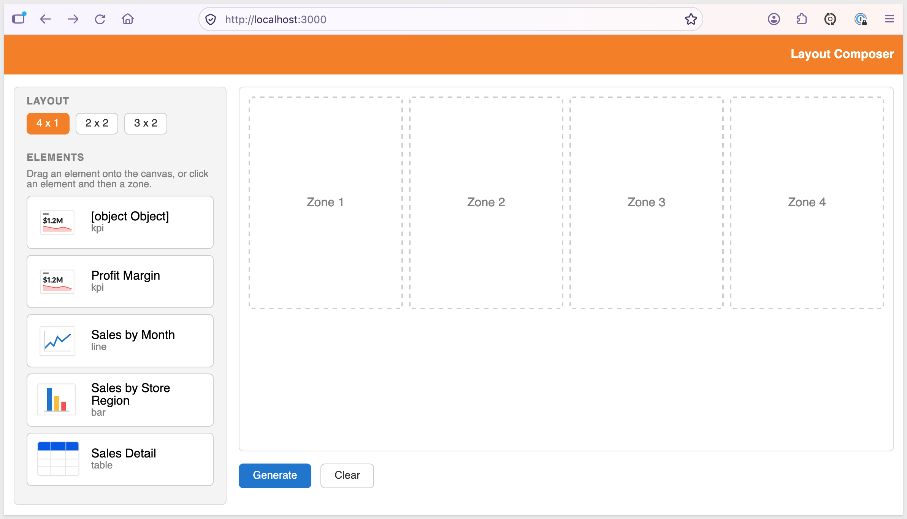

### Choose a layout
The three layout buttons set the canvas:
- `4 x 1`: four zones in one row
- `2 x 2`: two rows of two zones
- `3 x 2`: two rows of three zones

Changing the layout clears any placements.

### Place elements
The `Elements` list shows every element on the library workbook's first page. Place an element by dragging it onto a zone, or by clicking the element and then clicking a zone.

An element can be placed once. Moving it to another zone clears its previous zone, the `x` in a zone removes it, and `Clear` resets the canvas. Zones can stay empty; only filled zones appear in the generated workbook.

<video src="assets/place1.mp4"></video>

<aside class="positive">
<strong>NOTE:</strong><br> The element list is read from the library workbook when the page loads. Add an element to the library page in Sigma, refresh the application, and it appears in the list.
</aside>


<!-- END OF SECTION-->

## Generate the Workbook
Duration: 10

Placing elements arranges a plan on the canvas. `Generate` turns that plan into a real Sigma workbook, so the result is native and governed, built from the same elements and definitions we prepared earlier.

Click `Generate`. 

The status line reports `Workbook created.` the first time and `Workbook updated.` after that, and the page switches to the result: the generated workbook displayed in a single embedded view.

<video src="assets/generate1.mp4"></video>

The workbook has one visible page, `Layout Composer`. Any supporting page the elements depend on, such as `Source`, is marked hidden.

<aside class="positive">
<strong>NOTE:</strong><br> The first time an embedded workbook loads, Sigma creates the embed user. If the view is slow to appear on that first load, give it a moment.
</aside>

### Iterate on the layout
Click `Back to layout`, change the layout or move elements, and click `Generate` again. The application updates the same workbook in place rather than creating a new one each time, so users can refine a layout as many times as they like without cluttering Sigma.

<aside class="negative">
<strong>IMPORTANT:</strong><br> The application creates and manages a workbook named `Layout Composer Result` in the `Layout-Composer` folder. It is not something you create, and it is not a permanent workbook, because every Generate overwrites it. If it is deleted or archived, the next Generate creates a new one.
</aside>

**WHY IT MATTERS:**<br>
Users build the view they need without anyone writing a workbook for them, and because every element comes from the governed library, what they compose inherits the same data definitions and permissions as everything else in Sigma.


<!-- END OF SECTION-->

## Save and Switch Workbooks
Duration: 10

A generated workbook is a working copy that the next Generate overwrites. To keep a layout, users save a copy as their own and return to it later.

### Save a workbook
In the result view, enter a name and click `Save as my workbook`. The status line confirms `Saved as "{name}".` and the name box clears, ready for the next save.

The copy is placed in the embed user's `Your Documents`. It is a separate workbook, so later Generates do not change it.

<aside class="positive">
<strong>NOTE:</strong><br> Embed users do not need to know where their workbooks are stored in Sigma, because they never see the Sigma interface. They reach their saved workbooks through your application. Sigma administrators can still access the workbooks users create, which is useful for troubleshooting and support.
</aside>

### Switch between saved workbooks
Once at least one workbook is saved, the `Saved Workbooks` list appears at the top left of the page. 

Selecting a workbook loads it in the embedded view. 

Saved workbooks do not show the save controls, since they are already saved. `Back to layout` returns to the canvas, and `Generate` returns to the working copy.

<video src="assets/save1.mp4"></video>


<!-- END OF SECTION-->

## How It Works
Duration: 15

The application is small because Sigma does most of the work. It reads a workbook's specification, rewrites the part that describes layout, and writes the result back. This section walks through each step and the code behind it. 

All of the code is in the `layout_composer` project.

At a high level, one trip through the application looks like this:

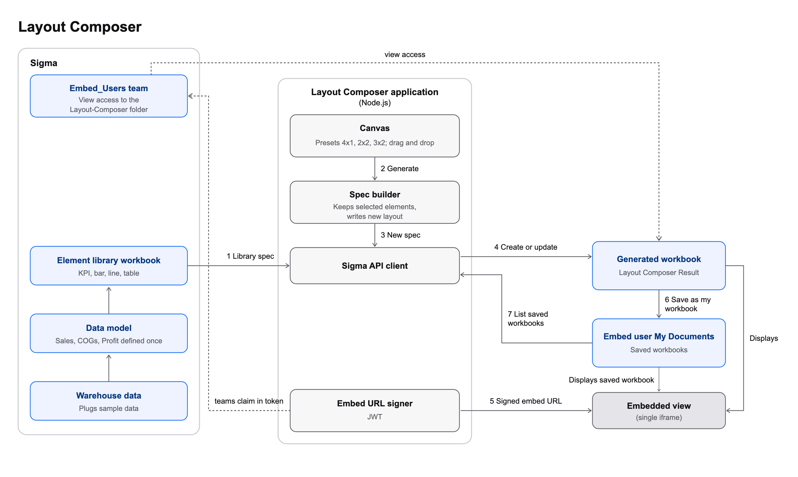

Simply put:

1. The application reads the element library workbook's specification
2. The user's selections are combined with a preset's grid to produce a new specification
3. The application creates the workbook the first time, and updates it in place after that
4. A signed embed URL displays the workbook to the embed user
5. Saving copies the workbook into the embed user's `Your Documents`

### The workbook specification
[Workbook as code](https://help.sigmacomputing.com/docs/manage-workbooks-as-code) represents a workbook as a document you can read and write through the REST API. Three parts matter here:
- `elements`: a flat list of every element, each with an `id`, a `kind` (such as `kpi-chart`, `bar-chart`, `line-chart` or `table`) and a `source`
- `pages`: metadata for each page, such as its name and whether it is hidden
- `layout`: an XML string that places elements on each page's grid

Here is the `Total Sales` element from the library workbook, trimmed to the parts we use:

```javascript
{
  "id": "3nm3tybYvL",
  "kind": "kpi-chart",
  "name": "Total Sales",
  "source": { "dataModelId": "{data model id}", "elementId": "{table id}", "kind": "data-model" }
}
```

The element's `source` records where its data comes from, here the `Plugs Sales` table in the data model. An element can also read from another element in the workbook, such as a table on the `Source` page. When that happens, the element it reads from has to travel with it into any new workbook.

The layout for the library's first page looks like this. Sigma pages use a 24-column grid, and each element is placed with `gridColumn` and `gridRow` ranges:

```
<Page type="grid" gridTemplateColumns="repeat(24, 1fr)" id="LNCiKoJCN7">
  <Element elementId="3nm3tybYvL" gridColumn="1 / 12" gridRow="1 / 10"/>
  <Element elementId="rFpMyuqoKb" gridColumn="12 / 18" gridRow="1 / 10"/>
</Page>
```

The project keeps a reference copy of the full library specification in `library/`, so you can compare it with the live one.

### Read the library
`routes/api.js` fetches the specification with a single call:

```javascript
const { libraryWorkbookId } = await resolveIds();
const spec = await sigma('get', `/v2/workbooks/${libraryWorkbookId}/spec`);
const document = spec.document;
```

`helpers/spec.js` then lists the elements on the first page's layout. Those are the elements users see in the picker:

```javascript
// A styled title comes back as { text, fontWeight, fontSize } instead of a plain string.
const elementName = (el) => (typeof el.name === 'string' ? el.name : (el.name && el.name.text) || el.id);

function listLibraryElements(doc) {
  const firstPage = doc.layout.split('<Page ')[1];
  const ids = [...firstPage.matchAll(/elementId="([^"]+)"/g)].map((m) => m[1]);
  return ids.map((id) => {
    const el = doc.elements.find((e) => e.id === id);
    return { id, name: elementName(el), kind: el.kind };
  });
}
```

The helper is there because an element's `name` is a plain string until you style its title in Sigma. After that it becomes an object with a `text` property.

### Presets are grid coordinates
`helpers/presets.js` defines each canvas as a list of zones. A zone is `[startColumn, endColumn, startRow, endRow]` in the same 24-column grid the layout uses:

```javascript
{
  id: '2x2',
  zones: [
    [1, 13, 1, 15],   // top left
    [13, 25, 1, 15],  // top right
    [1, 13, 15, 29],  // bottom left
    [13, 25, 15, 29], // bottom right
  ],
}
```

Because presets are data, adding a layout means adding an entry to this list. The canvas in the browser draws its zones from the same list.

### Build the new document
`buildDocument` in `helpers/spec.js` does the real work. It keeps only the elements the user placed, plus anything they depend on, and writes a new layout with one `<Element>` per placement:

```javascript
// Keep the placed elements plus anything they use as a source.
const keep = neededElementIds(libraryDoc, placedIds);

const leaves = placed
  .map(([zone, id]) => {
    const [c1, c2, r1, r2] = preset.zones[zone];
    return `  <Element elementId="${id}" gridColumn="${c1} / ${c2}" gridRow="${r1} / ${r2}"/>`;
  })
  .join('\n');
```

`neededElementIds` walks each kept element's `source.elementId` until nothing new is found, so any element a placed element reads from comes along without the application knowing it exists.

The function also decides which pages to keep. Layout that references an element that is not in the new workbook is rejected, so a supporting page such as `Source` is kept only if every element on it is kept. Any page that remains, other than the canvas page, is marked hidden using the page's `visibility` setting:

```javascript
const keptBlocks = otherBlocks.filter((block) =>
  [...block.matchAll(/elementId="([^"]+)"/g)].every((m) => keep.has(m[1]))
);
const keptPageIds = new Set(keptBlocks.map((block) => block.match(/id="([^"]+)"/)[1]));
const pages = libraryDoc.pages
  .filter((pg) => pg.id === canvasPageId || keptPageIds.has(pg.id))
  .map((pg) => (pg.id === canvasPageId ? { ...pg, name: 'Layout Composer' } : { ...pg, visibility: 'hidden' }));
```

The result is a complete workbook document: filtered `elements`, adjusted `pages` and a rewritten `layout`.

### Create or update in place
The first Generate creates the workbook. Later ones update it. Both calls send the document that `buildDocument` produced:

```javascript
if (workbookId) {
  await sigma('put', `/v2/workbooks/${workbookId}/spec`, { document });
} else {
  const created = await sigma('post', '/v2/workbooks/spec', {
    name: 'Layout Composer Result',
    folderId,
    document,
  });
  writeState({ workbookId: created.workbookId });
}
```

Element and page IDs are preserved on create, which is why layout entries can refer to elements by the same IDs the library used. The workbook's ID is stored in a small local file, `.generated.json`, so the next Generate knows which workbook to update. If an update fails because the workbook was deleted or archived, the application falls through to the create call.

### Display with a signed embed URL
`routes/api.js` signs a short-lived token for the embed user and appends it to the workbook's URL:

```javascript
const token = jwt.sign(
  {
    sub: EMBED_EMAIL,
    iss: CLIENT_ID,
    jti: crypto.randomUUID(),
    iat: now,
    exp: now + 3600,
    account_type: EMBED_ACCOUNT_TYPE,
    teams: [EMBED_TEAMS],
  },
  SECRET,
  { algorithm: 'HS256', keyid: CLIENT_ID }
);
const url = `${workbookUrl}?:embed=true&:jwt=${token}`;
```

`sub` is the embed user, `teams` places that user in `Embed_Users` (which can view the folder), and the client ID, sent as both `iss` and the key ID, tells Sigma which secret to verify with. Sigma requires `iat`, so do not remove it.

### Save and list workbooks
Saving uses the copy endpoint, with the embed user's home folder as the destination:

```javascript
const { homeFolderId } = await getEmbedMember();
await sigma('post', `/v2/workbooks/${workbookId}/copy`, {
  name,
  destinationFolderId: homeFolderId,
});
```

`getEmbedMember` finds the embed user by email (`GET /v2/members?email=`). The `Saved Workbooks` list is the embed user's files (`GET /v2/members/{memberId}/files`) filtered to workbooks in `My Documents`. Sigma's file list can lag a moment behind a new copy, so the page adds a just-saved workbook to the list itself.

### Short IDs in the environment file
The IDs you pasted from the browser are Sigma's short URL IDs. The Sigma API accepts them when reading a workbook (`GET /v2/workbooks/{id}`) and a folder (`GET /v2/files/{id}`), and returns the full IDs that later calls need. `resolveIds` in `helpers/sigma.js` does this once at startup, which is why you never have to look up a UUID.

### Extend the sample
The pieces above are the points developers are most likely to change:
- Add a layout: add an entry to `helpers/presets.js`
- Add an element: place it on the library workbook's first page and refresh the application
- Give each user their own saved workbooks: sign the token with each signed-in user's email
- Use it without embedding: link to the generated workbook's URL instead of loading the iframe


<!-- END OF SECTION-->

## What we've covered
Duration: 5

In this QuickStart, we built an application that lets users assemble their own Sigma workbook from approved elements. Users choose elements and place them on a canvas, and the application writes the arrangement back to Sigma as a real workbook that displays in a single view, updates in place as the layout changes, and can be saved as the user's own.

The pattern works because Sigma holds the parts that need governing. The data model defines the measures once, the element library holds the approved elements, and the generated workbook inherits both. The application only decides which elements go where.

Key takeaways:
- A workbook's specification is data: read it, filter and rearrange it, and write it back through the API
- A library workbook is a convenient way to author reusable elements in the Sigma UI instead of writing them by hand
- Creating a workbook once and updating it in place keeps the experience fast and the folder tidy
- A team-level share and a signed embed URL let you display content to users without per-workbook permissions
- The same approach extends to more layouts, more elements and per-user saved workbooks

Places to extend the app:
- **Containers as library cards:** build a library item as a container, such as a KPI with a text element that explains it, so one choice in the picker brings a complete card. The sample lists individual elements today, so this means changing how the picker reads the library page
- **Widgets in your own dashboard:** embed library elements one at a time inside your application's dashboard, and let your own admin pages decide which element appears in which widget. The library workbook can serve as the catalog
- **Role-based starting points:** pre-compose layouts for sales, finance or operations users and let them adjust from there
- **More element types:** maps, pivot tables, controls, and chat or agent elements follow the same pattern
- **Sharing and scheduling:** share or schedule exports of a saved workbook
- **Your own identity:** sign the token with each signed-in user's email so saved workbooks are private to each user


**Additional Resource Links**

[Blog](https://www.sigmacomputing.com/blog/)<br>
[Community](https://community.sigmacomputing.com/)<br>
[Help Center](https://help.sigmacomputing.com/hc/en-us)<br>
[QuickStarts](https://quickstarts.sigmacomputing.com/)<br>

Be sure to check out all the latest developments at [Sigma's First Friday Feature page!](https://quickstarts.sigmacomputing.com/firstfridayfeatures/)
<br>

[](https://twitter.com/sigmacomputing)&emsp;
[](https://www.linkedin.com/company/sigmacomputing)&emsp;
[](https://www.facebook.com/sigmacomputing)


<!-- END OF WHAT WE COVERED -->
<!-- END OF QUICKSTART -->
