author: pballai
id: developers_migrating_from_excel_made_easy
summary: Use the excel-to-sigma Claude Code skill to migrate an Excel rolling forecast to a Sigma data model and workbook, keep the forecast inputs editable with input tables, and verify that Sigma's totals tie to Excel's.
categories: migrations
environments: web
status: Published
feedback link: https://github.com/sigmacomputing/sigmaquickstarts/issues
tags: Default
lastUpdated: 2026-10-22

# Migrating From Excel Made Easy

## Overview
Duration: 5

Sigma brings the flexibility of a spreadsheet to live warehouse data, with the governance, collaboration, and scale that a file on one person's laptop can't offer. That makes the Excel planning models finance teams rebuild every cycle, the budget and forecast workbooks, a natural fit for Sigma. The conversion itself is often what stalls the project.

This QuickStart demonstrates how to migrate an Excel rolling forecast to Sigma with a `Claude Code` skill called `excel-to-sigma`. We will build a Sigma data model and workbook from the Excel file, keep the forecast inputs editable as input tables, and verify that Sigma's totals tie to Excel's.

### About the sample Excel file
A planning workbook is a data-entry tool as much as a report. Actuals are pulled in by formula, the forecast runs on growth rates and typed overrides, and summary tabs and charts sit on top. Rebuilding one by hand means tracing every formula back to its source, deciding which cells people actually edit, and then checking the totals and hoping nothing drifted.

The skill automates that loop. Point it at your `.xlsx` file; it audits the workbook, maps each cell as an actual, a driver-based forecast, or a manual input, drafts a plan from that map, and builds the Sigma data model and workbook. It then compares Sigma's results against the values Excel calculated. Anything that needs a decision, such as an Excel chart, is flagged before the build runs, so nothing is dropped silently.

<aside class="positive">
<strong>WHY IT MATTERS:</strong><br> The cells people type into are what make a planning workbook useful, so a read-only copy would be a step backward. The skill keeps those inputs editable as Sigma input tables and proves the totals match Excel's, which gives finance teams the same model on live data that others can see and update under governance.
</aside>

### Sample workbook

For the demonstration, we'll migrate a workbook called `Acme FY26 Rolling Forecast`: a 6+6 forecast with January through June as actuals and July through December as forecast. It has four sheets:

- `P&L`: revenue, cost of revenue, operating expenses, EBITDA, and net income by month. Actual months are `SUMIFS` formulas against the `GL Actuals` sheet; forecast months use driver growth rates, a carried run-rate, or typed inputs.
- `Quarterly`: a quarterly roll-up of revenue, gross profit, EBITDA, and net income.
- `GL Actuals`: 258 posted ledger transactions that feed the actuals.
- `Drivers`: ten monthly growth rates that drive the forecast.

You'll see the audit and plan the skill produces, the parity check against Excel's totals, and the resulting Sigma data model and workbook, with the growth rates and manual forecast inputs still editable.

Final workbook:

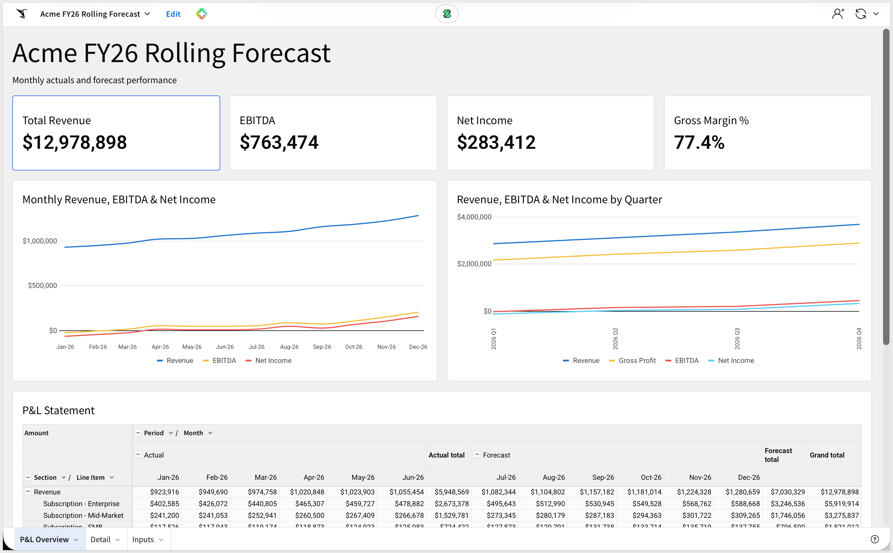

Data Model:

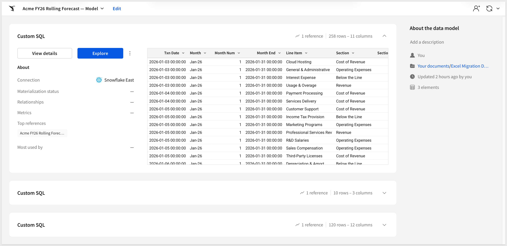

The migration is one-directional: Excel is the source, Sigma is the target. The skill reads the <code>.xlsx</code> file directly, so no Excel installation or account is involved. Workbook shapes the skill can't map automatically are flagged for review rather than silently dropped or guessed at.

<aside class="positive">
<strong>ABOUT THE SKILL CODE:</strong><br> The skill code used in this QuickStart is vendored into <code>sigmacomputing/quickstarts-public</code> for a stable reader experience — the version you clone matches what's captured in the screenshots and outputs below.
</aside>

<aside class="negative">
<strong>AI MODEL DIFFERENCES:</strong><br> Depending on which AI, model, and version you're running, the exact prompt wording, option ordering, and intermediate messages may differ slightly from what's shown in this QuickStart. The substantive steps and decisions are the same — pick the option that matches the intent described, even if the label varies.
</aside>

### Target Audience
Sigma SEs, technical CSMs, and migration partners running Excel-to-Sigma conversions.

### Prerequisites
- `Claude Code` installed (CLI or desktop).
- Sigma API credentials.
- `Python 3` with the `venv` module. The skill installs its own dependencies into a virtual environment.
- `git`, to clone the skill from GitHub.
- A Sigma connection with write access to your warehouse. The skill stores the forecast inputs in Sigma input tables, which write back to the warehouse.

<aside class="negative">
<strong>NOTE:</strong><br> Sigma recommends that you use non-production resources when doing QuickStarts. 
</aside>

<button>[Sigma Free Trial](https://www.sigmacomputing.com/free-trial/)</button>


<!-- END OF SECTION-->

## How the Excel Migration Skill Works
Duration: 5

An Excel planning model has to stay editable after it moves, or the migration has only produced a read-only copy. `excel-to-sigma` is built around that: it classifies how each part of the workbook is used, then routes it to the Sigma construct that preserves that behavior.

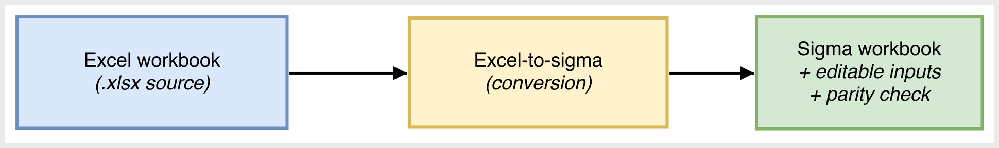

### One skill, three routes

When the skill starts, a router audits the workbook and picks the route that fits its shape. Each route ends with the same checks: a fail-loud audit before the build, and a parity comparison against the values Excel calculated.

| Route | Workbook shape | What gets built in Sigma |
|-------|----------------|--------------------------|
| `forecast` | A P&L or forecast drawn in cells: actuals pulled by `SUMIFS` from a transaction sheet, forecast months driven by growth rates and typed overrides. This is the route the sample workbook takes. | A data model and workbook with actuals and forecast combined, KPIs, an actual-versus-forecast pivot, a trend chart, and editable input tables for the rates and manual cells. |
| `input-table` | Formal Excel Tables that people type into: budget entry grids, trackers, subscription lists. | A Sigma input table for the entry data, read through a warehouse view by a data model, so the roll-ups recompute as people edit. |
| `research` | A research-style model with line items by year and statement sections, including fleets of workbooks built from one template. | A data model and workbook with the hard-coded grid and one canonical formula per derived line. Fleets are triaged as automatic, needs review, or blocked. |

### How the skill reads a forecast workbook

For the `forecast` route, the skill classifies every formula and number in the P&L by what it does. That classification decides what each cell becomes in Sigma:

| Cell class | Excel signal | Becomes in Sigma |
|------------|--------------|------------------|
| Actual | `SUMIFS` over the `GL Actuals` sheet | A read-only data model element holding the ledger rows from that sheet |
| Driver growth | Prior month multiplied by `1 + rate` from the `Drivers` sheet | A forecast calculated from the last actual and the rate, with the rates held in an editable input table |
| Manual | A typed number sitting in a row of formulas | An editable input table, one value per line item and month |
| Derived | Totals, subtotals, and margin percentages | Calculations in the workbook that recompute from the rows above |

For the sample workbook, the skill finds ten growth rates and 42 manual forecast cells, which become the 52 inputs that stay editable in Sigma.

<aside class="positive">
<strong>WHY IT MATTERS:</strong><br> Classifying the workbook before building is what keeps the inputs editable. Forecasters keep typing into the same rates and overrides, and the P&L and trend chart update from those inputs, in a governed Sigma workbook instead of a file passed between people.
</aside>

### What this enables beyond a single conversion

A pure lift-and-shift is the floor, not the ceiling.

- **Point the actuals at your warehouse:**<br>
In Excel, each close means exporting the ledger and pasting it into the actuals sheet. The migrated data model carries the ledger rows as a SQL element, so it works on its own. Pointing that element at your general ledger table in the warehouse lets new postings flow in instead of being pasted into a sheet, and the model works from the same governed data as everything else in Sigma.
- **Audit your source as a side effect:**<br>
The parity check that closes every run is also a fresh pair of eyes on the workbook's math. A mismatch is either a translation bug or an error that has been quietly living in the spreadsheet. Both are worth finding.
- **Scale from one workbook to a folder of them:**<br>
When many files come from one template, the skill's batch mode fingerprints each one, converts it, and sorts the results by how much review each needs. That turns a pile of near-identical models into a short list of exceptions.


<!-- END OF SECTION-->

## Install and Configure the Skill
Duration: 10

First we need to clone the skill's GitHub repository, install its Python dependencies, and capture your Sigma credentials. There's no source-tool credential step here: `excel-to-sigma` reads the workbook directly from the `.xlsx` file, so Excel never needs an account or API key.

The skill lives in `sigmacomputing/quickstarts-public` under [excel-migration-skills/](https://github.com/sigmacomputing/quickstarts-public/tree/main/excel-migration-skills)

From a terminal, run each command below one at a time so you can confirm each step before moving on.

<aside class="positive">
<strong>NOTE:</strong><br> <code>~</code> in the commands below is shell shorthand for your home folder — <code>/Users/&lt;you&gt;</code> on macOS, <code>/home/&lt;you&gt;</code> on Linux.
</aside>

**Step 1: Create a local folder for the clone**

```copy-code
mkdir -p ~/quickstarts-public
```

**Step 2: Move into the new folder**

```copy-code
cd ~/quickstarts-public
```

**Step 3: Clone the repo without pulling any files yet**

```copy-code
git clone --filter=blob:none --sparse https://github.com/sigmacomputing/quickstarts-public.git .
```

**Step 4: Fill in only the excel-migration-skills folder**

```copy-code
git sparse-checkout set excel-migration-skills
```

**Step 5: Symlink excel-to-sigma into the Claude skills folder**

```copy-code
mkdir -p ~/.claude/skills
ln -s ~/quickstarts-public/excel-migration-skills/excel-to-sigma ~/.claude/skills/excel-to-sigma
```

This should return with no error.

**Step 6: Install the skill's Python dependencies**<br>
The skill's scripts read the workbook with `openpyxl`. This creates a virtual environment inside the skill folder, so nothing is installed into your system Python:

```copy-code
cd ~/quickstarts-public/excel-migration-skills/excel-to-sigma/scripts
python3 -m venv .venv && .venv/bin/pip install -r ../requirements.txt
```

Once done, the project will look like this in VSCode:

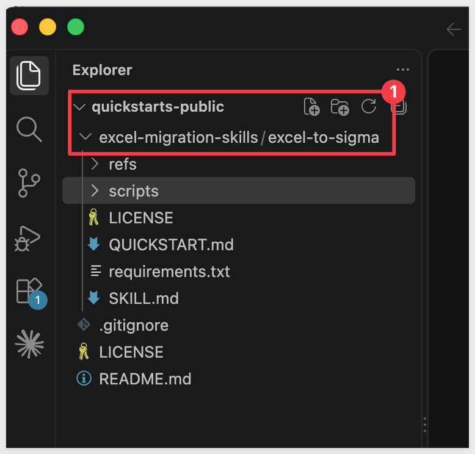


**Step 7: Add your Sigma API credentials.**<br>
Written to `~/.sigma-migration/env`:

```copy-code
mkdir -p ~/.sigma-migration
cat >> ~/.sigma-migration/env <<'EOF'
export SIGMA_BASE_URL='https://api.us-a.aws.sigmacomputing.com'
export SIGMA_CLIENT_ID='{your-client-id}'
export SIGMA_CLIENT_SECRET='{your-client-secret}'
EOF
```

Get `SIGMA_CLIENT_ID` and `SIGMA_CLIENT_SECRET` from Sigma under `Administration` > `Developer Access` > `Create New Client Credentials` (requires Admin role).

For information, see: [Generate Sigma API client credentials](https://help.sigmacomputing.com/reference/generate-client-credentials)

`SIGMA_BASE_URL` must match your Sigma deployment region. 

The value shown (`https://api.us-a.aws.sigmacomputing.com`) covers AWS US. 

To find the correct URL for your instance, see: [Supported regions, data platforms, and features](https://help.sigmacomputing.com/docs/region-warehouse-and-feature-support)


**Step 8: Verify Claude Code can see the skill.**<br>
Type `claude` in your terminal to start Claude Code, then begin typing the skill name:

```copy-code
claude
```

```copy-code
/excel-to-sigma
```

`excel-to-sigma` should appear in the list of available skills as you type. Once you see it, exit Claude Code with `/exit`; we'll invoke the skill with a full prompt in a later section.

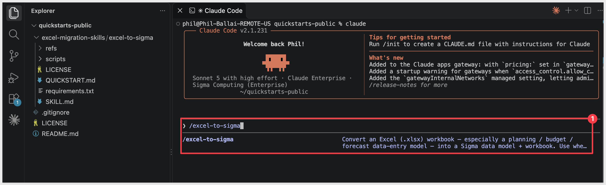


<!-- END OF SECTION-->

## Prepare Demo Data
Duration: 5

The sample workbook is the only file the skill needs, so there's no warehouse data to load before the conversion. We'll download it into the same working folder the skill will read from.

**Step 1: Create a working folder for your migrations.**

```copy-code
mkdir -p ~/sigma-migration-workspace
```

**Step 2: Download the sample workbook.**<br>
This is the `Acme FY26 Rolling Forecast.xlsx` file described in the Overview.

<button>[Download Acme FY26 Rolling Forecast.xlsx](https://sigma-quickstarts-main.s3.us-west-1.amazonaws.com/excel/Acme+FY26+Rolling+Forecast.xlsx)</button>

**Step 3: Move the file into the working folder.**<br>
Most browsers save downloads to `~/Downloads`. If yours saves elsewhere, adjust the path:

```copy-code
mv ~/Downloads/"Acme FY26 Rolling Forecast.xlsx" ~/sigma-migration-workspace/
```

**Step 4: Confirm the file is in place.**

```copy-code
ls ~/sigma-migration-workspace
```

You should see `Acme FY26 Rolling Forecast.xlsx` listed.

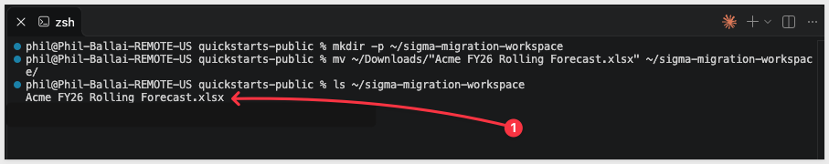


<!-- END OF SECTION-->

## Prepare the Sigma Target Folder
Duration: 5

The skill needs two things in Sigma before it builds: a folder to land the new data model and workbook in, and a connection with write access, so the forecast inputs stay editable. We'll get both ready now so they're on hand when the skill asks.

**Step 1: Confirm write access on your connection.**<br>
In Sigma, open `Administration` > `Connections` and select the connection you plan to use. The connection needs write access configured, because Sigma input tables store what people type in the warehouse.

If write access isn't set up yet, follow [Set up write access](https://help.sigmacomputing.com/docs/set-up-write-access) before continuing. Keep the connection's name handy; the skill will ask which connection to use and checks for write access before it builds.

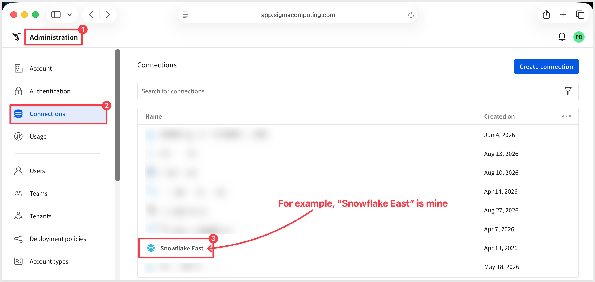

**Step 2: Create a folder.**<br>
In Sigma, navigate to where you want the migrated workbook to live and create a folder:

```copy-code
mkdir Excel Migration Demo
```

**Step 3: Grab the folder ID.**<br>
Open the folder. The ID is the last segment of the URL. Copy it from the address bar and keep it on the clipboard for the next section:

```copy-code
https://app.sigmacomputing.com/{your-org}/folder/{your-folder-id}
```

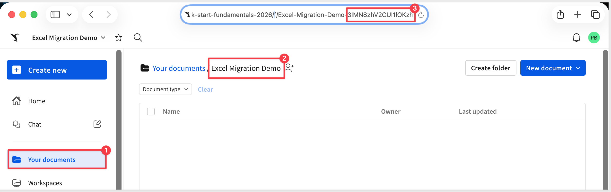


<!-- END OF SECTION-->

## Run the Conversion
Duration: 20

With the workbook downloaded and the Sigma folder ready, we can hand the migration to Claude Code. One prompt runs the whole conversion: the skill audits the workbook, builds the model in Sigma, and checks the result against Excel before it reports back.

**Step 1: Move into the working folder.**

```copy-code
cd ~/sigma-migration-workspace
```

**Step 2: Start Claude Code.**

```copy-code
claude
```

<aside class="negative">
<strong>NOTE:</strong><br> Claude Code asks for approval on every bash command the skill runs, and a full conversion fires dozens of them. For each prompt, pick option <code>2. Yes, and don't ask again</code> so Claude Code remembers that command pattern. After the first handful of approvals the prompts stop coming. Alternatively, press <code>Shift+Tab</code> once to switch to <code>auto mode on</code> for the rest of the session — fine for a trusted skill like this one, just don't use it for unknown code.
</aside>

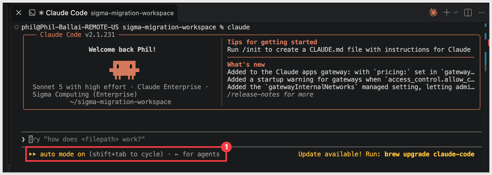

### Kickoff prompt

Adjust the prompt below, substituting your Sigma `connection name` and `folder ID`, then paste it into Claude Code as **Step 3**:

```copy-code
Run /excel-to-sigma on the following. Route the workbook, then walk every phase in SKILL.md end-to-end and stop only if a hard gate fails.

Excel
- Workbook: ~/sigma-migration-workspace/Acme FY26 Rolling Forecast.xlsx
- No Excel credentials needed — discovery reads the file directly.

Sigma
- SIGMA_API_TOKEN = mint from ~/.sigma-migration/env
- Connection: {your-connection-name} — look up its ID with GET /v2/connections and confirm writeAccess is true before building
- SIGMA_FOLDER_ID: {your-folder-id}

Options
- Intent: what-if — keep the growth rates and manual forecast cells editable as Sigma input tables
- Python: use the virtual environment in the skill's scripts folder (.venv)
- If the audit flags the Excel chart for review, rebuild it as a Sigma chart and record the sign-off before building
- Parity: Sigma's FY2026 totals must match Excel's. Report any deltas.

Don't declare the migration complete until the parity check passes. Collect anything I need to do in the Sigma UI into one checklist and stop there.
```

For example: 

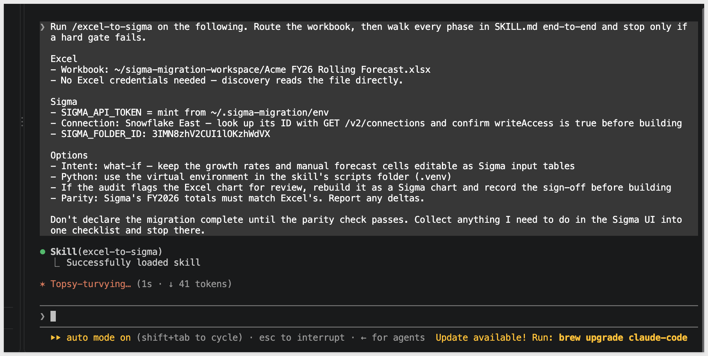

### What the skill does

Claude Code works through a checklist of five phases, and marks each one off as it completes:

**Audit and map the workbook** → **Draft the source-bound plan** → **Build the Sigma model and workbook** → **Verify parity against Excel** → **Enable published-mode editing**

- Audit and map: the audit checks that Sigma's API supports everything the build needs, then flags anything in the workbook that needs a decision. A `REVIEW_REQUIRED` flag on the Excel chart is expected for this workbook. The skill then maps the model cell by cell into actuals, driver-based forecast, and manual inputs.
- Draft the plan: the plan records the workbook's checksum, so every result is tied to the exact file being migrated. The skill checks each month's values in the plan against Excel's own before it builds.
- Build: the skill creates the data model and workbook in your folder and prints their IDs and a link.
- Verify parity: the skill exports the finished workbook from Sigma and compares its FY2026 totals against Excel's.
- Enable published-mode editing: the last phase needs you, as described next.

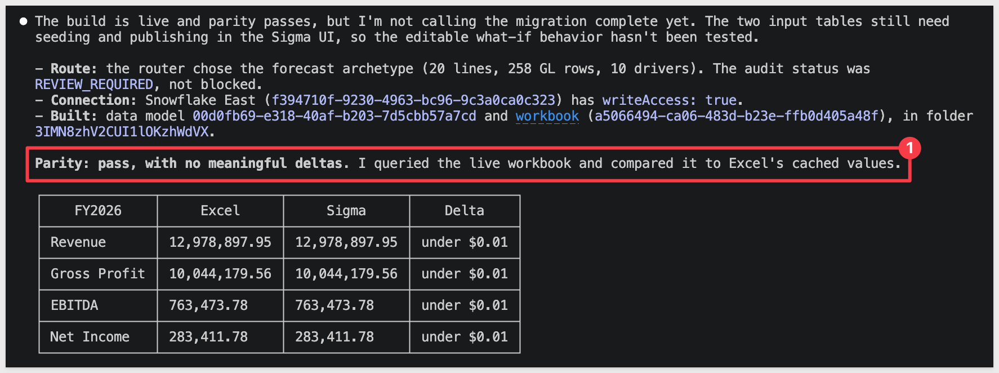

<aside class="positive">
<strong>NOTE:</strong><br> The audit never drops anything silently. Every flagged item needs a recorded decision before the build runs, which is why the run stops, rather than guessing, if it meets a workbook shape it can't map.
</aside>

### Complete the Sigma steps

When the build and parity check finish, the skill stops with a checklist of the steps that only the Sigma UI can do. 

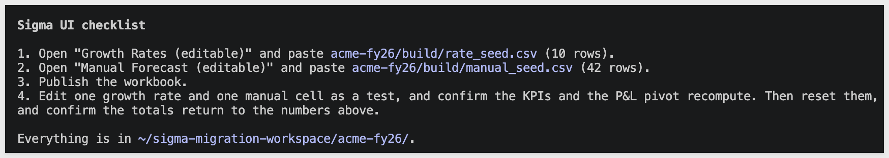

Leave that checklist for now. We'll work through it in the next section, using the Sigma workbook Claude created for us.

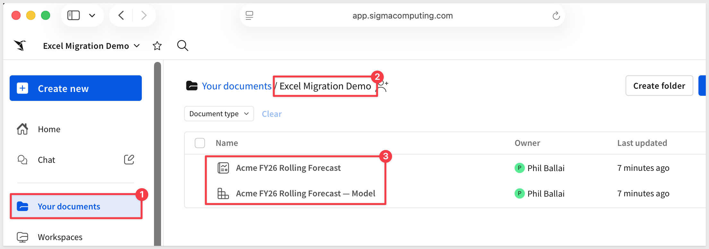


<!-- END OF SECTION-->

## Review the Output
Duration: 10

The migration is finished when the numbers tie and the inputs work. Claude's closing summary reports the first; the second takes a few steps in Sigma, because the workbook is where the result lives.

### The parity check

Claude queried the finished workbook and compared it with the values Excel had calculated. The four FY2026 totals match to the cent:

| FY2026 | Excel | Sigma | Difference |
|--------|-------|-------|------------|
| Revenue | 12,978,897.95 | 12,978,897.95 | under $0.01 |
| Gross Profit | 10,044,179.56 | 10,044,179.56 | under $0.01 |
| EBITDA | 763,473.78 | 763,473.78 | under $0.01 |
| Net Income | 283,411.78 | 283,411.78 | under $0.01 |

All 240 line-month values and all 16 quarterly chart points match as well. These totals hold on the default rates and manual values, before any input table is seeded.

### The Sigma workbook

Open the `Excel Migration Demo` folder in Sigma. The skill built a workbook with three pages:

- `P&L Overview`: four KPIs (`Total Revenue`, `EBITDA`, `Net Income`, and `Gross Margin %`), a monthly trend chart, the Excel chart rebuilt as a Sigma line chart (`Revenue, EBITDA & Net Income by Quarter`), and the `P&L Statement` pivot with actual and forecast months.
- `Detail`: the ledger transactions behind the actuals.
- `Inputs`: the forecast assumptions and the two input tables, `Growth Rates (editable)` and `Manual Forecast (editable)`.

A fourth page, `Model (sources)`, holds the calculation tables behind the workbook. It's hidden from the published view and visible in `Edit` mode.

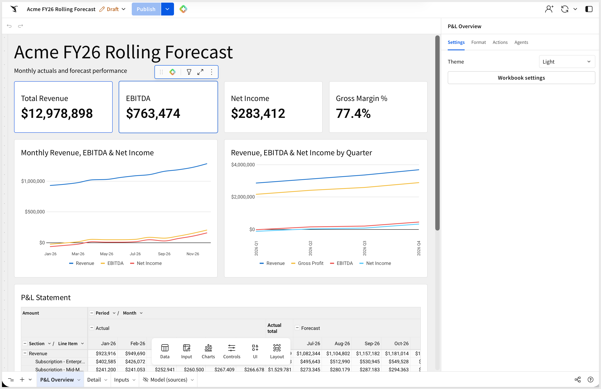

### Seed the input tables and publish

The totals above come from the default values, so the two input tables on the `Inputs` page are empty until we load them. Claude leaves these steps for you because they happen in the Sigma UI.

The skill wrote one seed file for each input table. The file names don't match the table names, so use this pairing:

| Seed file | Load into | What it holds |
|-----------|-----------|---------------|
| `rate_seed.csv` | `Growth Rates (editable)` | 10 rows: the monthly growth rate for each driver line item |
| `manual_seed.csv` | `Manual Forecast (editable)` | 42 rows: the typed forecast amounts, by line item and month |

<aside class="negative">
<strong>NOTE:</strong><br> <code>Upload CSV</code> builds the input table's columns from the file's headers, so each file has to go into its own table. A file loaded into the wrong table gives that table the wrong columns, and the workbook's joins and charts then show <code>Invalid Argument</code> errors.
</aside>

Both files are in this folder:

```copy-code
~/sigma-migration-workspace/acme-fy26/build/
```

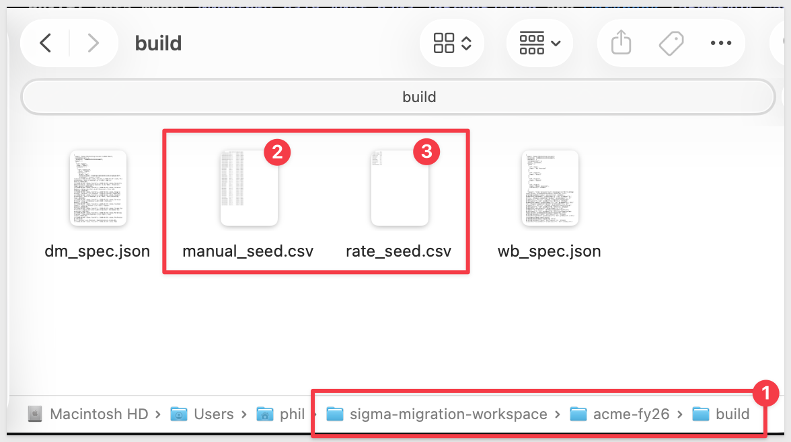

**Step 1:** Load `rate_seed.csv` into `Growth Rates (editable)`.<br>

On the `Inputs` page, open `Growth Rates (editable)`, use the input table's `Upload CSV` option, and select `rate_seed.csv`.

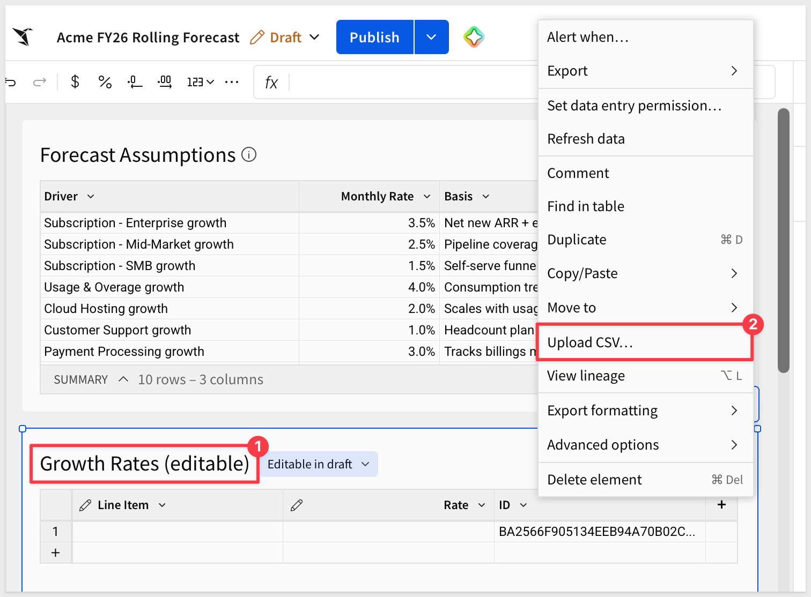

**Step 2:** Load `manual_seed.csv` into `Manual Forecast (editable)`.<br>

Open `Manual Forecast (editable)`, use `Upload CSV` again, and select `manual_seed.csv`.

When done, the input tables will look like this:

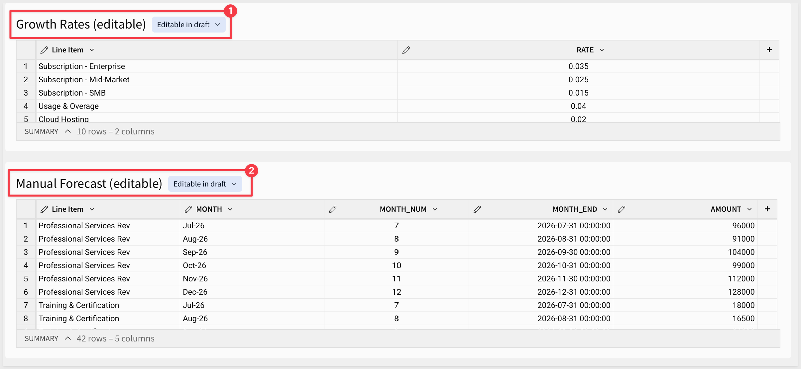

**Step 3:** `Publish` the workbook.

**Step 4: Test the what-if behavior.**<br>
In the published workbook, change one growth rate, such as `Subscription - Enterprise` from `0.035` to `0.06`, and one manual value, such as the `Jul-26` amount for `Professional Services Rev`. 

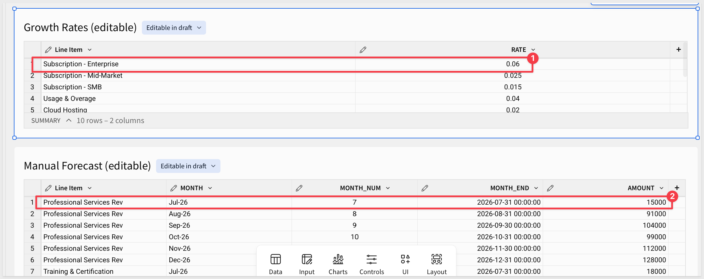

The KPIs and the `P&L Statement` pivot recompute.

Old values:

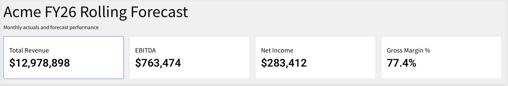

New Values:

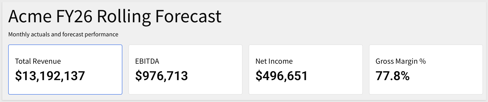

<aside class="positive">
<strong>WHY IT MATTERS:</strong><br> This is the part a read-only copy can't do. A forecaster changes a rate or an override and sees the P&L, KPIs, and trend update immediately, in a workbook that holds the same totals as the Excel file it replaced.
</aside>

### The Sigma data model

The skill also built a data model. It's saved in the same folder as `Acme FY26 Rolling Forecast — Model`, and it has three `Custom SQL` elements on the connection you chose:

- 258 rows and 11 columns: the ledger rows from the `GL Actuals` sheet, with each line item's section and order.
- 10 rows and 3 columns: the `Drivers` sheet as a table of rates and their basis.
- 120 rows and 12 columns: a forecast spine that gives every line item a row for each forecast month, along with how that month is forecast: growth, carried forward, or manual.


The ledger rows are written into the data model as a SQL element, so the migrated workbook is self-contained and there are no warehouse tables to load first. The workbook's calculation tables read from these three elements.

<aside class="positive">
<strong>NOTE:</strong><br> To feed the model from your own ledger table instead, edit the SQL in the ledger element so it selects the same columns from that table. The rest of the data model and workbook keep working from it.
</aside>

### The gap list

The skill records every item it flagged during the audit, along with who decided what, in `~/sigma-migration-workspace/acme-fy26/review.json`. The decisions are filed under your email. Two items came up for this workbook.

- `CHARTS_PRESENT`: the Excel chart was a single line chart of four series across four quarters. The skill rebuilt it as a Sigma line chart, checked all 16 points against Excel, and viewed an image export to confirm it renders.
- `FLAT_CARRY_POLICY`: three lines, `Third-Party Licenses`, `Facilities & Rent`, and `Depreciation & Amort.`, repeat the previous month in every July through December cell of the Excel file. The skill carries the June value flat, which matches Excel month by month. The June value is built into the forecast, so later changes to June ledger actuals won't flow into those three lines.

Open `review.json` and confirm you agree with each decision before treating the migration as complete. If the flat-carry behavior isn't what you want for a line, that's the item to revisit.

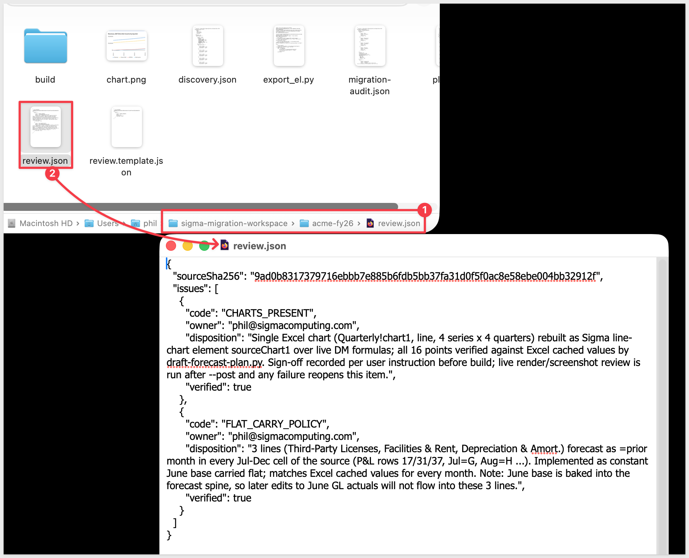


<!-- END OF SECTION-->

## Common Issues
Duration: 5

### `Invalid Argument` errors after loading the seed files

If the KPIs, charts, and pivot on `P&L Overview` all show `Invalid Argument`, with a message such as `Join key formula contains an invalid expression: Column "{id}.MONTH_NUM" does not exist`, a seed file went into the wrong input table. 

`Upload CSV` builds a table's columns from the file's headers, so `manual_seed.csv` in `Growth Rates (editable)` removes the `RATE` column the forecast needs, and the reverse removes `MONTH_NUM`. Upload `rate_seed.csv` to `Growth Rates (editable)` and `manual_seed.csv` to `Manual Forecast (editable)`, then check that the workbook recalculates.

### The audit reports `REVIEW_REQUIRED`

This is expected for the sample workbook and not a failure. `REVIEW_REQUIRED` means the audit found items that need a recorded decision, such as the Excel chart, and the run continues. Each decision is written to `review.json` with an owner.

### Claude says the file isn't a valid `.xlsx`

The skill needs a real Excel workbook. A file saved from another spreadsheet app, or one that was only renamed to end in `.xlsx`, can fail to open even though the extension looks right. In the original application, export the file as an Excel workbook, such as `File` > `Export To` > `Excel` in Numbers, and point the skill at the exported copy.


<!-- END OF SECTION-->

## What we've covered
Duration: 5

We migrated an Excel rolling forecast to Sigma without hand-translating a single formula, and we kept the part that makes a planning workbook useful: the cells people type into. The same prompt works for any forecast workbook of this shape, with a different file and different folder and connection.

The tedious part of a spreadsheet migration is working out what each cell is for. 

The skill classifies every number as an actual, a driver-based forecast, a manual input, or a derived total, and builds the Sigma workbook from that map: KPIs, a trend chart, and a P&L pivot on a data model, with the growth rates and manual overrides held in input tables that forecasters can keep editing. Anything it couldn't map on its own, such as the Excel chart, was flagged and recorded with an owner in `review.json` instead of being dropped.

The parity check is the real proof. Sigma's FY2026 totals matched the values Excel had calculated, along with every line-month value, so the migrated model gives finance teams the same numbers they already trust, now in a workbook that others can see and update under governance instead of copies of a file.

From here, the data model's ledger element is a SQL element, so pointing it at your general ledger table in the warehouse lets new postings flow in without pasting an export into a sheet. And the classification approach carries over to other models: workbooks built around formal Tables route to input tables, and research-style models route to their own build.

**Additional Resource Links**

[Blog](https://www.sigmacomputing.com/blog/)<br>
[Community](https://community.sigmacomputing.com/)<br>
[Help Center](https://help.sigmacomputing.com/hc/en-us)<br>
[QuickStarts](https://quickstarts.sigmacomputing.com/)<br>

Be sure to check out all the latest developments at [Sigma's First Friday Feature page!](https://quickstarts.sigmacomputing.com/firstfridayfeatures/)
<br>

[](https://twitter.com/sigmacomputing)&emsp;
[](https://www.linkedin.com/company/sigmacomputing)&emsp;
[](https://www.facebook.com/sigmacomputing)


<!-- END OF WHAT WE COVERED -->
<!-- END OF QUICKSTART -->
