author: pballai
id: tables_create_and_promote_sigma_tables
summary: tables_create_and_promote_sigma_tables
categories: Tables
environments: web
status: Published
feedback link: https://github.com/sigmacomputing/sigmaquickstarts/issues
tags: Default
lastUpdated: 2026-12-31

<!--
ROUGH DRAFT generated from a video (qs_videos_studio_inbound). NOT verified in a live Sigma.
Source: Videos/sigma-tables-public-beta-q4-roadmap-demo (transcript.txt, frames/).
Before this goes anywhere near sigmaquickstarts:
1. Walk every step in a live Sigma trial and correct names, menu paths and field labels.
2. Recapture every screenshot (the video frames have browser chrome, a staging URL and a real person's name).
3. Remove this comment and every VERIFY comment. Keep the commented screenshot placeholders until images exist.
4. Roadmap and release status were deliberately left out. Keep them out.
VERIFY items are listed in ../outline.md.
-->

# Create and Promote Sigma Tables

## Overview
Duration: 5

Sigma tables let teams edit data directly in a table, with every change written back to the data platform. The Getting Started with Sigma Tables QuickStart shows how to turn an existing warehouse table into a Sigma table.

This QuickStart picks up from there and shows the other ways in. We will create a Sigma table from a CSV file, control who can view and edit it, promote it so other workbooks can use it, and add editable columns to data that already lives in the warehouse. The data will be stored in Snowflake, through a Sigma connection with write access enabled.

<aside class="positive">
<strong>WHY IT MATTERS:</strong><br> Teams that capture edits, comments, or overrides usually end up with several linked input tables joined back to a warehouse view. A Sigma table can hold those edits in one governed table, shared by every workbook that needs it.
</aside>

Along the way you'll learn how to:
- Prepare Snowflake schemas for Sigma tables and their audit logs
- Create a Sigma table from a CSV file
- Control who can view and edit a Sigma table
- Promote a workbook Sigma table so it can be shared across workbooks
- Add editable columns to a warehouse table
- Migrate an existing input table to a Sigma table

<aside class="positive">
<strong>IMPORTANT:</strong><br> Some screens in Sigma may appear slightly different from those shown in QuickStarts. This is because Sigma continuously adds and enhances functionality. Rest assured, Sigma's intuitive interface ensures that any differences will not prevent you from successfully completing any QuickStart.
</aside>

For more information on Sigma's product release strategy, see [Sigma product releases](https://help.sigmacomputing.com/docs/sigma-product-releases)

If something doesn't work as expected, here's how to [contact Sigma support](https://help.sigmacomputing.com/docs/sigma-support)

### Target Audience
<!-- VERIFY: audience wording. Getting Started uses: Sigma admins and data teams evaluating Sigma tables for operational write-back use cases. -->

### Prerequisites

<ul>
  <li>Any modern browser is acceptable.</li>
  <li>Access to your Sigma environment, with an Admin account type.</li>
  <li>Sigma tables enabled for your organization.</li>
  <li>A Snowflake connection in Sigma with write access enabled. See <a href="https://help.sigmacomputing.com/docs/set-up-write-access">Set up write access</a></li>
  <li>Ability to create a schema and grant privileges in Snowflake. This QuickStart provides the script.</li>
  <li>Completion of <a href="https://quickstarts.sigmacomputing.com/guide/tables_getting_started_with_sigma_tables/index">Getting Started with Sigma Tables</a>, or equivalent familiarity.</li>
  <!-- VERIFY: sample data for the input column section. -->
 </ul>

<aside class="positive">
<strong>IMPORTANT:</strong><br> Sigma recommends using non-production resources when completing QuickStarts.
</aside>

<button>[Sigma Free Trial](https://www.sigmacomputing.com/free-trial/)</button>


<!-- END OF SECTION-->

## Prepare Snowflake
Duration: 8

A Sigma table is a real table in your data platform, so it needs a place in Snowflake to live. We will create two schemas: `SIGMA_TABLES_WRITE`, where Sigma writes the tables it creates and promotes, and `SIGMA_TABLES_AUDIT`, where it records every edit made to them.

<aside class="negative">
<strong>NOTE:</strong><br> The script below grants access to <code>SIGMA_SERVICE_ROLE</code>. Substitute the role your Sigma connection actually uses if it differs. You can confirm it in Sigma under <code>Administration</code> > <code>Connections</code> by clicking your Snowflake connection.
</aside>

**1.** In a Snowflake worksheet, run the following script:

```copy-code
USE ROLE ACCOUNTADMIN;
USE WAREHOUSE COMPUTE_WH;

CREATE DATABASE IF NOT EXISTS QUICKSTARTS;
CREATE SCHEMA   IF NOT EXISTS QUICKSTARTS.SIGMA_TABLES_WRITE;
CREATE SCHEMA   IF NOT EXISTS QUICKSTARTS.SIGMA_TABLES_AUDIT;

GRANT USAGE ON DATABASE QUICKSTARTS TO ROLE SIGMA_SERVICE_ROLE;

GRANT USAGE, CREATE TABLE, CREATE VIEW, CREATE STAGE ON SCHEMA QUICKSTARTS.SIGMA_TABLES_WRITE TO ROLE SIGMA_SERVICE_ROLE;

GRANT USAGE        ON SCHEMA QUICKSTARTS.SIGMA_TABLES_AUDIT TO ROLE SIGMA_SERVICE_ROLE;
GRANT CREATE TABLE ON SCHEMA QUICKSTARTS.SIGMA_TABLES_AUDIT TO ROLE SIGMA_SERVICE_ROLE;
GRANT SELECT ON ALL    TABLES IN SCHEMA QUICKSTARTS.SIGMA_TABLES_AUDIT TO ROLE SIGMA_SERVICE_ROLE;
GRANT SELECT ON FUTURE TABLES IN SCHEMA QUICKSTARTS.SIGMA_TABLES_AUDIT TO ROLE SIGMA_SERVICE_ROLE;
```

<!-- VERIFY: confirm CSV upload and promotion work with these grants only. -->

Click `Run all` (1). The results show `Statement executed successfully` (2).

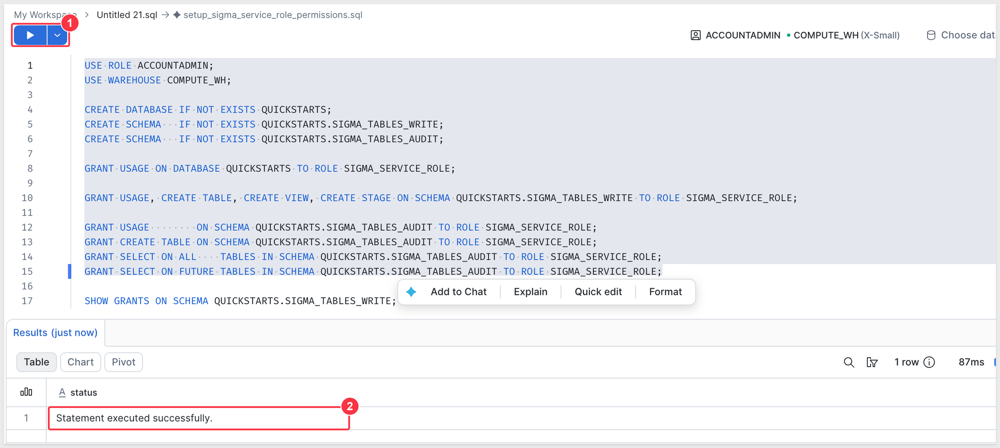

<aside class="positive">
<strong>NOTE:</strong><br> No <code>SELECT</code>, <code>UPDATE</code>, or ownership grants are needed on <code>SIGMA_TABLES_WRITE</code>. Sigma creates its tables there with the connection's role, so that role owns them and already has full access.
</aside>

**2.** In Sigma, go to `Administration` > `Connections` and select your Snowflake connection. Confirm `Role` (1) matches the role used in the script.

**3.** Edit the connection and, under `Write access`, set `Write schema` to `QUICKSTARTS.SIGMA_TABLES_WRITE` (2). <!-- VERIFY: label of the button that opens the connection for editing -->

**4.** Turn on `Sigma table audit logs` (3) and set `Audit log schema for Sigma tables` to `QUICKSTARTS.SIGMA_TABLES_AUDIT` (4). Leave `Auto-create Sigma table audit logs` off, then save the connection.

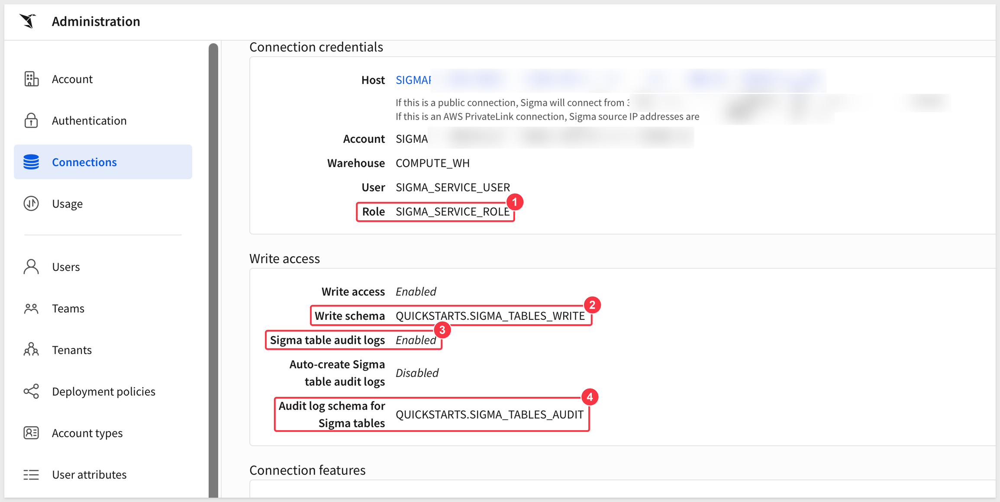

For more information, see [Set up write access](https://help.sigmacomputing.com/docs/set-up-write-access)


<!-- END OF SECTION-->

## Create a Sigma Table from a CSV
Duration: 8

A Sigma table can start from scratch, much like an input table, inside a workbook. We will start from a CSV file so there is data to work with.

**1.** Download the sample data to your computer. It is the same support tickets file used in Getting Started with Sigma Tables.

<button>[Download the Sigma Tables Sample CSV](https://sigma-quickstarts-main.s3.us-west-1.amazonaws.com/sigma-tables/sigma-tables-sample-data.csv)</button>

**2.** In a workbook, open the element bar and select `Input` (1), then `Sigma table` (2).


In the `Create Sigma table` dialog, select the `Upload CSV` tab (1), select your Snowflake connection (2), then click `Upload CSV` (3). The connection needs write access, because Sigma saves the table there.

<aside class="negative">
<strong>IMPORTANT:</strong><br> Choose your own Snowflake connection here, not <code>Sigma Sample Database</code>. A table is promoted on the connection it was created on, so this choice decides where it can be promoted later.
</aside>


**3.** Select "sigma-tables-sample-data.csv" when prompted. <!-- VERIFY: confirm the file picker appears when you click Upload CSV in the Create Sigma table dialog -->

**4.** In the `Upload CSV` dialog, confirm the `Connection` is your Snowflake connection (1) and leave `Contains headers` selected (2). Check that `Results` shows `20 rows - 7 columns` (3), then click `Save` (4).


<!-- RECAPTURE ctp_03 if the Connection field shows Sigma Sample Database. -->

Sigma loads the file and shows a new, fully editable Sigma table. It assigned a primary key based on the data.

<aside class="positive">
<strong>PRIMARY KEYS:</strong><br> Every Sigma table needs a primary key. This is an extra requirement compared to input tables.
</aside>

**5.** In the element panel, hover over the data source name to see the table name (1). The `Local table` label (2) shows it is available in this workbook, rather than a shared table in the connection.


Open the data source menu (1). It offers `Manage grants` (2) to control who can use the table, `Promote table` (3) to turn it into a shared connection table, and `Change primary key column(s)` (4).


<aside class="negative">
<strong>IMPORTANT:</strong><br> Change the primary key before you promote the table. It cannot be changed afterwards.
</aside>

**6.** Save the workbook by clicking `Save as` and naming it:

```copy-code
Sigma Tables Lab
```

The table is local to this workbook, so saving keeps it available for the sections that follow. <!-- VERIFY: button label for a new workbook (Save vs Save as) and the name used later in the QS -->


<!-- END OF SECTION-->

## Create Test Teams
Duration: 5

Sigma controls who can use a table through teams. We will create two test teams first, so you can restrict the table in the next section and see the result without affecting anyone else.

**1.** In the left menu of `Administration`, select `Teams` (1), then select `Create team` (2).


**2.** On the `New team` page, enter the following for `Team name` (1):

```copy-code
Tables Viewers
```

Leave the other fields as they are and select `Create` (2).


**3.** On the `Tables Viewers` team page (1), select `Add members` (2), add yourself, and confirm. Your name now shows under `Team members` (3). <!-- VERIFY: Add members dialog labels and how you select yourself -->


**4.** Create a second team the same way, named:

```copy-code
Tables Editors
```

On its team page (1), select `Add members` (2) and add yourself. Your name shows under `Team members` (3).


**5.** Select `Teams` to return to the list. Both new teams are listed (1).


<!-- END OF SECTION-->

## Control Access to the Table
Duration: 8

A Sigma table keeps access control next to the data, so you decide who can use it without leaving the workbook. We will start by opening the grant controls for the table.

**1.** Return to the `Sigma Tables Lab` workbook, click the `Edit` link and select the Sigma table.

**2.** In the element panel, open the data source menu (1) and select `Manage grants` (2).


The `Manage data sources` dialog opens on the `Security` tab. `Table grants` lists who can manage the table, and `Row and column level rules` controls what everyone else can view or edit.

We will add rules that stack on top of each other:

**1.** Click `Add rule` (1), select the `Tables Viewers` team under `Who can access` (2), and set `Permit to` as `View only` (3).


Leave `Row` set to `All rows` and make sure `Column` is turned on. In the column list, clear `Ticket Id` (1) so the team sees every other column. Leave `Id` selected (2), because the primary key must stay in the rule. The list now shows `7 columns` (3).

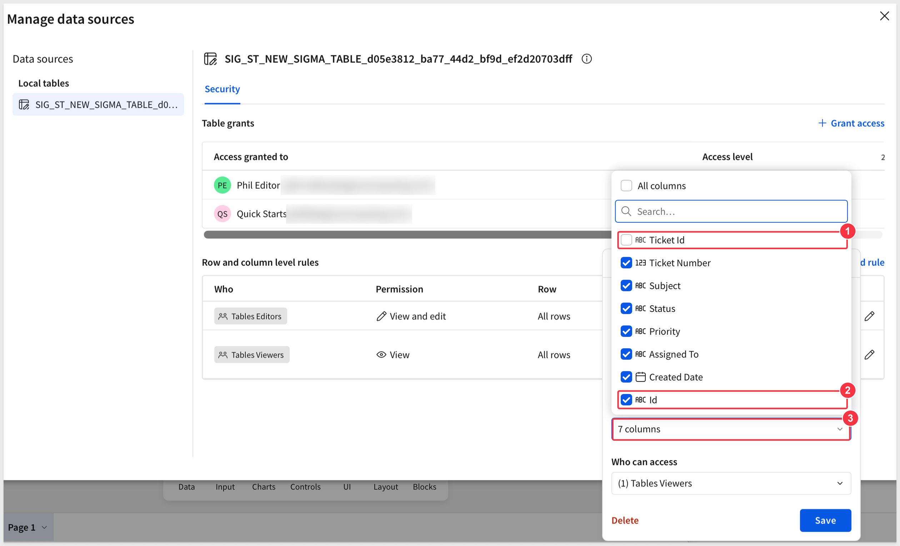

**2.** Click `Add rule` again to add a second rule. Set `Permit to` as `View and edit` (1).

With `View and edit`, `Column` is always on, so select `All columns` (2). Select the `Tables Editors` team under `Who can access` (3), then click `Save` (4). 

Editors can then see the `Ticket Id` column, which the viewers cannot.

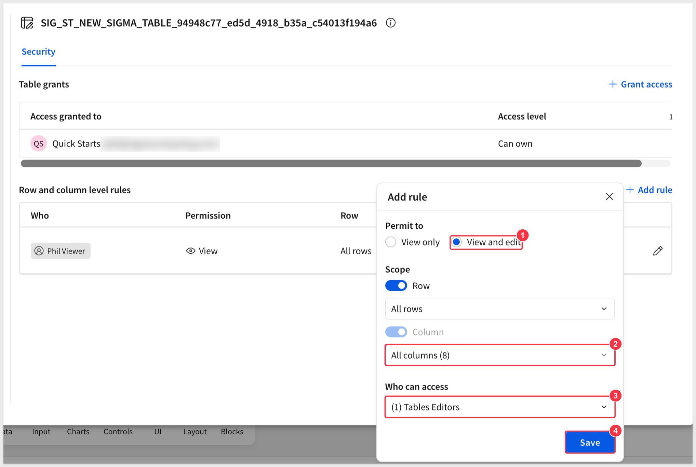

**3.** Click `Add rule` once more and add a rule for yourself: set `Permit to` as `View and edit`, select `All columns`, select your own user under `Who can access`, and click `Save`. Once a table has rules, they apply to everyone who opens it, including you, so this rule keeps the data visible in your own workbook.

<!-- VERIFY: does the editor also need a Table grant (Phil Editor showed Can own in one run, not in the 6f580f19 run)? Teams vs users: latest run used users Phil Viewer / Phil Editor. -->

Both rules are now listed under `Row and column level rules`. The editors rule covers `All columns` (1), while the viewers rule lists the columns it allows, without `Ticket Id` (2).

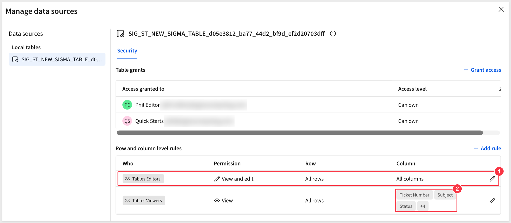

<aside class="positive">
<strong>SCOPE:</strong><br> Under <code>Scope</code>, <code>Row</code> is on by default and limits a rule to specific rows. <code>Column</code> limits it to specific columns. With <code>View only</code>, turn <code>Column</code> on to choose the columns. With <code>View and edit</code>, <code>Column</code> cannot be turned off, the primary key column is included by default, and you can add more columns or select <code>All columns</code>.
</aside>

### User Impersonation

Back in the workbook, the table still shows all of its data, because your own rule covers `All columns`. To see the other rules in effect, impersonate a user who is assigned to one of the teams. If your account has no additional users to try this with, such as in a trial, follow along with the screenshots.

Impersonated users need access to the workbook, so share it with both teams first. In the `Share Workbook` dialog, give `Tables Viewers` the `Can view` permission (1) and `Tables Editors` the `Can edit` permission (2), then click `Share` (3). <!-- VERIFY: how the Share Workbook dialog is opened (button label and location) -->

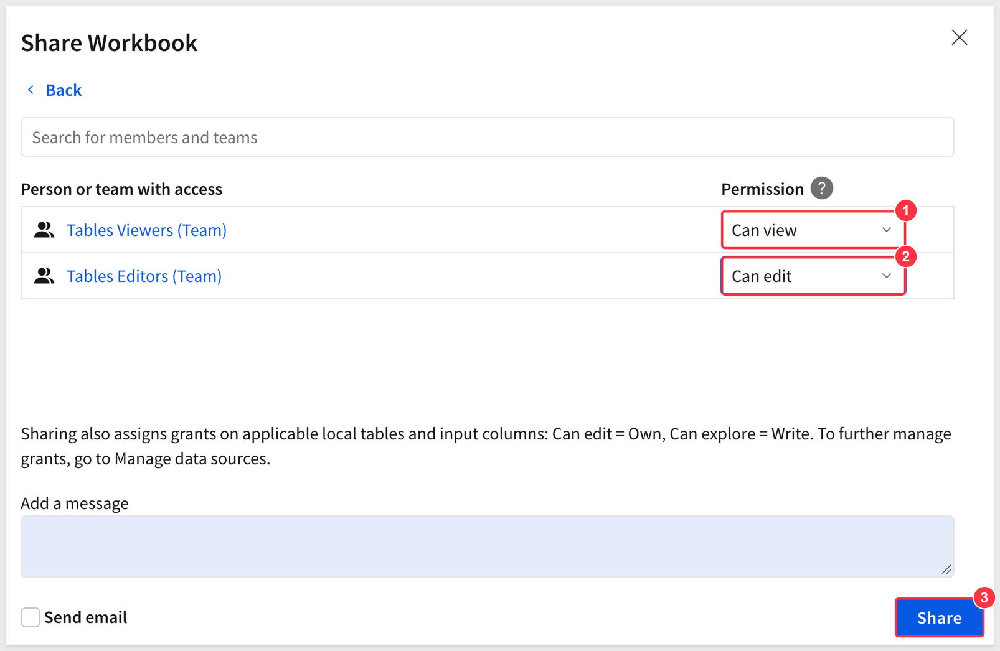

For this test, we assigned two test users to the teams: one to `Tables Viewers` and one to `Tables Editors`.

In `Administration` > `Users`, open the menu for a user on the `Tables Viewers` team (1) and select `Impersonate user` (2).

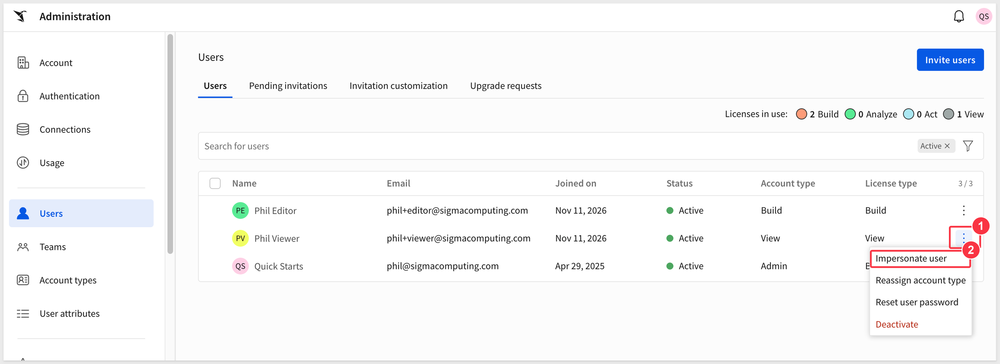

After you select `Impersonate user`, open the `Sigma Tables Lab` workbook. The banner (1) shows who you are logged in as. The viewer does not see the `Ticket Id` column, and cannot edit the workbook to add it back. <!-- RECAPTURE ctp_13: viewer view without Ticket Id, Id showing data --> When you are done, select `Stop impersonation` (2).


<!-- VERIFY: how the workbook is opened after impersonation starts. The capture shows the viewer in a custom view of the workbook. -->

Impersonate the editor the same way. The banner confirms who you are logged in as, and the editor sees every column, including `Ticket Id`, because their rule covers `All columns`.

<!-- RECAPTURE ctp_13c: editor impersonation showing all columns (no Unhide column step) -->
<!-- 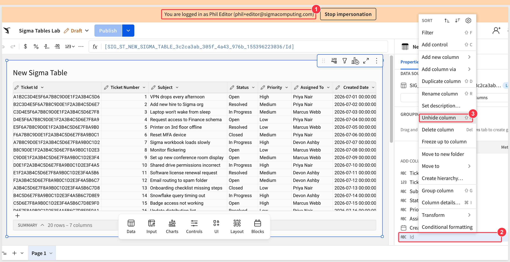 -->

<aside class="positive">
<strong>NOTE:</strong><br> This is a good way to confirm a rule works before you rely on it: view the table as a user the rule applies to.
</aside>


<!-- END OF SECTION-->

## Promote a Table to a Connection Table
Duration: 8

A local Sigma table lives in one workbook. Promoting it creates a shared table in Snowflake that any workbook can use. We will place it in the `SIGMA_TABLES_WRITE` schema created in "Prepare Snowflake."

**1.** From the table's data source menu (1), select `Promote table` (2).

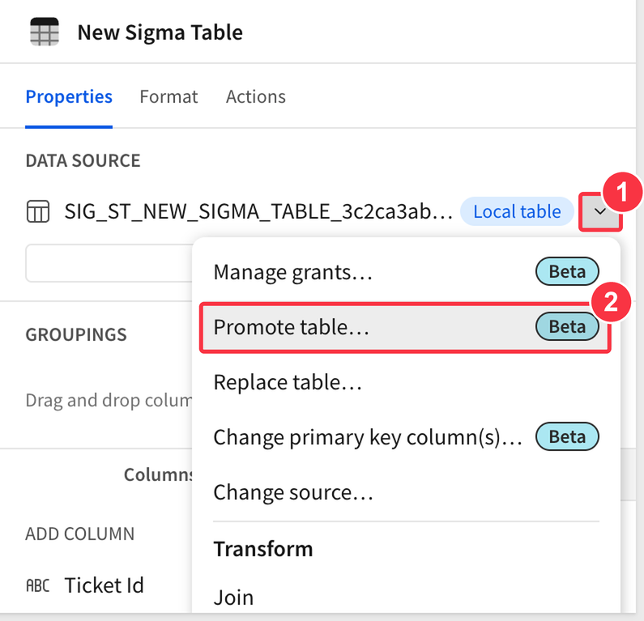

**2.** In `Table name`, enter `SUPPORT_TICKETS` (1).

**3.** In `Schema`, select `QUICKSTARTS.SIGMA_TABLES_WRITE` (2). If the connection's role has access to more than one schema, you can place tables in different business-unit buckets.

**4.** Review `Columns included` (3). The dialog shows the columns that will be included and how their names will map.

<aside class="positive">
<strong>NOTE:</strong><br> Promotion includes every column in the Sigma table, so <code>Id</code> carries over to <code>SUPPORT_TICKETS</code> as its primary key.
</aside>

<!-- VERIFY: can Id be hidden or dropped on the promoted table afterward (it is the primary key)? If yes, add a step after promotion; if no, leave the NOTE as is. -->

**5.** Click `Promote` (4).


<!-- RECAPTURE ctp_14: Table name SUPPORT_TICKETS, Schema QUICKSTARTS.SIGMA_TABLES_WRITE, Columns included 8/8. -->

<aside class="negative">
<strong>IMPORTANT:</strong><br> Edits made during promotion may be lost, so make sure there are no pending edits before you click `Promote`.
</aside>

The result is a Sigma table called `Support_Tickets` in the current workbook. The data source now shows `SUPPORT_TICKETS` (1). `Id` is still in the column list, marked as the primary key (2).

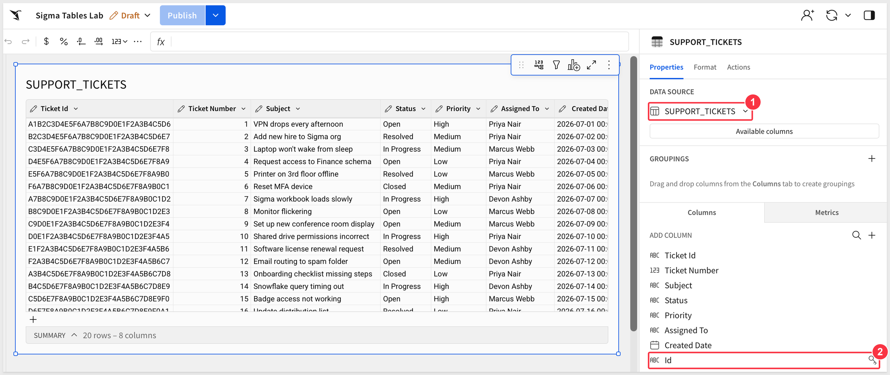

To open it in the connection explorer, open the element menu (1), select `Element source` (2), then `View table` (3). It appears in `QUICKSTARTS.SIGMA_TABLES_WRITE` with standard column names.

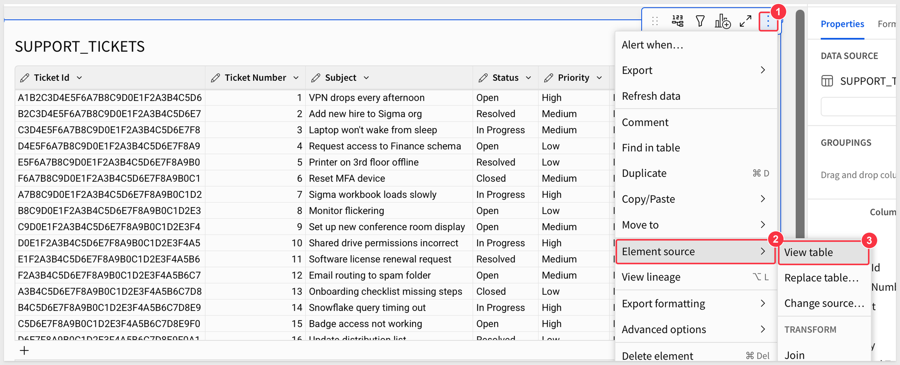

<aside class="negative"><strong>SCREENSHOT REQUIRED: ctp_15</strong><br> Access tab: write access and audit log (no real names or emails)</aside>
<!--  -->
<!-- SOURCE FRAME: frames/t0259.jpg (Access tab). Recapture. Contains real names, emails and a staging connection name. -->

Now open the table in a second workbook with `Explore`. Make an edit in one workbook, wait a couple of seconds while it is committed to the warehouse, and the other open workbook updates too. There are no separate modes to manage: edits are live across all sessions.

<aside class="negative"><strong>SCREENSHOT REQUIRED: ctp_16</strong><br> Two workbooks side by side, an edit appearing in the other (two-window capture)</aside>
<!--  -->
<!-- SOURCE FRAME: frames/t0268.jpg. Needs a two-window capture. -->


<!-- END OF SECTION-->

## Group and Edit at Multiple Levels
Duration: 6

A Sigma table also supports grouping. You can add commentary or adjustments at a group level, or capture feedback by type, and keep adding columns you can edit in place.

<aside class="negative"><strong>SCREENSHOT REQUIRED: ctp_17</strong><br> Grouped Sigma table with group-level editable columns</aside>
<!--  -->
<!-- SOURCE FRAME: frames/t0303.jpg, t0312.jpg, t0325.jpg. Recapture. -->

<aside class="positive">
<strong>WHY IT MATTERS:</strong><br> Think of sales forecasting, where a forecast is entered by a rep, adjusted by a manager, and overridden by a VP. One backing table with editable columns at each level replaces three linked input tables that had to be joined and published as a warehouse view.
</aside>

<!-- VERIFY: the exact steps for adding group-level editable columns were only briefly shown. Walk through and write them as numbered steps. -->


<!-- END OF SECTION-->

## Add Editable Columns to a Warehouse Table
Duration: 10

Warehouse tables are read-only in Sigma, so you cannot change a value in this table:

<aside class="negative"><strong>SCREENSHOT REQUIRED: ctp_18</strong><br> Warehouse table where a value cannot be edited</aside>
<!--  -->
<!-- SOURCE FRAME: frames/t0348.jpg. Recapture. -->

An input column adds editable columns next to warehouse data, like a linked input table.

**1.** In the element panel, open `Columns` and select `Add column`, then the input column option. <!-- VERIFY: path and label -->

**2.** Set `Type` to `Number` and `Column name` to:

```copy-code
Quantity Adj
```

**3.** For `Primary key column(s)`, select `Order Number`, and click `Submit`.

<aside class="negative"><strong>SCREENSHOT REQUIRED: ctp_19</strong><br> Add column dialog: Type, Column name, Primary key column(s)</aside>
<!--  -->
<!-- SOURCE FRAME: frames/t0367.jpg, t0375.jpg. Recapture. -->

A new column appears where you can enter values. If the primary key you choose is not unique, one edit updates every row that shares that key. That is expected, so think it through when you design the key.

**4.** Add a text column named `Comment` the same way, again keyed on `Order Number`.

<aside class="negative"><strong>SCREENSHOT REQUIRED: ctp_20</strong><br> Table showing the Quantity Adj and Comment input columns with values entered</aside>
<!--  -->
<!-- SOURCE FRAME: frames/t0383.jpg, t0413.jpg. Recapture. -->

### What Happens Under the Covers
Sigma does not change the warehouse table. It creates a Sigma table for the edits and joins it to the warehouse table on the fly. You can see this in the query history: the normal warehouse query, plus a join to the Sigma table. If you use several different primary keys, Sigma creates several Sigma tables, and handles that for you.

<aside class="negative"><strong>SCREENSHOT REQUIRED: ctp_21</strong><br> Query history showing the warehouse query plus the join to the Sigma table</aside>
<!--  -->
<!-- SOURCE FRAME: frames/t0448.jpg (query history). Recapture. -->


<!-- END OF SECTION-->

## Migrate an Input Table
Duration: 6

If you already have an input table, you can convert it to a Sigma table.

**1.** Select the input table, and choose the option to create a Sigma table from it. <!-- VERIFY: label -->

**2.** Choose where to put it and give it a name. The name must be unique.

**3.** Click `Create`.

Sigma adds a new table element that is the Sigma table equivalent of the input table. Continue working with it from there.

<aside class="negative"><strong>SCREENSHOT REQUIRED: ctp_22</strong><br> Migrate input table: create Sigma table dialog and the resulting element</aside>
<!--  -->
<!-- SOURCE FRAME: frames/t0475.jpg, t0495.jpg. Recapture. -->


<!-- END OF SECTION-->

## What we've covered
Duration: 2

<!-- DRAFT THIS LAST, after the sections are verified. Do not list the tasks. Explain what was built, why it matters, and the reusable building blocks: three ways to get a Sigma table (new table, input columns on warehouse data, migrating an input table), one place to control access, and promotion for sharing across workbooks. -->


<!-- END OF WHAT WE COVERED -->
<!-- END OF QUICKSTART -->
