author: pballai
id: tables_create_and_promote_sigma_tables
summary: tables_create_and_promote_sigma_tables
categories: Tables
environments: web
status: Published
feedback link: https://github.com/sigmacomputing/sigmaquickstarts/issues
tags: Default
lastUpdated: 2026-12-31

<!--
ROUGH DRAFT generated from a video (qs_videos_studio_inbound). NOT verified in a live Sigma.
Source: Videos/sigma-tables-public-beta-q4-roadmap-demo (transcript.txt, frames/).
Before this goes anywhere near sigmaquickstarts:
1. Walk every step in a live Sigma trial and correct names, menu paths and field labels.
2. Recapture every screenshot (the video frames have browser chrome, a staging URL and a real person's name).
3. Remove this comment and every VERIFY comment. Keep the commented screenshot placeholders until images exist.
4. Roadmap and release status were deliberately left out. Keep them out.
VERIFY items are listed in ../outline.md.
-->

# Create and Promote Sigma Tables

## Overview
Duration: 5

Sigma tables let teams edit data directly in a table, with every change written back to the data platform. The Getting Started with Sigma Tables QuickStart shows how to turn an existing warehouse table into a Sigma table.

This QuickStart picks up from there and shows the other ways in. We will create a Sigma table from a CSV file, control who can view and edit it, promote it so other workbooks can use it, and add editable columns to data that already lives in the warehouse.

<aside class="positive">
<strong>WHY IT MATTERS:</strong>  Teams that capture edits, comments, or overrides usually end up with several linked input tables joined back to a warehouse view. A Sigma table can hold those edits in one governed table, shared by every workbook that needs it.
</aside>

Along the way you'll learn how to:
- Create a Sigma table from a CSV file
- Control who can view and edit a Sigma table
- Promote a workbook Sigma table so it can be shared across workbooks
- Add editable columns to a warehouse table
- Migrate an existing input table to a Sigma table

<aside class="positive">
<strong>IMPORTANT:</strong>  Some screens in Sigma may appear slightly different from those shown in QuickStarts. This is because Sigma continuously adds and enhances functionality. Rest assured, Sigma's intuitive interface ensures that any differences will not prevent you from successfully completing any QuickStart.
</aside>

For more information on Sigma's product release strategy, see [Sigma product releases](https://help.sigmacomputing.com/docs/sigma-product-releases)

If something doesn't work as expected, here's how to [contact Sigma support](https://help.sigmacomputing.com/docs/sigma-support)

### Target Audience
<!-- VERIFY: audience wording. Getting Started uses: Sigma admins and data teams evaluating Sigma tables for operational write-back use cases. -->

### Prerequisites

<ul>
  <li>Any modern browser is acceptable.</li>
  <li>Access to your Sigma environment.</li>
  <li>Completion of <a href="https://quickstarts.sigmacomputing.com/guide/tables_getting_started_with_sigma_tables/index">Getting Started with Sigma Tables</a>, or equivalent familiarity.</li>
  <!-- VERIFY: account type needed, Snowflake connection with a writable schema, a CSV file to upload (and where readers get it), sample data for the input column section. -->
 </ul>

<button>[Sigma Free Trial](https://www.sigmacomputing.com/free-trial/)</button>

<!-- END OF SECTION-->

## Create a Sigma Table from a CSV
Duration: 8

A Sigma table can start from scratch, much like an input table, inside a workbook. We will start from a CSV file so there is data to work with.

**1.** Download the sample data to your computer. It is the same support tickets file used in Getting Started with Sigma Tables.

<button>[Download the Sigma Tables Sample CSV](https://sigma-quickstarts-main.s3.us-west-1.amazonaws.com/sigma-tables/sigma-tables-sample-data.csv)</button>

**2.** In a workbook, open the element bar and select `Input` (1), then `Sigma table` (2). Choose to upload a CSV file. <!-- VERIFY: how the upload CSV option is chosen after Sigma table; see ctp_02 -->

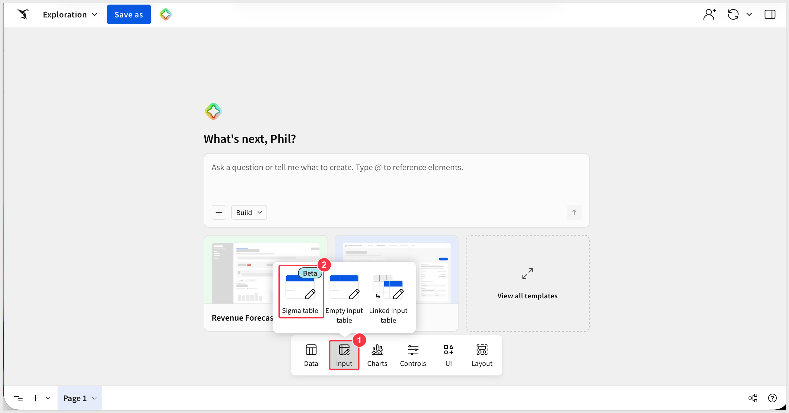

<aside class="negative"><strong>SCREENSHOT REQUIRED: ctp_02</strong>  Create Sigma table dialog: Upload CSV tab, connection, Upload CSV button (waiting on a decision about the beta/GA sentence in the dialog)</aside>
<!-- 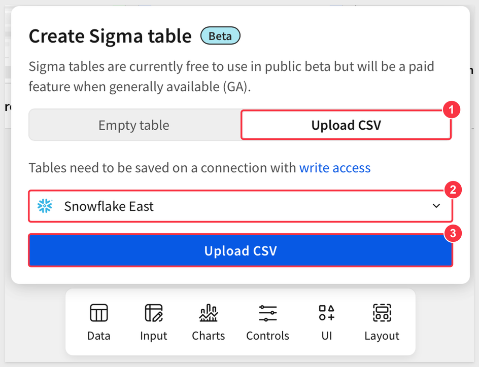 -->

**3.** Select `sigma-tables-sample-data.csv` when prompted. <!-- VERIFY: confirm the file picker appears when you click Upload CSV in the Create Sigma table dialog -->

**4.** In the `Upload CSV` dialog, confirm the `Connection` (1) and leave `Contains headers` selected (2). Check that `Results` shows `20 rows - 7 columns` (3), then click `Save` (4).

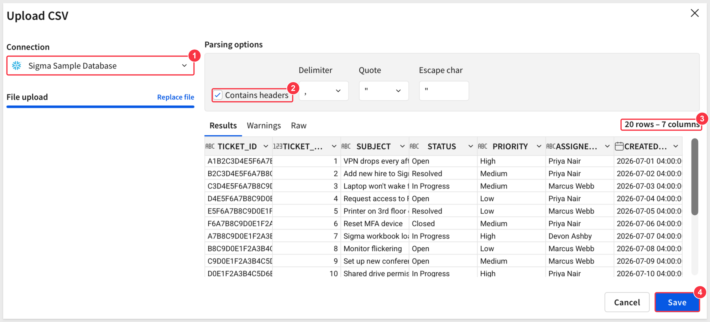

Sigma loads the file and shows a new, fully editable Sigma table. It assigned a primary key based on the data.

<aside class="positive">
<strong>PRIMARY KEYS:</strong>  Every Sigma table needs a primary key. This is an extra requirement compared to input tables.
</aside>

**5.** In the element panel, hover over the data source name to see the table name (1). The `Local table` label (2) shows it is available in this workbook, rather than a shared table in the connection.

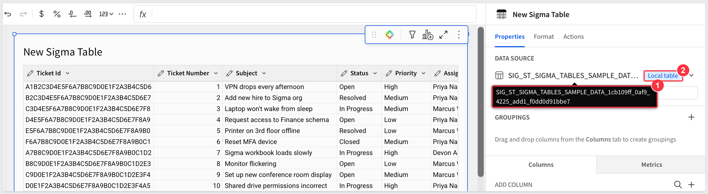

Open the data source menu (1). It offers `Manage grants` (2) to control who can use the table, `Promote table` (3) to turn it into a shared connection table, and `Change primary key column(s)` (4).

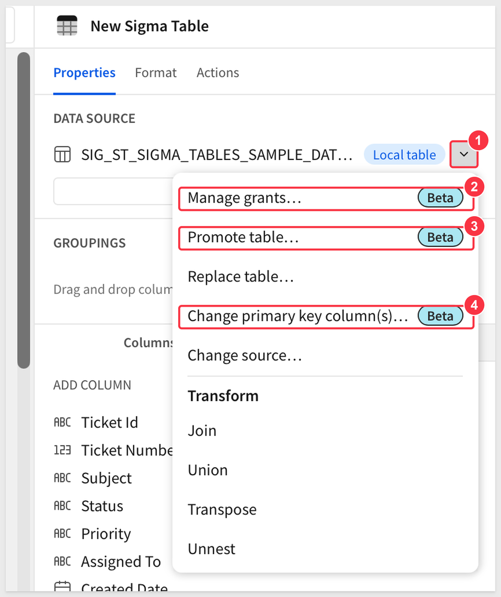

<aside class="negative">
<strong>IMPORTANT:</strong>  Change the primary key before you promote the table. It cannot be changed afterwards.
</aside>

<!-- END OF SECTION-->

## Create Test Teams
Duration: 5

Sigma controls who can use a table through teams. We will create two test teams first, so you can restrict the table in the next section and see the result without affecting anyone else.

**1.** In the left menu of `Administration`, select `Teams` (1), then select `Create team` (2). <!-- VERIFY: account type needed to create teams; add it to Prerequisites -->

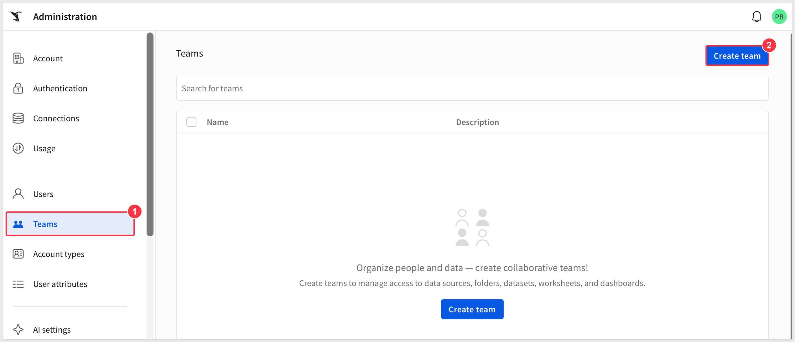

**2.** On the `New team` page, enter `Tables Viewers` for `Team name` (1). Leave the other fields as they are and select `Create` (2).

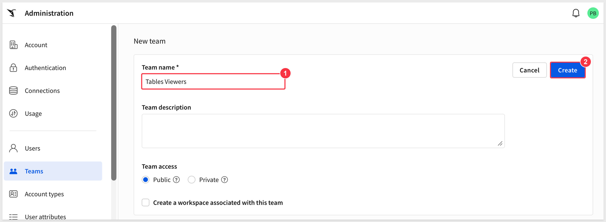

**3.** On the `Tables Viewers` team page (1), select `Add members` (2), add yourself, and confirm. Your name now shows under `Team members` (3). <!-- VERIFY: Add members dialog labels and how you select yourself -->

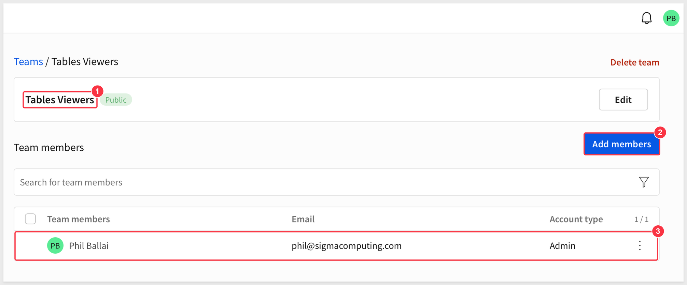

**4.** Create a second team named `Tables Editors` the same way. On its team page (1), select `Add members` (2) and add yourself. Your name shows under `Team members` (3).

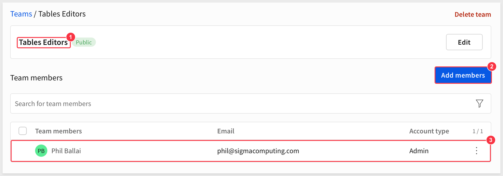

**5.** Select `Teams` to return to the list. Both new teams are listed (1).

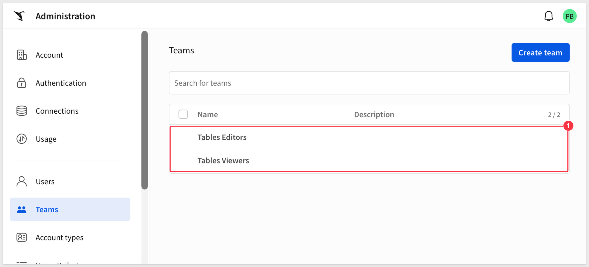

<!-- END OF SECTION-->

## Control Access to the Table
Duration: 8

Open the data source menu and select `Manage grants`. In the `Local table management` dialog, the `Table grants` list (1) shows who has access. For a table you created, that is you, with `Can own` (2). Select `Grant access` (3) to add others.

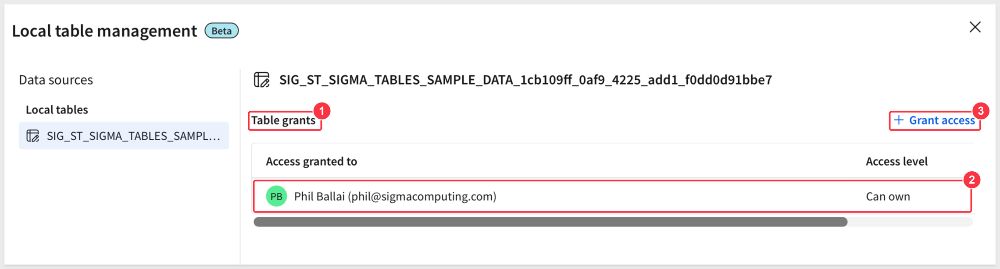

<!-- VERIFY: row and column rules are not visible in this dialog (it scrolls right). The draft said: Under `Row and column level rules`, the default rule gives other people `View and edit` on all rows and all columns. Capture it, or remove it, and re-check the `Add rule` steps below. -->

<!-- VERIFY (2026-11-07): the video's staging build showed a `Manage data sources` dialog with a `Security` tab, `Table grants`, and a separate `Row and column level rules` section (`Add rule`; columns Who, Permission, Row, Column; default rule Others / View and edit / All rows / All columns). Phil's trial shows `Local table management` with `Table grants` only (grant types `Write` and `Own`), and nothing further when scrolled right. So the rules section does not exist in the trial. The narrator also introduces row and column security as a roadmap item. The `Add rule` steps, the `View` / `View and edit` wording and the "No data" step cannot stay as written. Decision pending (Phil): drop the rules, the "No data" step and possibly the test teams; keep `Table grants` and `Grant access`. -->

To restrict this, add rules that stack on top of each other:

**1.** Click `Add rule`, select the `Tables Viewers` team, and set the permission to `View`.

**2.** Add a second rule for the `Tables Editors` team with `View and edit`.

**3.** Click `Save`.

<aside class="negative"><strong>SCREENSHOT REQUIRED: ctp_12</strong>  Add rule dialog with the team rules set up (use clean test teams)</aside>
<!-- 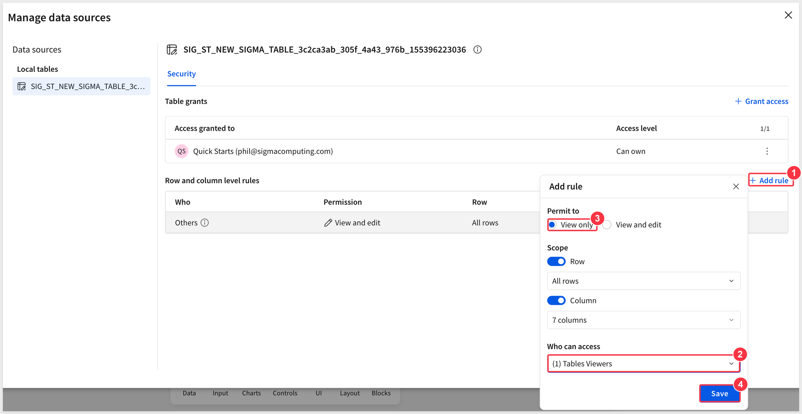 -->
<!-- SOURCE FRAME: frames/t0162.jpg, t0172.jpg, t0193.jpg. Recapture. -->

Rules can apply at the row level or the column level. <!-- VERIFY: how rows and columns are scoped in the rule dialog -->

Back in the workbook, the table now shows no data, as expected: the current user is not on either team. Remove the rule to see the data again.

<aside class="negative"><strong>SCREENSHOT REQUIRED: ctp_13</strong>  Table showing "No data" while the rules exclude you</aside>
<!-- 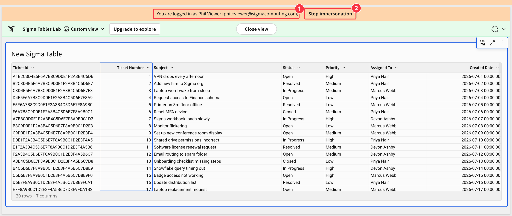 -->
<!-- SOURCE FRAME: frames/t0186.jpg (No data). Recapture. -->

<aside class="positive">
<strong>NOTE:</strong>  This is a good way to confirm a rule works before you rely on it: test it as a user who should not have access.
</aside>

<!-- END OF SECTION-->

## Promote a Table to a Connection Table
Duration: 8

A local Sigma table lives in one workbook. Promoting it creates a shared table in your data platform that any workbook can use.

**1.** From the table's data source menu, select `Promote table`.

**2.** Choose a destination schema. If you have access to more than one schema, you can place tables in different business-unit buckets.

**3.** Enter a name, for example `ST_DEMO_101`. The dialog shows the columns that will be included and how their names will map.

**4.** Click `Create`. <!-- VERIFY: button label -->

<aside class="negative"><strong>SCREENSHOT REQUIRED: ctp_14</strong>  Promote dialog: schema, table name, column mapping preview</aside>
<!-- 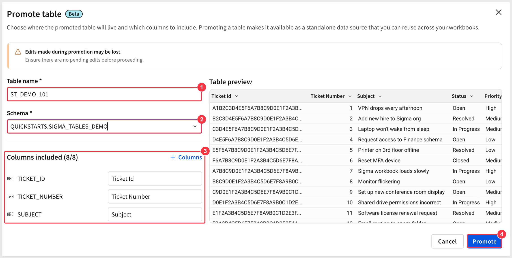 -->
<!-- SOURCE FRAME: frames/t0235.jpg. Recapture. -->

The result is a shared Sigma table. The name changes, and in the data source it now looks like a warehouse table, although it is editable. Select `View` to open it in the connection explorer, where it appears in the write-back schema with standard column names.

On the table's `Access` tab you can turn write access on or off, and open the audit log. <!-- VERIFY: do not mention any beta label -->

<aside class="negative"><strong>SCREENSHOT REQUIRED: ctp_15</strong>  Access tab: write access and audit log (no real names or emails)</aside>
<!--  -->
<!-- SOURCE FRAME: frames/t0259.jpg (Access tab). Recapture. Contains real names, emails and a staging connection name. -->

Now open the table in a second workbook with `Explore`. Make an edit in one workbook, wait a couple of seconds while it is committed to the warehouse, and the other open workbook updates too. There are no separate modes to manage: edits are live across all sessions.

<aside class="negative"><strong>SCREENSHOT REQUIRED: ctp_16</strong>  Two workbooks side by side, an edit appearing in the other (two-window capture)</aside>
<!--  -->
<!-- SOURCE FRAME: frames/t0268.jpg. Needs a two-window capture. -->

<!-- END OF SECTION-->

## Group and Edit at Multiple Levels
Duration: 6

A Sigma table also supports grouping. You can add commentary or adjustments at a group level, or capture feedback by type, and keep adding columns you can edit in place.

<aside class="negative"><strong>SCREENSHOT REQUIRED: ctp_17</strong>  Grouped Sigma table with group-level editable columns</aside>
<!--  -->
<!-- SOURCE FRAME: frames/t0303.jpg, t0312.jpg, t0325.jpg. Recapture. -->

<aside class="positive">
<strong>WHY IT MATTERS:</strong>  Think of sales forecasting, where a forecast is entered by a rep, adjusted by a manager, and overridden by a VP. One backing table with editable columns at each level replaces three linked input tables that had to be joined and published as a warehouse view.
</aside>

<!-- VERIFY: the exact steps for adding group-level editable columns were only briefly shown. Walk through and write them as numbered steps. -->

<!-- END OF SECTION-->

## Add Editable Columns to a Warehouse Table
Duration: 10

Warehouse tables are read-only in Sigma, so you cannot change a value in this table:

<aside class="negative"><strong>SCREENSHOT REQUIRED: ctp_18</strong>  Warehouse table where a value cannot be edited</aside>
<!--  -->
<!-- SOURCE FRAME: frames/t0348.jpg. Recapture. -->

An input column adds editable columns next to warehouse data, like a linked input table.

**1.** In the element panel, open `Columns` and select `Add column`, then the input column option. <!-- VERIFY: path and label -->

**2.** Set `Type` to `Number` and `Column name` to `Quantity Adj`.

**3.** For `Primary key column(s)`, select `Order Number`, and click `Submit`.

<aside class="negative"><strong>SCREENSHOT REQUIRED: ctp_19</strong>  Add column dialog: Type, Column name, Primary key column(s)</aside>
<!--  -->
<!-- SOURCE FRAME: frames/t0367.jpg, t0375.jpg. Recapture. -->

A new column appears where you can enter values. If the primary key you choose is not unique, one edit updates every row that shares that key. That is expected, so think it through when you design the key.

**4.** Add a text column named `Comment` the same way, again keyed on `Order Number`.

<aside class="negative"><strong>SCREENSHOT REQUIRED: ctp_20</strong>  Table showing the Quantity Adj and Comment input columns with values entered</aside>
<!--  -->
<!-- SOURCE FRAME: frames/t0383.jpg, t0413.jpg. Recapture. -->

### What Happens Under the Covers
Sigma does not change the warehouse table. It creates a Sigma table for the edits and joins it to the warehouse table on the fly. You can see this in the query history: the normal warehouse query, plus a join to the Sigma table. If you use several different primary keys, Sigma creates several Sigma tables, and handles that for you.

<aside class="negative"><strong>SCREENSHOT REQUIRED: ctp_21</strong>  Query history showing the warehouse query plus the join to the Sigma table</aside>
<!--  -->
<!-- SOURCE FRAME: frames/t0448.jpg (query history). Recapture. -->

<!-- END OF SECTION-->

## Migrate an Input Table
Duration: 6

If you already have an input table, you can convert it to a Sigma table.

**1.** Select the input table, and choose the option to create a Sigma table from it. <!-- VERIFY: label -->

**2.** Choose where to put it and give it a name. The name must be unique.

**3.** Click `Create`.

Sigma adds a new table element that is the Sigma table equivalent of the input table. Continue working with it from there.

<aside class="negative"><strong>SCREENSHOT REQUIRED: ctp_22</strong>  Migrate input table: create Sigma table dialog and the resulting element</aside>
<!--  -->
<!-- SOURCE FRAME: frames/t0475.jpg, t0495.jpg. Recapture. -->

<!-- END OF SECTION-->

## What we've covered
Duration: 2

<!-- DRAFT THIS LAST, after the sections are verified. Do not list the tasks. Explain what was built, why it matters, and the reusable building blocks: three ways to get a Sigma table (new table, input columns on warehouse data, migrating an input table), one place to control access, and promotion for sharing across workbooks. -->

<!-- END OF WHAT WE COVERED -->
<!-- END OF QUICKSTART -->
