author: pballai
id: tables_getting_started_with_sigma_tables
summary: tables_getting_started_with_sigma_tables
categories: Tables
environments: web
status: Published
feedback link: https://github.com/sigmacomputing/sigmaquickstarts/issues
tags: Default
lastUpdated: 2026-11-05

# Getting Started with Sigma Tables

## Overview
Duration: 5

Sigma has always been known as a leader in analytics, giving teams a direct line to explore and understand their data without waiting on engineering to build something new.

Sigma has extended that same direct connection to writing data, not just reading it -- letting teams update, correct, and enrich tables in their data platform right where they live, without exporting to a spreadsheet or standing up a custom write-back pipeline.

If you've used [Sigma input tables](https://help.sigmacomputing.com/docs/intro-to-input-tables) before, a Sigma table takes a different approach to that same idea. Instead of holding data inside a single workbook, it turns an existing table in your data platform into a shared, governed surface that any workbook, app, or outside system can read and write -- the same live data, reusable everywhere, rather than used in a single workbook or manually copied for reuse.

The two aren't the same thing today, and this QuickStart doesn't assume one replaces the other -- which fits depends on whether the data needs to live and move with one workbook, or be shared more broadly.

This QuickStart demonstrates how to use Sigma tables to turn an existing table into a shared, editable data source entirely within the Sigma UI. The data used will come from, and be stored in, Snowflake. 

During this demonstration, we will enable admin-controlled write access on a table, edit it directly inside a workbook, add rows a few different ways, build actions that update and delete rows from a right-click menu, and track every change with an audit log along the way.

Prefer to watch first? [Watch the short summary video](https://sigmacomputing.wistia.com/s/h1i0i7s5g6gf6cq) to see what Sigma tables are, how to enable write access, and how to edit a table.

Along the way you'll learn how to:
- Enable write access on a database table in Snowflake to turn it into a Sigma table
- Reference a Sigma table in a workbook and edit data directly in the grid
- Modify a Sigma table's schema by adding, renaming, and deleting columns
- Add new rows to a Sigma table directly in the grid
- Build actions that update and delete rows from a right-click context menu
- Configure audit logging to track who changed what, and when

For the most recent information on Sigma tables, see: [Sigma tables overview](https://help.sigmacomputing.com/docs/sigma-tables-overview)

<aside class="positive">
<strong>IMPORTANT:</strong><br> Some screens in Sigma may appear slightly different from those shown in QuickStarts. This is because Sigma continuously adds and enhances functionality. Rest assured, Sigma's intuitive interface ensures that any differences will not prevent you from successfully completing any QuickStart.
</aside>

For more information on Sigma's product release strategy, see [Sigma product releases](https://help.sigmacomputing.com/docs/sigma-product-releases)

If something doesn't work as expected, here's how to [contact Sigma support](https://help.sigmacomputing.com/docs/sigma-support)

### Target Audience
Sigma admins and data teams evaluating Sigma tables for operational write-back use cases -- capturing edits, corrections, or supplemental data directly against a table in the data platform without standing up a separate application.

### Prerequisites

<ul>
  <li>Any modern browser is acceptable.</li>
  <li>Access to your Sigma environment, with an Admin account type or ownership of the target table.</li>
  <li>Sigma tables enabled for your organization.</li>
  <li>A Snowflake connection with privileges to manage grants on the target schema.</li>
  <li>Ability to create a database, schema, and table in Snowflake -- this QuickStart provides a sample dataset to load, so you don't need an existing table with a primary key already in place.</li>
  <li>Some familiarity with Sigma is assumed. Not all steps will be shown, as the basics are assumed to be understood.</li>
 </ul>

<aside class="positive">
<strong>IMPORTANT:</strong><br> Sigma recommends using non-production resources when completing QuickStarts.
</aside>

<button>[Sigma Free Trial](https://www.sigmacomputing.com/free-trial/)</button>


## Prepare the Demo Data
Duration: 10

Sigma tables work against a real table in your data platform, so this QuickStart needs one to practice on. 

Rather than asking you to shape your own table to fit along the way, we will load a small, ready-made dataset. The data represents a support ticket queue that already has everything a Sigma table needs: a primary key, and a few columns worth editing.

You may notice the table has both a `Ticket Id` and a `Ticket Number`. That's deliberate -- more on why later, once it actually matters.

<aside class="negative">
<strong>NOTE:</strong><br> The script below grants access to <code>SIGMA_SERVICE_ROLE</code>. Substitute the role your Sigma connection actually uses if it differs -- you can confirm it in Sigma under <code>Administration</code> > <code>Connections</code> by clicking your Snowflake connection.
</aside>

```copy-code
USE ROLE ACCOUNTADMIN;
USE WAREHOUSE COMPUTE_WH;

CREATE DATABASE IF NOT EXISTS QUICKSTARTS;
CREATE SCHEMA  IF NOT EXISTS QUICKSTARTS.SIGMA_TABLES_DEMO;
USE SCHEMA QUICKSTARTS.SIGMA_TABLES_DEMO;

CREATE OR REPLACE FILE FORMAT sigma_tables_csv_format
  TYPE = CSV
  FIELD_DELIMITER = ','
  FIELD_OPTIONALLY_ENCLOSED_BY = '"'
  NULL_IF = ('', 'NULL')
  EMPTY_FIELD_AS_NULL = TRUE
  PARSE_HEADER = TRUE;

CREATE OR REPLACE STAGE sigma_tables_demo_stage
  URL = 's3://sigma-quickstarts-main/sigma-tables/'
  FILE_FORMAT = sigma_tables_csv_format;

CREATE OR REPLACE TABLE TICKETS (
  TICKET_ID     VARCHAR,
  TICKET_NUMBER NUMBER,
  SUBJECT       VARCHAR,
  STATUS        VARCHAR,
  PRIORITY      VARCHAR,
  ASSIGNED_TO   VARCHAR,
  CREATED_DATE  TIMESTAMP_NTZ
);

COPY INTO TICKETS FROM @sigma_tables_demo_stage/sigma-tables-sample-data.csv MATCH_BY_COLUMN_NAME = CASE_INSENSITIVE;

ALTER TABLE TICKETS ADD PRIMARY KEY (TICKET_ID) RELY;

GRANT USAGE                  ON DATABASE QUICKSTARTS                          TO ROLE SIGMA_SERVICE_ROLE;
GRANT USAGE                  ON SCHEMA   QUICKSTARTS.SIGMA_TABLES_DEMO        TO ROLE SIGMA_SERVICE_ROLE;
GRANT CREATE TABLE           ON SCHEMA   QUICKSTARTS.SIGMA_TABLES_DEMO        TO ROLE SIGMA_SERVICE_ROLE;
GRANT SELECT                 ON ALL    TABLES IN SCHEMA QUICKSTARTS.SIGMA_TABLES_DEMO TO ROLE SIGMA_SERVICE_ROLE;
GRANT SELECT                 ON FUTURE TABLES IN SCHEMA QUICKSTARTS.SIGMA_TABLES_DEMO TO ROLE SIGMA_SERVICE_ROLE;
GRANT UPDATE, INSERT, DELETE ON ALL    TABLES IN SCHEMA QUICKSTARTS.SIGMA_TABLES_DEMO TO ROLE SIGMA_SERVICE_ROLE;
GRANT UPDATE, INSERT, DELETE ON FUTURE TABLES IN SCHEMA QUICKSTARTS.SIGMA_TABLES_DEMO TO ROLE SIGMA_SERVICE_ROLE;

SELECT * FROM QUICKSTARTS.SIGMA_TABLES_DEMO.TICKETS;
```

<aside class="positive">
<strong>NOTE:</strong><br> These grants apply to every table in the schema now and in the future (<code>ALL TABLES</code>/<code>FUTURE TABLES</code>), which is convenient as long as <code>SIGMA_TABLES_DEMO</code> stays dedicated to this demo. If you'd rather keep write access scoped to just this one table -- say, if other tables might land in this schema later that you don't want editable through Sigma -- grant these privileges on <code>TICKETS</code> specifically instead, by swapping <code>ALL TABLES IN SCHEMA QUICKSTARTS.SIGMA_TABLES_DEMO</code> for <code>TABLE QUICKSTARTS.SIGMA_TABLES_DEMO.TICKETS</code> in each grant.
</aside>

Click to `Run all` and verify the data landed correctly:

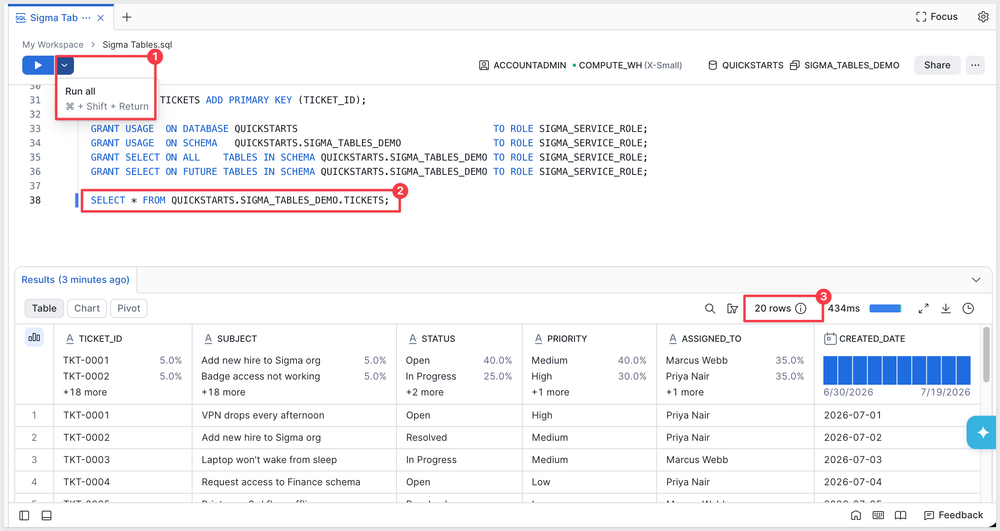

Expected results:
- `ROW_COUNT`: `20`
- `DISTINCT_STATUSES`: `4`

You now have a `TICKETS` table -- open tickets, a few resolved, a few closed -- ready to turn into a Sigma table.


<!-- END OF SECTION-->

## Enable Write Access on a Database Table
Duration: 10

Turning an existing database table into a Sigma table means turning on write access for it, from Sigma. The Snowflake-side privileges are already in place from "Prepare the Demo Data" -- what's left is access granted inside Sigma.

<aside class="positive">
<strong>NOTE:</strong><br> This section covers the simplest path: a single admin, using a shared service identity, granting themselves full access to get something working. Sigma also supports OAuth-based connections, where each user authenticates with their own data platform identity -- see <a href="https://help.sigmacomputing.com/docs/configure-data-access-for-sigma-tables">Configure data access for Sigma tables</a> if that's how your connection is set up.
</aside>

<aside class="positive">
<strong>NOTE:</strong><br> The table needs a primary key already configured in Snowflake before you can enable write access, and that key needs to be declared with <code>RELY</code> (e.g. <code>ADD PRIMARY KEY (id) RELY</code>). Snowflake doesn't enforce primary keys by default -- without <code>RELY</code>, Sigma treats the table as if it has no primary key at all.
</aside>

**1.** In Sigma, browse to the table through the connection explorer: `your Snowflake connection`, then `QUICKSTARTS` > `SIGMA_TABLES_DEMO` > `TICKETS`. Select the `Access` tab.

Toggle on `Allow write access`. This grants organization members permission to write changes back to this table in the warehouse:

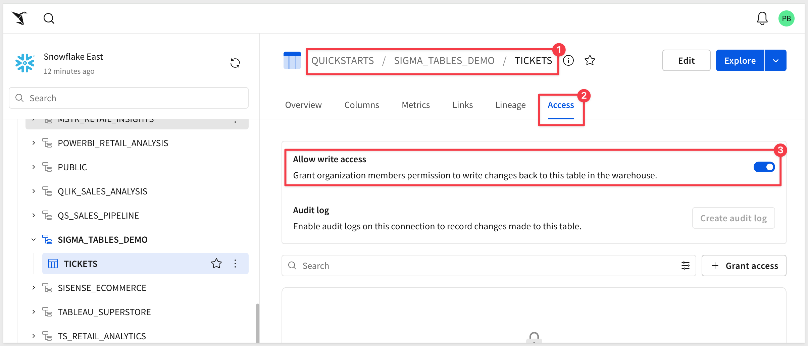

**2.** No one has access to the table yet, even with write access turned on. 

Click `Grant access`, search for yourself (or whoever needs to work with the table), and choose `Can own`. 

`Can own` is what this QuickStart uses going forward, since later sections also change the table's structure, not just its data.

For the full breakdown of access levels and how to configure them for other users, see [Configure data access for Sigma tables](https://help.sigmacomputing.com/docs/configure-data-access-for-sigma-tables)

Click `Save`:

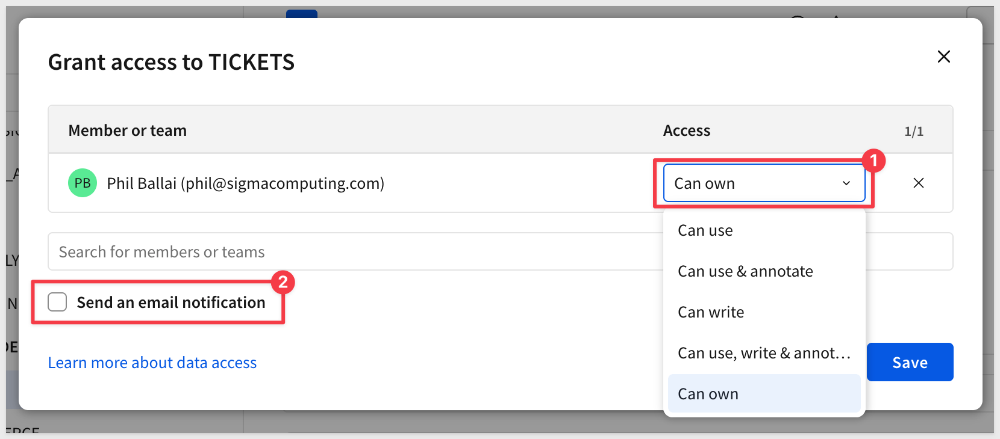

`TICKETS` is now a Sigma table. It's still the same table in Snowflake -- Sigma didn't copy it anywhere -- but it can now be edited from Sigma, with every change written straight back to Snowflake.

One more change while we are here to demonstrate how to deal with potential data type issues. 

Click the `Edit` button.

Click the `Columns` tab and change the `CREATED_DATE` column `Format` to `Date time`.

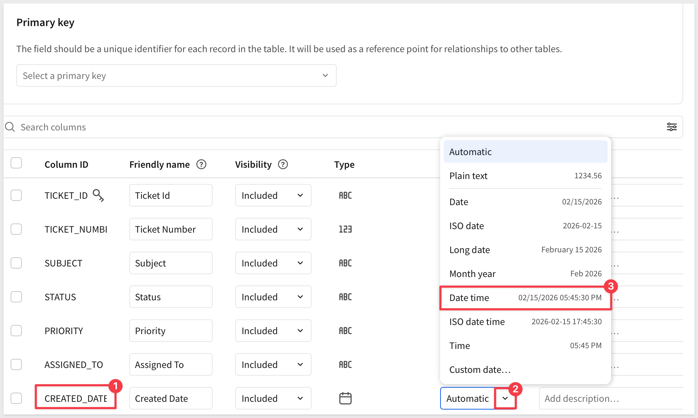

Click `Publish` to save the change.

<aside class="positive">
<strong>NOTE:</strong><br> While you're here, it's worth turning on audit logging too -- it only captures changes made after it's enabled, so switching it on now means everything you do for the rest of this QuickStart gets recorded. This QuickStart looks at what that log actually captures later, in "Edit Table Data."
</aside>

### Enable Audit Logging

Sigma table audit logs are append-only tables Sigma creates in your data platform. You can view an audit log and add it to a workbook the same way you would any other table in the connection. Each entry in the audit log records details about an individual data or schema change that was attempted or committed.

**1.** In Snowflake, create a schema for the audit log to write to, and give your Sigma service identity access to it:

```copy-code
USE ROLE ACCOUNTADMIN;
USE WAREHOUSE COMPUTE_WH;

CREATE SCHEMA IF NOT EXISTS QUICKSTARTS.SIGMA_TABLES_AUDIT;

GRANT USAGE        ON SCHEMA QUICKSTARTS.SIGMA_TABLES_AUDIT TO ROLE SIGMA_SERVICE_ROLE;
GRANT CREATE TABLE ON SCHEMA QUICKSTARTS.SIGMA_TABLES_AUDIT TO ROLE SIGMA_SERVICE_ROLE;
GRANT SELECT ON ALL    TABLES IN SCHEMA QUICKSTARTS.SIGMA_TABLES_AUDIT TO ROLE SIGMA_SERVICE_ROLE;
GRANT SELECT ON FUTURE TABLES IN SCHEMA QUICKSTARTS.SIGMA_TABLES_AUDIT TO ROLE SIGMA_SERVICE_ROLE;
```

**2.** In Sigma, go to `Administration` > `Connections`, select your Snowflake connection, and turn on `Enable Sigma table audit logs`.

**3.** For `Audit log database for Sigma tables` and `Audit log schema for Sigma tables`, enter `QUICKSTARTS` and `SIGMA_TABLES_AUDIT` -- the schema you just created. 

Leave `Auto-create Sigma table audit logs` on if you want every future Sigma table on this connection to get an audit log automatically; turn it off to create them one table at a time instead.

`Save` the changes.

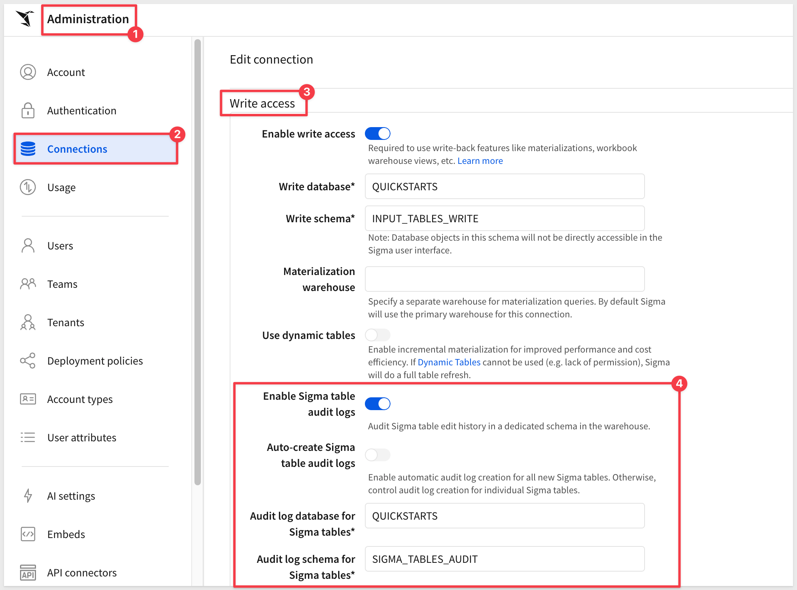

**4.** Back on the `TICKETS` table's `Access` tab, click `Create audit log`.

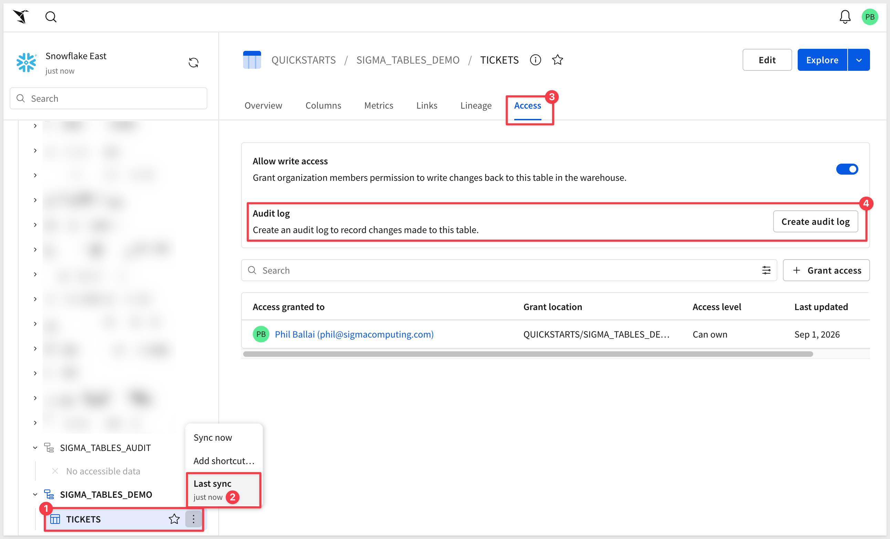

Once created, we can `Sync` the `SIGMA_TABLES_AUDIT` table and observe the new log table appear (the name will vary).

Notice that a grant has been automatically added for us:

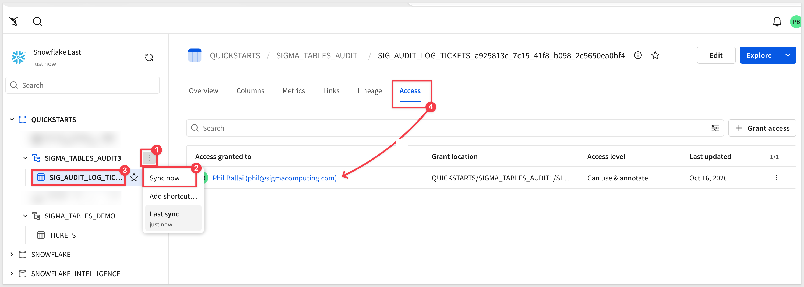

<aside class="negative">
<strong>NOTE:</strong><br> Once audit logging is on, it's not just an observability feature -- <code>TICKETS</code> now depends on it. If Sigma can't write to the audit log for any reason, edits to the table fail until the audit log is reachable again.
</aside>


<!-- END OF SECTION-->

## Reference a Sigma Table in a Workbook
Duration: 5

A Sigma table doesn't need its own dedicated workbook -- reference it from any workbook that needs it, the same way you'd add any other table. Since it's still the same table in Snowflake, edits made in one workbook show up everywhere else `TICKETS` is used.

**1.** From the `TICKETS` table page -- the same page you were just on to grant access -- click `Explore`.

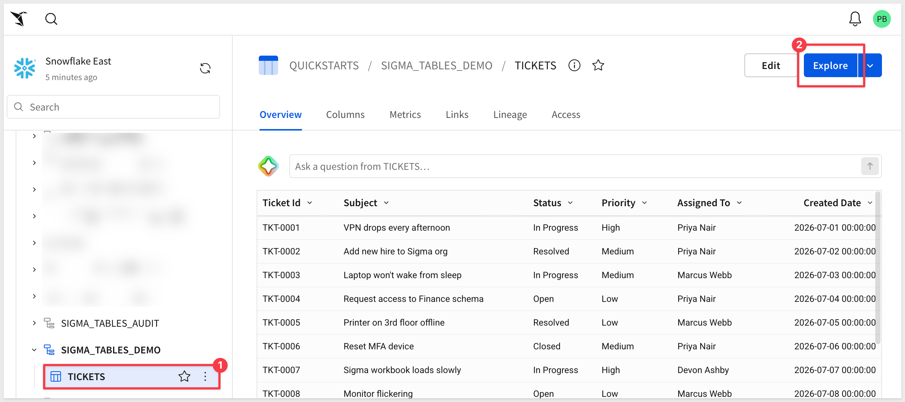

Sigma opens a new workbook draft with `TICKETS` already added as a table element, ready to edit.

Click `Save as` and name the new workbook:

```copy-code
Sigma Tables QuickStart
```

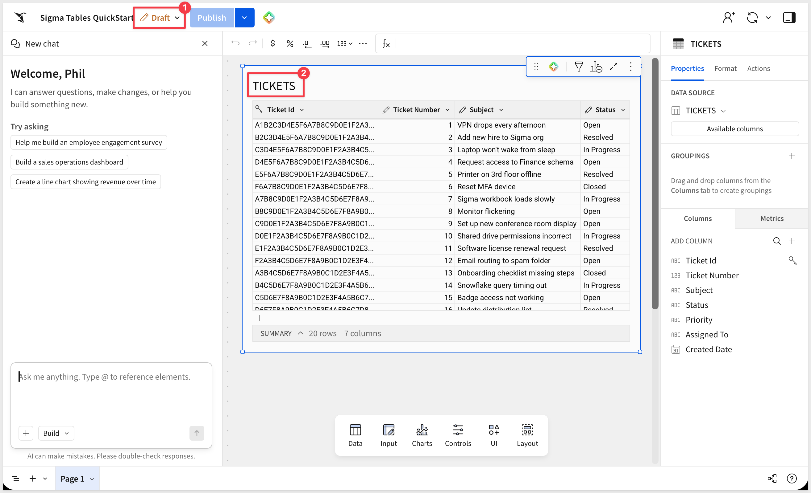

<aside class="positive">
<strong>WHY IT MATTERS:</strong><br> A Sigma table is still just a table. Join <code>TICKETS</code> to other data the same way you'd join anything else in Sigma -- pull in assignee details from an employee directory, or account context from a CRM table -- without changing `TICKETS` itself. Making a table editable doesn't wall it off from the rest of your data model.
</aside>


<!-- END OF SECTION-->

## Edit Table Data
Duration: 10

Editing a Sigma table works like editing any spreadsheet cell -- select it, type a new value, and press `Enter`. 

What's different from a regular Sigma table is where that value ends up: written straight back to `TICKETS` in Snowflake, not just changed on screen.

It doesn't matter whether the workbook is in draft or published mode -- with `Can own` access on the table, editing a cell writes straight to Snowflake either way. A Sigma table edit isn't a workbook change waiting to be published; it's a live write to the underlying table.

<aside class="positive">
<strong>PRIMARY KEYS:</strong><br> You can't edit values in the primary key column (<code>Ticket Id</code>) -- Sigma uses it to identify which row to update, so it stays fixed. 
<br><br>
If a primary key value itself needs correcting, delete the row and add a new one with the right value, rather than trying to edit it in place.
</aside>

<aside class="negative">
<strong>IMPORTANT:</strong><br> Sigma tables don't support undo, redo, or version history the way editing a regular Sigma document does. Once a change writes back to Snowflake, there's no built-in way to revert it from within Sigma -- double-check a value before pressing Enter. Of course, if a mistake is made, just correct it by providing the correct value. All changes are recorded to the audit log, mistakes and all.
</aside>

**1.** In the workbook, select a cell in an editable column. For example change the `STATUS` on ticket number `1` to `In Progress` and press `Enter`.

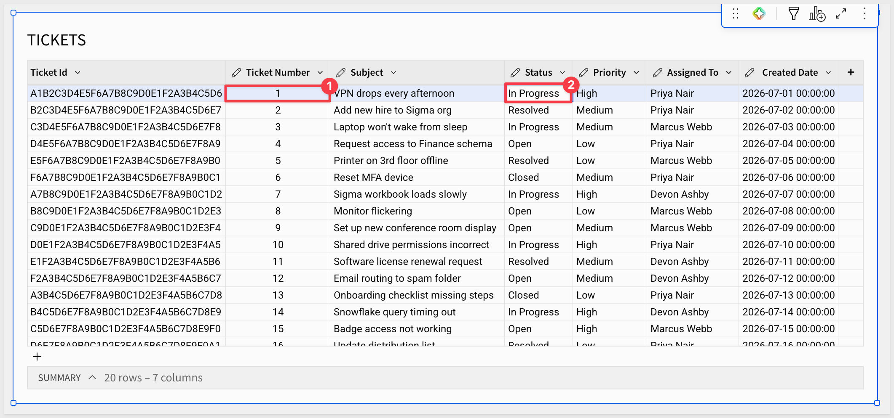

The change writes back to `TICKETS` in Snowflake immediately -- no publish step required. 

Anyone else with access to this Sigma table, **in this workbook or any other**, sees the update the next time their view refreshes.

We can verify the change landed in Snowflake for `TICKET_NUMBER 1`:
```copy-code
SELECT * FROM QUICKSTARTS.SIGMA_TABLES_DEMO.TICKETS
WHERE TICKET_NUMBER = '1';
```

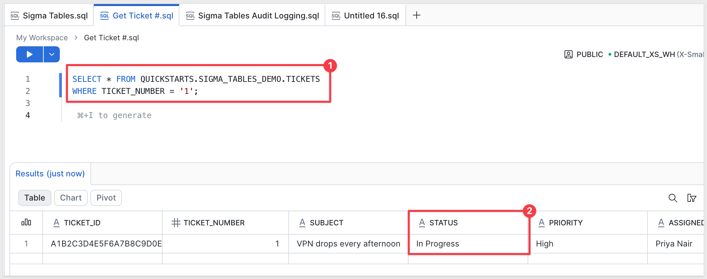

You can also paste a block of values copied from a spreadsheet or another source directly into the grid, to update multiple cells at once the same way.

### Viewing the change in Audit Log

The audit log also shows this edit activity by looking at the log table in the `QuickStarts` > `Sigma_Tables_Audit` > `SIG_AUDIT_LOG_XXX` connection browser:

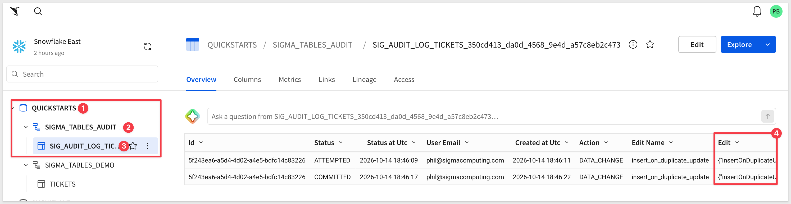

Double-click into the `COMMITTED` row, `Edit` cell to see the status value we changed:

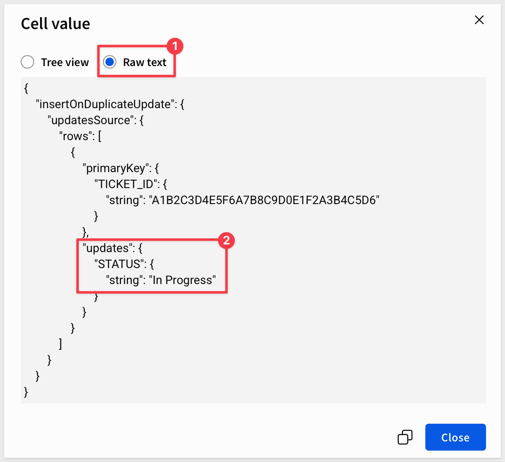


<!-- END OF SECTION-->

## Modify the Table Schema
Duration: 10

A Sigma table's schema isn't fixed once write access is on. Add a column when you need to capture something new, rename one for clarity, or remove one you no longer need -- all without leaving Sigma or touching Snowflake directly.

<aside class="positive">
<strong>NOTE:</strong><br> Schema changes need <code>Can own</code> access on the table -- the same level this QuickStart granted in "Enable Write Access on a Database Table." 
<br> <br> 
Snowflake has no separate privilege for changing a table's structure -- adding, renaming, or dropping a column requires owning the table outright. The grant below transfers ownership to your Sigma service identity while preserving the read/write access it already had, using <code>COPY CURRENT GRANTS</code> rather than replacing it.
</aside>

**1.** In Snowflake, transfer ownership of the table to your Sigma service identity:

```copy-code
GRANT OWNERSHIP ON TABLE QUICKSTARTS.SIGMA_TABLES_DEMO.TICKETS TO ROLE SIGMA_SERVICE_ROLE COPY CURRENT GRANTS;
```

**2.** Schema changes happen on `TICKETS`'s own page in the connection explorer -- the same page used earlier to grant write access -- not inside a workbook. 

If you're still in the workbook from the last section, there's a shortcut: open the `TICKETS` table element's menu and select `Element source` > `View table` to jump straight there instead of browsing the connection tree from scratch.

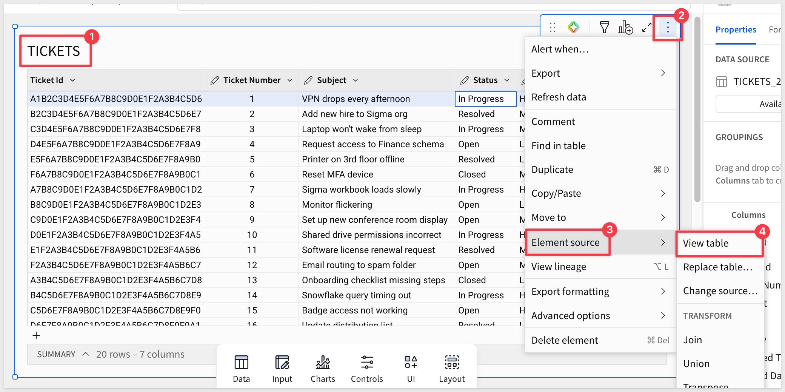

**3.** Click `Edit` and open `Columns`, and click `+ Add column`.

**4.** In the new row, fill in a `Column ID` and `Friendly name`, choose a data type from the `Type` dropdown, and set `Visibility` to `Included`.

For example, a text column named `RESOLUTION_NOTES` to capture how a ticket was closed out. The remaining fields are optional.

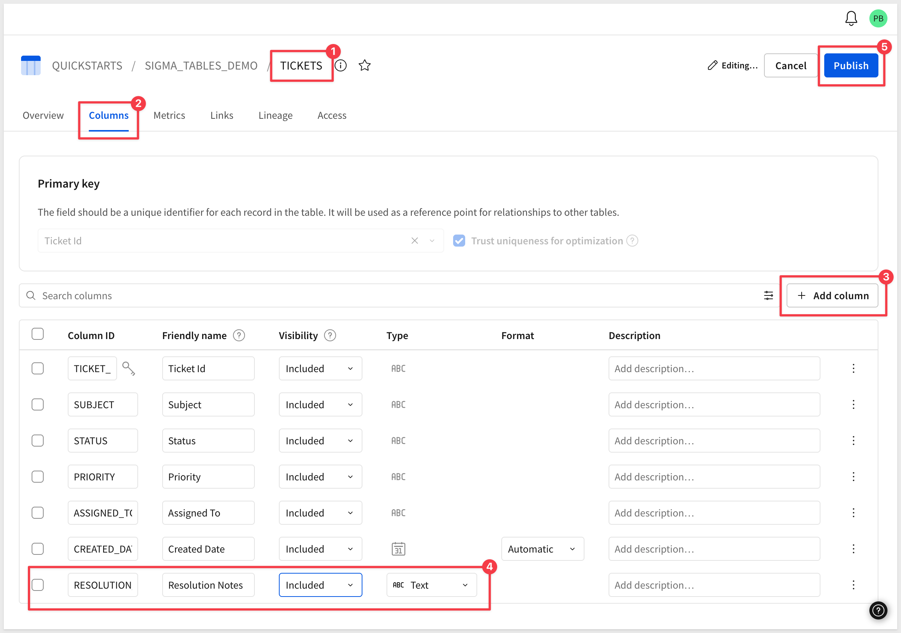

**5.** Click `Publish` to save the change.

<aside class="negative">
<strong>NOTE:</strong><br> Setting <code>Visibility</code> to <code>Included</code> controls what new elements offer by default -- it doesn't reach back into workbook elements that already reference this table, like the one from "Reference a Sigma Table in a Workbook." Those need the new column added manually, every time, regardless of <code>Visibility</code>.
</aside>

**6.** Back in your workbook, refresh the page first. Select the `TICKETS` table element. In the `Properties` panel's `Data Source` section, click `Available columns`.

**7.** In the `Source columns` modal, check the box next to `Resolution Notes` (or whatever new column you added), then close the modal.

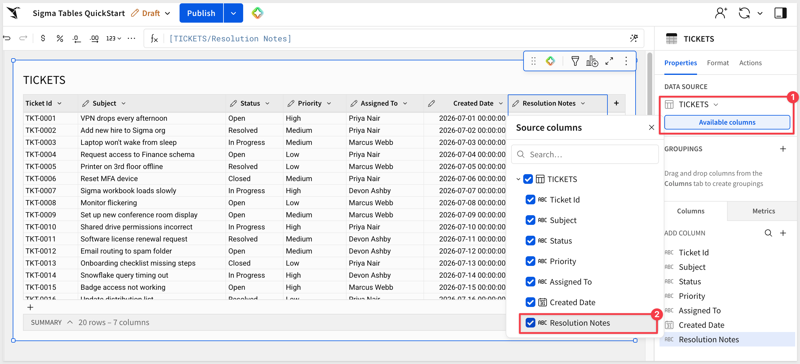

The new column now appears in the grid, ready to edit like any other.

<aside class="negative">
<strong>NOTE:</strong><br> Workbook mode doesn't affect making the change itself -- schema edits happen on the table directly, in the data catalog, not inside any specific workbook. What it does affect is who sees the change and when: published workbooks that reference this table pick it up immediately, while a draft still pointing at the old column needs to add the column manually. 
</aside>

If you delete a column that other elements in your workbooks depend on, Sigma asks you to pick a replacement before the deletion goes through, so a chart or calculation doesn't silently break.

For example, we added and then deleted a `Test` column and were warned:

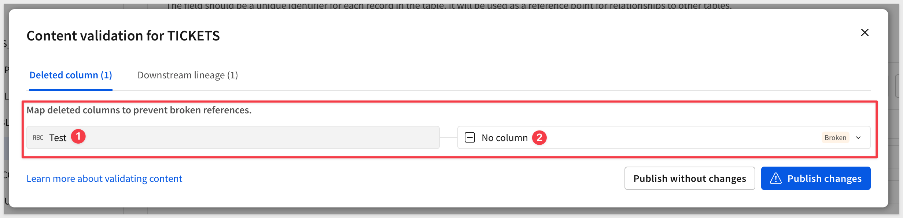


<!-- END OF SECTION-->

## Add Rows to a Sigma Table
Duration: 10

A Sigma table needs new rows just as often as it needs existing ones corrected -- a new ticket comes in and needs to be logged. Sigma lets you add it directly in the grid, with no extra setup.

Before adding anything, let's sort `Ticket Number` descending, so the newest ticket lands at the top of the grid -- that way, the new row you add is immediately visible, right where you're already looking, instead of buried at the bottom.

**1.** Click the dropdown arrow on the `Ticket Number` column header and choose `Sort descending`.

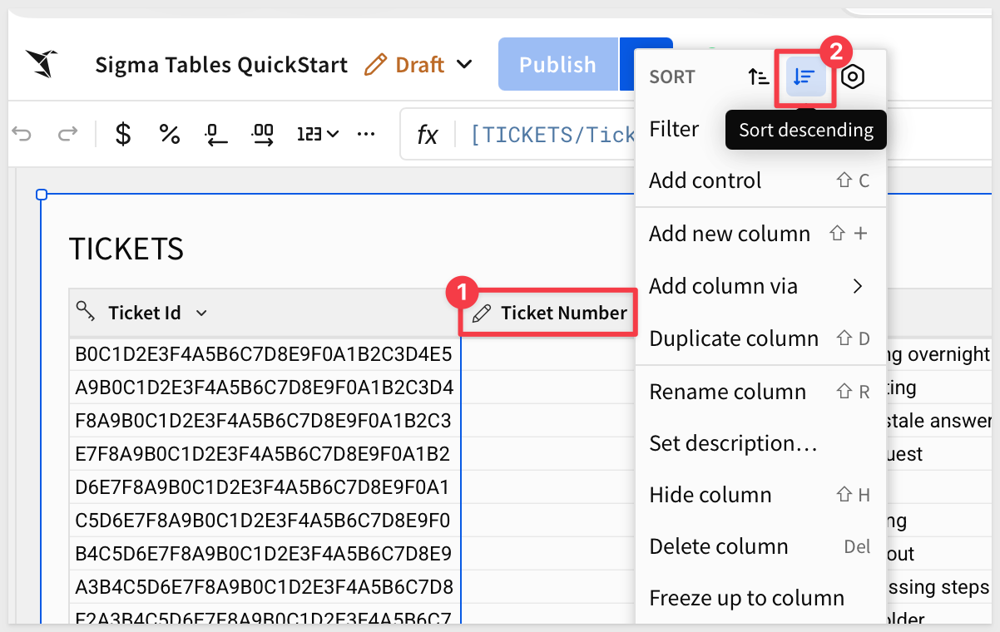

### Add a Row Directly in the Grid

The simplest way to add a row doesn't need a button, an action, or any setup at all.

**1.** Scroll to the bottom of the `TICKETS` table element. Click the `+` that appears below the last row.

Sigma generates `Ticket Id` for this row automatically, so you don't enter it yourself.

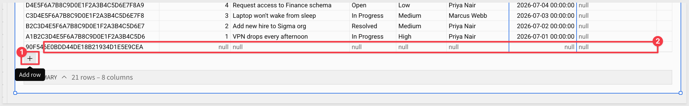

**2.** Sigma adds a blank row.

Set `Ticket Number` to one higher than the first row (21).

Fill in values the same way you'd edit any other cell -- type into `Subject`, `Status`, `Priority`, `Assigned To`, and `Created Date`, then press `Enter` to commit each one.

Since it was sorted by `Ticket Number`, the new row should appear at the top of the table.

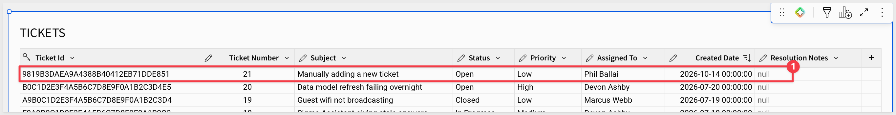

<aside class="negative">
<strong>NOTE:</strong><br> Now that you've seen what <code>Ticket Id</code> actually is -- a system-generated identifier, not something meant for people to read -- hide it.
<br><br>
Select the <code>TICKETS</code> table element, open <code>Available columns</code> in the <code>Properties</code> panel the same way you did to show <code>Resolution Notes</code> earlier, and uncheck <code>Ticket Id</code>. <code>Ticket Number</code> stays as the identifier people actually see and use.
</aside>

This works well enough for a one-off addition by someone already comfortable in the grid, but it doesn't scale to a repeatable workflow or a less technical audience. A guided form is generally the preferred way to let that kind of audience add or update rows -- that pattern is already covered in depth across several other Sigma QuickStarts.

For a sense of what's possible, browse the [AI Apps](https://quickstarts.sigmacomputing.com/?cat=aiapps) and [App Templates](https://quickstarts.sigmacomputing.com/?cat=apptemplates) QuickStart categories.

<!--
### Bulk-Load Additional Rows

This is also where a workbook stops being just information to look at and starts behaving like an app. Buttons and actions built on Sigma tables give you a real interface for changing data -- an intake form, an approval queue, a status tracker -- built entirely in Sigma, without standing up a separate application.

Let's simulate batch importing tickets from another system, using an action to pull them from another table in the workbook instead on demand or automatically.

An action is a trigger (the button) paired with an effect (what happens to the table) -- the effect is what actually reads and writes rows.

<aside class="positive">
<strong>NOTE:</strong><br> Insert actions can only target a Sigma table with a text primary key -- <code>Ticket Id</code> already is one -- and can't insert multiple rows from a single multi-value source. That's exactly why this section pulls rows from a source table instead of a hand-filled form.
</aside>

**1.** In Snowflake, create a small staging table with a few new tickets to load:

```copy-code
USE ROLE ACCOUNTADMIN;
USE WAREHOUSE COMPUTE_WH;
USE SCHEMA QUICKSTARTS.SIGMA_TABLES_DEMO;

CREATE OR REPLACE TABLE NEW_TICKETS (
  TICKET_NUMBER NUMBER,
  SUBJECT       VARCHAR,
  STATUS        VARCHAR,
  PRIORITY      VARCHAR,
  ASSIGNED_TO   VARCHAR
);

INSERT INTO NEW_TICKETS (TICKET_NUMBER, SUBJECT, STATUS, PRIORITY, ASSIGNED_TO) VALUES
  (22, 'Conference room projector won''t connect', 'Open', 'Medium', 'Priya Nair'),
  (23, 'New hire needs laptop imaged',              'Open', 'High',   'Marcus Webb'),
  (24, 'Expense report tool throwing errors',       'Open', 'Medium', 'Devon Ashby');
```

<aside class="positive">
<strong>NOTE:</strong><br> No new grant is needed here -- <code>SIGMA_SERVICE_ROLE</code> already has <code>SELECT</code> on every table in <code>SIGMA_TABLES_DEMO</code>, current and future, from the grants in "Prepare the Demo Data."
</aside>

**2.** In your workbook, add `NEW_TICKETS` as a table element. It doesn't need write access or a primary key -- it's only a source for this action, not a Sigma table itself.

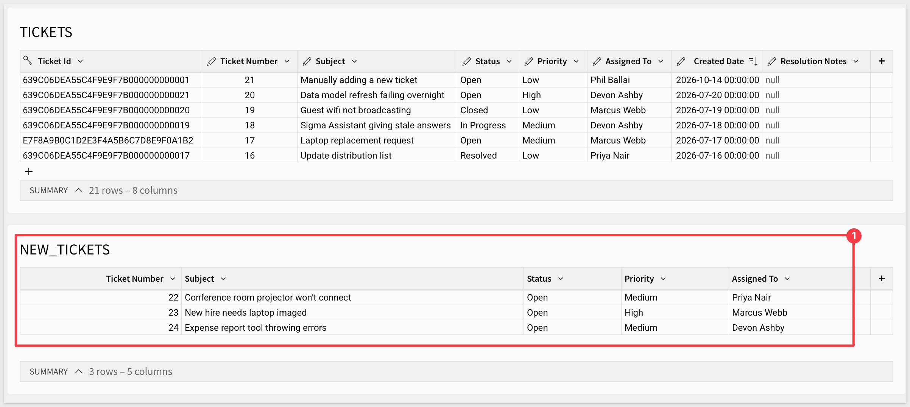

**3.** Add a `Button` element labeled `Load New Tickets`. Add an action, and choose `Insert row(s)` under `Sigma tables`.

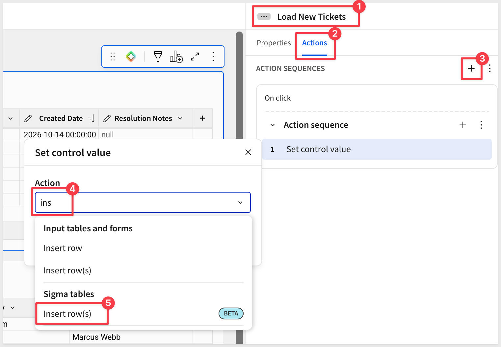

**4.** For `Insert type`, choose `Source data`. 

Set `Into` to `TICKETS`, `Source table` to `NEW_TICKETS`, and `Rows to insert` to `All rows` so every row in `NEW_TICKETS` inserts, not just one.

**5.** For `Ticket Number`, `Subject`, `Status`, `Priority`, and `Assigned To`, set the `Type` dropdown to `Column`, then set the `Value` dropdown next to it to the matching column on `NEW_TICKETS`.

Leave `Created Date` out of `Insert with value(s)` entirely -- these rows land without one, and you can set it manually in the grid afterward if needed.

`Resolution Notes` can be left `Static value` and empty.

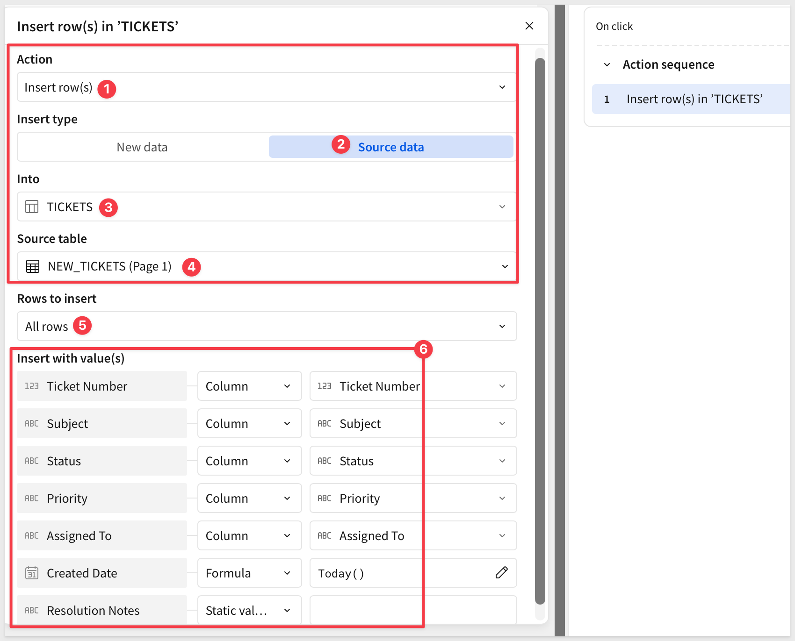

<aside class="negative">
<strong>NOTE:</strong><br> Choosing <code>Column</code> as the type doesn't automatically match a column by name -- the <code>Value</code> dropdown defaults to the same column every time (the first one in the list) until you explicitly change it.
<br><br>
Go through <code>Ticket Number</code>, <code>Subject</code>, <code>Status</code>, <code>Priority</code>, and <code>Assigned To</code> one at a time and confirm each <code>Value</code> is set to its own matching column, not left on the default.
</aside>

**6.** `Publish`, then click `Load New Tickets`. All three rows insert at once, each getting its own auto-generated `Ticket Id`.

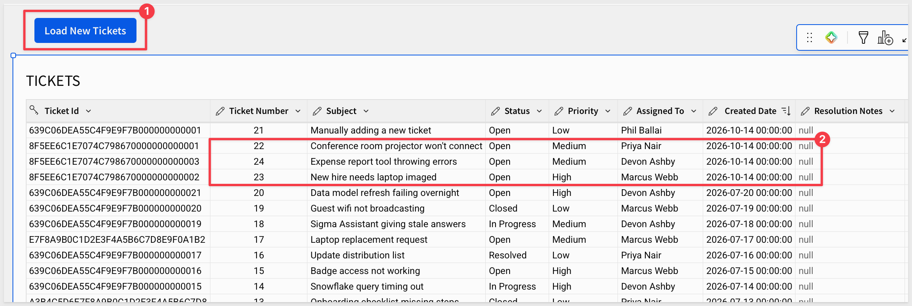

<aside class="negative">
<strong>NOTE:</strong><br> Now that you've seen what <code>Ticket Id</code> actually is -- a system-generated identifier, not something meant for people to read -- hide it.
<br><br>
Select the <code>TICKETS</code> table element, open <code>Available columns</code> in the <code>Properties</code> panel the same way you did to show <code>Resolution Notes</code> earlier, and uncheck <code>Ticket Id</code>. <code>Ticket Number</code> stays as the identifier people actually see and use.
</aside>
-->


<!-- END OF SECTION-->

## Build Actions to Update and Delete Rows
Duration: 10

Typing into the grid works for one-off changes. For anything repeatable -- marking a ticket resolved, clearing out closed ones -- build an action that updates or deletes a specific row in `TICKETS`, without typing into the grid by hand.

An action is a trigger paired with an effect -- the trigger is what the user does, and the effect is what happens to the table. Buttons and actions built on Sigma tables give you a real interface for changing data -- an intake form, an approval queue, a status tracker -- built entirely in Sigma, without standing up a separate application.

A standalone button doesn't have a natural answer to "which row?" -- it isn't attached to any particular row, so it has no row to match against. Instead, this section attaches each action to a [custom context menu item](https://help.sigmacomputing.com/docs/create-custom-context-menu-actions), added to the table itself: right-click any row, and the row you clicked becomes the one the action acts on, the same way `Column` pulls a value from "the currently selected row" elsewhere in Sigma.

<aside class="positive">
<strong>NOTE:</strong><br> Update and delete actions target rows one of two ways: 
<br><br>
- <strong>Single row:</strong> matches one specific row by its primary key.
<br>
- <strong>Formula:</strong> matches every row where a boolean expression evaluates true.
<br><br>
There's no separate option to match by a column's value directly, so if that's what you need, write it as a formula instead (for example, <code>[Status] = "Closed"</code>). No action can change a primary key value once a row exists.
</aside>

### Update a Row

**1.** Select the `TICKETS` table element, open the `Format` tab, and expand `Custom context menu`.

**2.** Click `+ Add an option` and label it `Mark Resolved`.

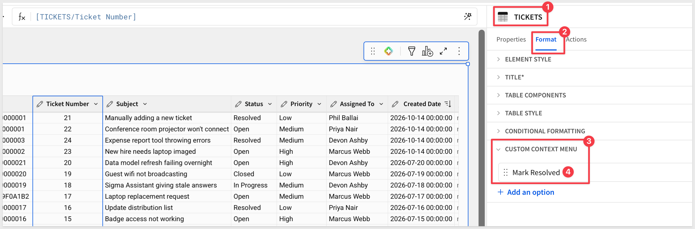

**3.** Switch to the table element's `Actions` tab. Under `Action sequences`, find `Cell context menu` and select `Mark Resolved` beneath it -- the same option you just created in `Format`. 

Click `Add action` and, under `Sigma tables`, choose `Update row(s)`, then set `In` to `TICKETS`.

**4.** For `Update row(s) by`, choose `Single row`, then set the primary key value source to `Column`.

Matching still works against `Ticket Id` even though you hid it from the grid; hiding a column only affects what's displayed, not what the table itself can reference.

**5.** Under `Update with value(s)`, set `Status` to `Resolved`.

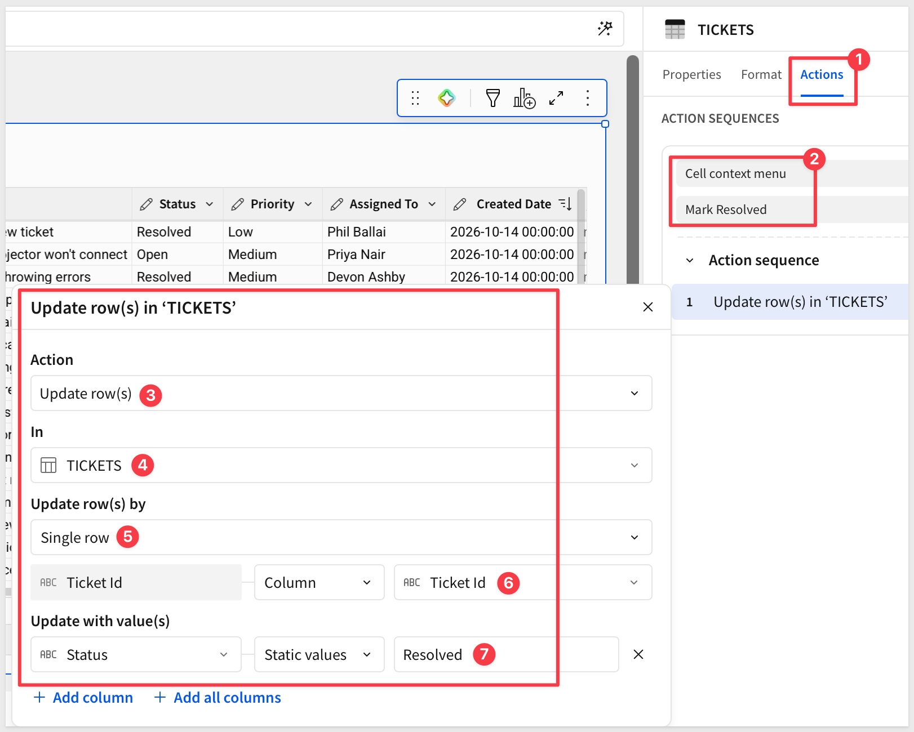

**6.** `Publish`, then right-click any row and choose `Mark Resolved` to test it.

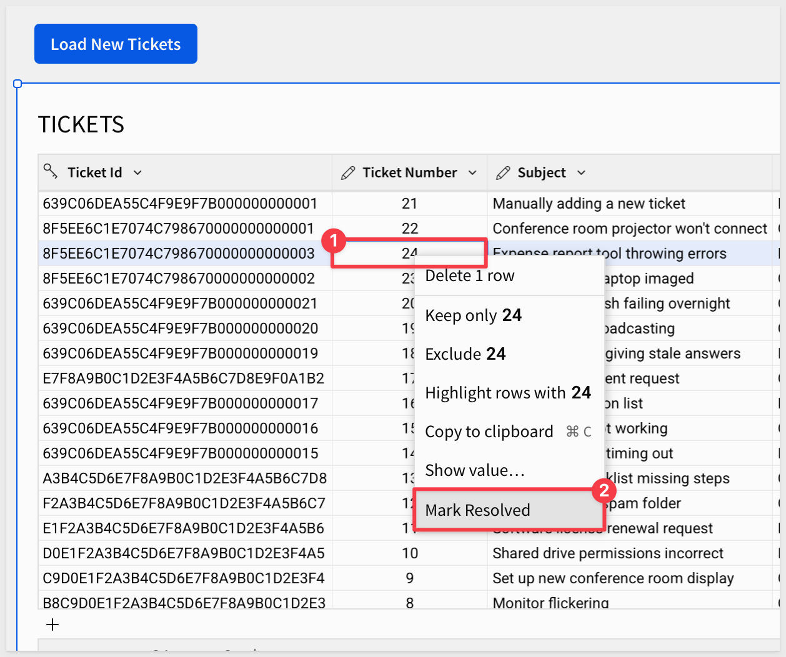

Watch closely as the change happens fast. Of course, with Sigma you can build popups to warn users about an action before committing them.

### Delete a Row

**1.** Back in `Custom context menu`, click `+ Add an option` again and label it `Delete Ticket`.

**2.** Back in the table element's `Actions` tab, find `Delete Ticket` under `Cell context menu` and add a new action sequence: under `Sigma tables`, choose `Delete row(s)`, set `In` to `TICKETS`, and for `Delete row(s) by`, choose `Single row`, matched the same way as the update action.

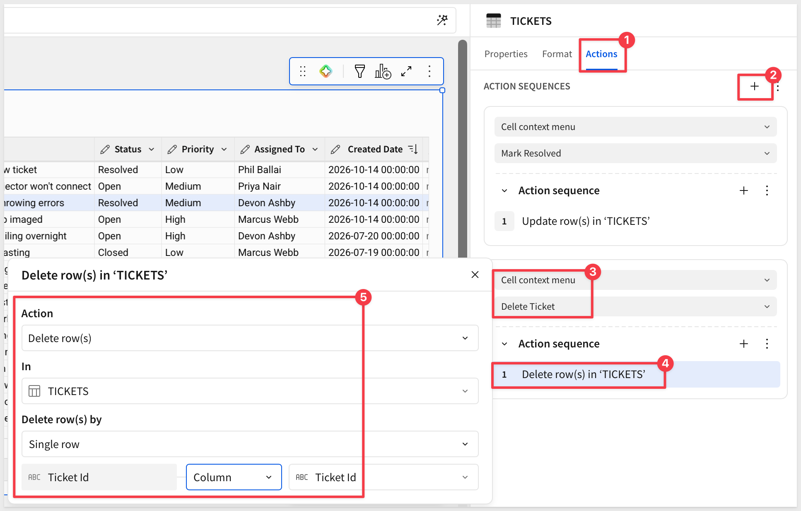

**3.** `Publish`, then right-click a row you don't mind losing and choose `Delete Ticket` to test it.

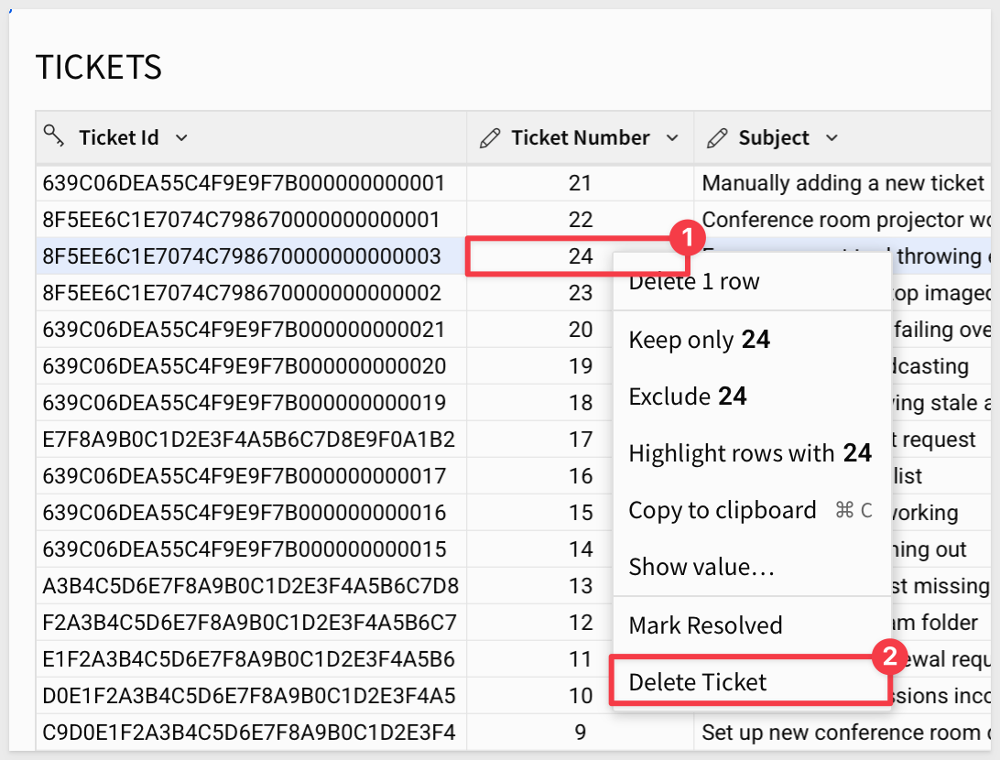

<aside class="negative">
<strong>NOTE:</strong><br> Sigma tables don't support undo -- a deleted row is gone. Test this one on data you're comfortable losing.
</aside>

<aside class="positive">
<strong>NOTE:</strong><br> A custom context menu action's ability to run depends on the viewer's access to <code>TICKETS</code> itself, not just their access to this workbook.
<br><br>
For example, granting a user <code>Can write</code> on <code>TICKETS</code> and <a href="https://help.sigmacomputing.com/docs/share-a-workbook">sharing this workbook</a> with them at only <code>Can View</code> is enough for <code>Mark Resolved</code> and <code>Delete Ticket</code> to work correctly when they use it -- the workbook access level doesn't need to match the table access level.
<br><br>
Exactly which combination of table and workbook access levels is required (or sufficient) depends on your own setup -- see <a href="https://help.sigmacomputing.com/docs/configure-data-access-for-sigma-tables">Configure data access for Sigma tables</a> for the full access-level reference. To check your own setup without needing a second account, <a href="https://help.sigmacomputing.com/docs/impersonate-users">impersonate a user</a> at the access level you want to verify -- for example, after sharing this workbook at <code>Can View</code> and granting <code>Can write</code> on <code>TICKETS</code> to a second user, impersonating them confirms they only see the custom menu options, not Sigma's built-in ones:
<br><br>
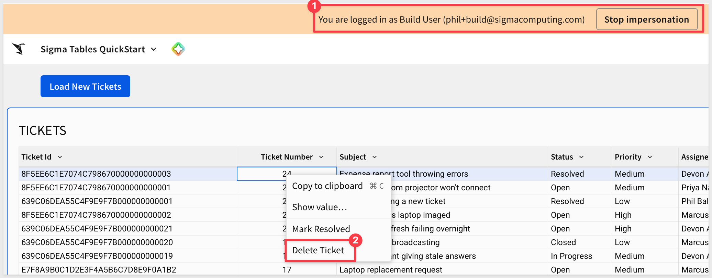
</aside>


<!-- END OF SECTION-->

## What we've covered
Duration: 5

We built the full lifecycle of a Sigma table on top of a real table in Snowflake: enabling write access, referencing it in a workbook, editing data, schema, and rows directly in the grid, and updating and deleting rows with actions -- all while every change was captured in an audit log along the way.

A few things are worth carrying into your own work:

- **A Sigma table is still just a table.** Joining it to other data, filtering it, building calculations against it all work the same as with any other table in Sigma -- write access adds a capability, it doesn't wall the table off from the rest of your data model.
- **Table access and workbook access are two separate controls, and both have to agree.** Test that deliberately rather than assuming -- impersonating a user at the access level you're granting is a fast way to confirm it behaves the way you expect.
- **An action is a trigger paired with an effect.** A right-click on a row is the trigger, and updating or deleting that row is the effect. That pattern isn't specific to a support ticket queue: it's the same mechanism behind an approval queue, an intake form, or a status tracker, the kind of patterns found across the [AI Apps](https://quickstarts.sigmacomputing.com/?cat=aiapps) and [App Templates](https://quickstarts.sigmacomputing.com/?cat=apptemplates) QuickStart categories.

**Additional Resource Links**

[Blog](https://www.sigmacomputing.com/blog/)<br>
[Community](https://community.sigmacomputing.com/)<br>
[Help Center](https://help.sigmacomputing.com/hc/en-us)<br>
[QuickStarts](https://quickstarts.sigmacomputing.com/)<br>

Be sure to check out all the latest developments at [Sigma's First Friday Feature page!](https://quickstarts.sigmacomputing.com/firstfridayfeatures/)
<br>

[](https://twitter.com/sigmacomputing)&emsp;
[](https://www.linkedin.com/company/sigmacomputing)&emsp;
[](https://www.facebook.com/sigmacomputing)


<!-- END OF WHAT WE COVERED -->
<!-- END OF QUICKSTART -->
